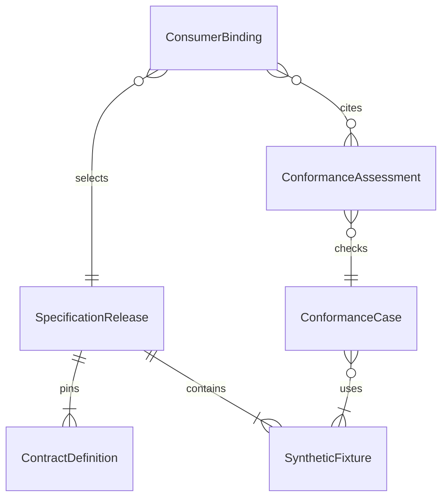

# U1 공통 교환 명세 — 기능 설계

- 단위: U1 `u1-exchange-spec` (`spec`), 깊이/검증 전략: Standard, 기준일: 2026-11-18.
- 근거: [확인한 Q&A](functional-design-questions.md), [단위 정의](../../../inception/units-generation/unit-of-work.md), [FR/NFR 배정](../../../inception/units-generation/unit-of-work-story-map.md), [요구사항](../../../inception/requirements-analysis/requirements.md), [컴포넌트](../../../inception/domain-design/components.md), [교환 계약](../../../inception/contract-design/contract-summary.md).
- User Stories는 이번 계획에서 생략되었다. U1 배정 FR 30개의 **교환 명세·규범·합성 사례 부분**을 설계한다. 구현·제품 설치·실제 외부 연동/권한·안전 적격성은 이번 산출물이 아니다.

## 기준과 책임 경계

이 문서는 **7개 흐름과 상태 전이의 기준**이다. [entities.md](entities.md)의 YAML은 명세 관리 모델 6개·값 객체 8개의 기준이며 [rules.md](rules.md)의 YAML은 BR 34개의 기준이다. 아래 ER·규칙 요약은 파생 뷰다. wire 필드/필수성은 상류 Common·C01~C08 JSON Schema와 의미 규범을 그대로 참조한다. 독자적인 새 전송 스키마를 만들지 않는다.

U1은 Common과 C01~C08, 합성 교환 사례·호환 기준을 소유한다. 제품의 도메인 엔티티는 U2 25개·U3 6개와 원 컴포넌트 소유를 유지한다. U2의 EVALUATION/LLM_REQUEST/LLM_RESPONSE·외부 API 어댑터·승인/안전 검증기는 U1의 빌드/합성 사례 의존에 포함하지 않는다. U3 전용 자료도 U2 자체 검증의 숨은 의존으로 삼지 않는다.

| 결과 층 | U1에서 정의/검사할 것 | 실제 실행 소유자에게 남는 것 |
|---|---|---|
| 전송/구조 | 바이트 파싱·고정 registry·등록 Schema의 적합성 | 허용 루트·실제 파일 I/O·실제 연결·입출력 한도 적용 |
| 의미 | 동일 내용/계보·수치/기간·정책 투영·상세 집계·상태 표현의 규범과 합성 기대값 | 제품 의미 검증기·원천 조회·동시 변경 감지의 실행 |
| 동의/승인 | 목적/대상/필드와 전체 대상 digest·행위·근거 지시자의 계약 | 원 정책 최신성·명시적 인간 승인 결합·철회의 독립 검증 |
| 결과/적격성 | 상태/오류·근거 범위와 미확인/차단 표현 | 실제 저장·수신·평가·Calendar 게시 결과 및 최종 안전/권한 판정 |

설계 선택의 근거는 다음과 같다. 승인된 계약을 세분화한 것이며 외부 지원이나 새 제품 정책을 결정하지 않는다.

| 선택 | 근거·효과 | 채택하지 않는 대안 |
|---|---|---|
| JSON 전체 내용·고정 버전·JCS 결합 | CD-ADR-001과 FR6.10/FR7.7. 설명 변경도 다른 내용으로 식별 | Markdown·파일명·수정 시각만으로 승인/최신성 추정 |
| 명세 적합성 결과와 제품 승인/게시 분리 | CD-ADR-002와 FR5.8/FR6.8. 합성 구조 성공의 권한 승격 차단 | 외부 VERIFIED/approved 자기 선언을 신뢰 |
| 원천 완전성과 전달 완전성 분리 | CR03과 FR4.9. 정상 요약이 상세 누락을 감추지 못함 | 일부 도착한 합계로 전체 완료 표시 |
| 모든 실제 분석 경로의 정확한 허용 집합 일치 | CR07·C04와 FR4.10/FR8.7. 예상과 다른 공개 범위 방지 | 자동 교집합/합집합으로 정책을 대신 변경 |

## WF1 — 고정 명세 선택과 독립 부합 정의

적용: BR1.1~BR1.4, BR7.4. 입력은 신뢰된 설치/배포 경로의 고정값과 U1 명세 묶음이다. 출력은 선택된 정의 및 소비자별 검사 범위다.

1. U2/U3는 각각 고정한 Common·C01/C02 bootstrap과 등록 버전을 선택한다. 원격 payload의 URL을 따라가 명세/코드/검증기를 가져오지 않는다.
2. C01/C02의 schemaVersion과 Common digest를 실제 내용과 대조한다. contracts에는 C03~C08 각각 정확히 한 번 존재해야 한다. 각 schemaId/schemaDigest와 실제 등록 정의를 확인한다.
3. 현행 U1 fixture 11개 이름→내용 객체의 전체 digest를 fixturesDigest와 대조한다. RELEASE는 이 digest에서 제외하고 C01/C02 구조 검사의 별도 fixture로 사용한다. U2 전용 LLM fixture는 제외한다.
4. 각 ConformanceCase의 입력·치환·합성 환경·대응 BR·구조 기대값·의미 기대값·외부 차단을 분리한다. 같은 U1 릴리스에 대해 U2/U3가 독립적으로 부합을 확인한다.
5. 실제 수행한 범위/증거만 ConformanceAssessment에 연결한다. 누락된 검사는 NOT_RUN, 정의된 미수행 사례는 PLANNED다. 같은 release의 부합 증거가 없는 ConsumerBinding은 UNASSESSED다.
6. 미등록/다른 digest/중복 계약은 선택을 보류한다. 배포된 같은 버전의 내용을 교체하거나 검증 편의를 위해 사례 기대값을 완화하지 않는다.

명세 부합은 제품 활성화의 충분조건이 아니다. 허용 필드·승인/행위·단위·ID·의미·필수 구조 변경은 호환 파괴로 검토하고 새 주요 버전과 소비자 합의를 요구한다. 공유 범위 확대에는 별도 사용자 동의가 필요하다. 소비자 검증 없는 새 버전 자동 활성화·원격 마이그레이션은 없다.

## WF2 — 엄격 수신·내용 동일성·의미 검사의 순서

적용: BR1.1~BR1.4, BR2.1~BR2.5, BR6.1~BR6.2. U1은 아래 순서를 명세하며 실제 I/O는 소비자가 수행한다.

1. 파싱 전에 신뢰된 실제 대상·루트·MIME·권한 및 유한 실행/입출력 프로필을 확인한다. 바이트/깊이 제한은 파싱 과정에서도 적용한다. 한도가 없거나 지원 불가이면 RESOURCE_LIMIT/DEPENDENCY_UNQUALIFIED로 보류한다.
2. UTF-8 단일 JSON 객체를 엄격 파싱한다. 선두 단일 BOM·바깥 공백/CRLF는 허용하지만 문자열·불투명 ID는 보존한다. 중복 키·잘림·후행 JSON·NaN/Infinity·잘못된 UTF-8·루트 비객체는 DATA_INVALID다.
3. 신뢰된 고정 registry에서 schemaVersion/문서종류를 선택하고 구조·필수/null·열거값·알 수 없는 필드를 검사한다. 모르는 extension은 `extensions.x_*` 문자열/null 형식만 구조상 허용하며 행동/권한에는 사용하지 않는다. C03/Detail의 초기 자유 확장 전송은 허용하지 않는다.
4. 파싱한 **전체** JSON의 JCS UTF-8 SHA-256을 계산하고 ArtifactRef/C06의 정확한 대상·정책 digest와 대조한다. 안내·가정·extensions 변경도 새 내용이다. 원격 위치/버전과 JSON 내용 digest는 별도 값으로 유지한다.
5. 필드 간 ID/버전·기간/시간대·단위·계산·출처·완전성 규칙을 적용한다. C03은 WF3/WF4, C05/C06은 WF5, C07은 WF6, C08은 WF7로 이어진다. 구조 통과만으로 의미·권한 검증을 생략하지 않는다.
6. 검사 도중 원격 버전이 바뀌거나 같은 논리 버전에 다른 내용이 있으면 REMOTE_CONFLICT/CONTENT_MISMATCH로 보류하고 이전 유효본을 보존한다. 다른 문서/버전의 유효 세션을 골라 합친 완전본을 만들지 않는다.
7. 실제 효과 직전에는 실행 소유자가 승인·안전·정책·철회·최신 계보를 다시 확인한다. U1의 한정 적합성 판정은 이 검증 호출이나 제품 권한을 생성하지 않는다.

명세의 오류 code와 입력 필드 경로·다음 안내만 반환하고 원 본문/토큰/민감 값을 오류에 복사하지 않는다. 파일명·텍스트·마크업·수식·URL·LLM 지시·suggestedAction은 데이터이며 실행 명령/경로/검증기 등록 지시가 아니다.

## WF3 — 분석 manifest·상세·집계·완전성

적용: BR2.1~BR2.5, BR3.1~BR3.7. 입력은 같은 원천 스냅샷에서 정책 투영한 운동·기간과 전달 상태이며 출력은 검증 가능한 분석 범위/유효 완전성 또는 채택 보류 사유다.

1. 생산자는 허용 필드를 WF4로 먼저 확인하고 동일 sourceSnapshotRef라도 투영이 다르면 새 snapshotId/digest를 부여한다. 원천 사실의 상태와 허용된 sourceRef·수집/생성 시각을 보존한다.
2. INLINE은 activities에 전체 목록, detailArtifacts=[], expectedPartCount=0, expectedActivityCount=목록 길이다. PARTITIONED는 activities=[]이며 N>=1개 Detail과 양의 전체 운동 수를 선언한다. 두 방식을 혼합하지 않는다.
3. PARTITIONED에서는 상세를 먼저 불변 파일로 저장하고 실제 digest를 결합한 루트를 마지막에 게시하도록 명세한다. 다중 파일 원자성을 가정하지 않는다. Detail은 등록 fragment만 사용하고 루트 digest를 역참조하거나 하위 Detail을 탐색하지 않는다.
4. 정상 descriptor는 index 0..N−1 각각 한 번·오름차순이며 store/object/version이 중복되지 않는다. 각 activityCount>=1, 모두 존재할 때 선언 합계=expectedActivityCount다. 유효 범위의 descriptor 자체가 누락되면 PARTIAL로 남기고, 중복/범위 밖 index/존재한 선언의 개수 모순은 DATA_INVALID다.
5. 소비자는 신뢰된 별칭의 정확한 objectId/versionRef만 읽고 WF2의 파싱/JCS와 등록 Detail 구조를 검사한다. digest 불일치·버전 미확인·읽기 실패면 해당 조각을 미사용·failedParts로 기록하고 SOURCE_INCOMPLETE/PARTIAL이다. 읽은 본문의 구조/계보가 무효이면 DATA_INVALID로 채택을 보류한다.
6. 루트와 상세의 snapshotId/sourceSnapshotRef/subjectRef/projection은 정확히 같고 Detail.rootPeriod=루트 period, partCount=N이다. Detail.period=descriptor.period이며 루트 안·동일 시간대다. 운동 startedAt의 현지 일자가 상세와 루트 기간 안에 있어야 한다. 같은 날 운동을 나눌 수 있으므로 조각 기간 겹침만으로 오류라고 하지 않는다.
7. 각 조각 및 전체 연결 결과는 `(startedAt UTC 순간, activityId Unicode 코드 포인트 순)`으로 정렬한다. 원 오프셋 문자열을 보존하고 activityId는 전체에서 유일하다. 동일 ID/상이 sourceRevision·같은 ID/같은 내용 중복도 DATA_INVALID다. 날짜/이름만 같은 다른 운동을 병합하지 않는다.
8. 모든 게시 상세를 확보한 뒤 종목별 운동 수와 거리/시간 합계를 정확한 Decimal로 대조한다. summary.totals 미허용은 빈 요약이다. 허용된 요약의 비공개 지표는 withheld, 공개 입력 상태는 `missing > not_collected > not_applicable 제외 > estimated 존재 > computed` 순서다. 전부 not_applicable이면 합계도 not_applicable이다. computed/estimated 합계의 근거와 허용된 원천 참조를 남긴다.
9. 원천 completeness를 보존하고 아래 표로 별도 effectiveCompleteness를 산출한다. 조각 기간의 합집합을 수집 완료 범위로 추정하지 않는다. 부분 합계·루트 요약을 모든 상세 확인 전 검증된 전체로 안내하지 않는다.
10. manifest·기간·상세 ArtifactRef 및 C08의 해당 생산자 결과로 요약/탐색을 연결한다. 끊긴 참조·미포함 기간·오래됨·미동기화는 원본 삭제 없이 사유와 확인 경로를 알린다. 새 탐색 서버/UI/미등록 wire 문서는 추가하지 않는다.

| 원천 선언/도착 조건 | effectiveCompleteness와 채택 범위 |
|---|---|
| COMPLETE, sourceCollectedAt 존재, missingPeriods=[], 전부 도착·합계 일치 | COMPLETE; 확인한 버전/범위만 사용 |
| PARTIAL, 알려진 누락 기간 또는 불명일 때 전체 period 명시 | 전달이 전부여도 PARTIAL; 전체 수집 성공으로 승격 금지 |
| COMPLETE 또는 PARTIAL이나 descriptor/상세 누락·읽기/버전/digest 실패 | PARTIAL과 SOURCE_INCOMPLETE, 실패 조각 분리; 전체 요약 검증 완료 금지 |
| 성공 수집·INLINE·0건·빈 요약·missingPeriods=[] | EMPTY; NEVER_COLLECTED와 구별 |
| sourceCollectedAt=null·INLINE·0건·빈 요약·missingPeriods=[period] | NEVER_COLLECTED; 미운동으로 단정 금지 |
| 중복·구조/계보/범위/개수/집계 모순 | DATA_INVALID; 스냅샷의 분석/계획 근거 채택 보류. 단순 PARTIAL로 완화 금지 |
| 정책상 withheld 지표 존재 | 그 사실만으로 수집/전달 완전성을 낮추지 않음; 수치 재계산의 한계는 별도 표시 |

## WF4 — 서비스별 동의·필드 투영·모든 실제 경로

적용: BR4.1~BR4.5, BR3.6. 입력은 원 정책의 검증 결과·현재 C04·신뢰된 실제 경로와 전송 후보이며 출력은 허용 투영 또는 전체 신규 전송 보류다.

1. 각 신규 요청 직전에 원 사용자·정책 버전/전체 digest·동의·철회·실제 권한·목적/대상을 독립 확인한다. C04 ACTIVE나 참조 문자열만으로 검증하지 않는다. 현재 U3의 확인 경로는 미해소이므로 실제 전송은 계속 보류한다.
2. 실제 경로는 신뢰된 전송 설정과 실제 소비 연결로 정한다. 저장소와 최종 독자가 다르면 둘 다 포함하며 payload가 경로를 생략해 검사를 피할 수 없다. 각 (service,purpose,targetAlias) grant는 유일하다.
3. C03에서는 각 실제 ANALYSIS 경로의 정확한 grant 하나에서 분석용 9개 필드만 추려 ASCII 정렬 집합을 구한다. 그 모든 집합이 최종 projection.allowedFieldPaths와 **정확히 같아야 한다**. 더 넓거나 더 좁아도 PERMISSION_DENIED로 전체 신규 전송을 보류한다. 자동 교집합/합집합은 생성하지 않는다.
4. analysis.metadata·summary.period·activity.date·activity.sport 네 항목 모두 명시적 허용을 확인한다. 오프셋 포함 실제 시각·불투명 계보·운동/조각 개수·참조도 공개됨을 동의 범위로 다룬다. 필수 구조를 이유로 동의를 자동 부여하지 않는다.
5. 고정 Metric 슬롯을 유지하고 미허용 필드는 실제 값 유무와 무관하게 `{state: withheld, quantity: null, sourceRef: null, calculationBasis: null}`로 나타낸다. pace/speed는 intensity+distance+duration이 모두 허용되어야 하며 heartRate는 별도다. missing/not_collected로 비공개 수집 사실을 노출하지 않는다.
6. 요약·계산 근거·sourceRef·설명·extensions로 숨긴 값을 우회 공개하지 않는지 확인한다. totals는 별도 동의이며 지표 자체의 허용을 대신하지 않는다. 초기 C03/Detail에는 GPS/FIT·수면/HRV·통증에 대응하는 등록 필드가 없으므로 별도 동의가 있어도 추가 전송하지 않는다.
7. 경로별 차이는 사용자에게 알린다. 명시적으로 정책을 변경한 뒤 새 policyDigest·projection·snapshotId/digest로 다시 검사한다. 기존 승인 내용에 대해서는 자동 삭제/가림/확장 후 같은 승인을 재사용하지 않는다.
8. C05~C08도 목적별 필수 업무 묶음·메타데이터를 명시적으로 허용받아야 한다. 안전한 최소 자료로 표현할 수 없거나 자유 서술의 금지 자료 여부가 불명확하면 전송을 보류한다.
9. 철회/정책 변경을 발견하면 남은 신규 요청을 중단하고 진행 중/외부 반영/대기·실패를 구분한다. 이미 시작한 전송 취소·모델/저장소의 외부 사본 회수는 보장하지 않는다. 다음 요청은 다시 검사한다.

## WF5 — 목표·계획·승인 선언·개정·저장 계약

적용: BR5.1~BR5.5, BR1.2, BR6.1~BR6.2, BR7.1~BR7.2. U1은 교환 구조/오류 사례를 제공하고 작성은 U3, 수신·독립 검증은 U2가 맡는다.

1. C05 goal에 ID/개정·running 종목·objective/목표일·선택 거리/시간·가능 시간/빈도·기존 고정 운동/제약을 기록한다. null과 필수 미정·모순을 구별하고 목표량/목표일을 임의 생성하지 않는다. 사용자 입력 수집/질문 방식은 U3가 정한다.
2. PROPOSAL 완전본에 적용 기간·주차 목표·세션·휴식일·근거/가정·시각 정책을 결합한다. 날짜/주차/목표 범위·세션 ID와 세션 버전 유일성·양수 예상 시간(s)·거리(m)·강도 단위·수행 내용과 휴식/가능 시간/고정 운동의 모순을 검사한다. 부분 오류는 **계획 전체**를 보류한다.
3. 시간대/정책 버전/tzdbVersion/calendarAlias·기본 시각은 payload 전체 digest에 포함한다. session.localTime이 있으면 우선하며 null이면 결합한 기본값만 사용한다. 실제 단일 현지 시각으로 해석 불가하거나 정책 변경 시 보류·새 승인으로 연결한다.
4. 전체 C05 digest·현재 policyDigest·사용자·PUBLISH_PLAN 행위에 C06 선언을 연결한다. 프로필/기록 지시자는 불신 입력이고 선언 구조가 맞아도 승인 검증을 통과한 것으로 표시하지 않는다. 현행 적격 승인 프로필은 UNQUALIFIED다.
5. U3는 지원이 실제 확인된 직접 저장 또는 허용 수동 대안으로 버전별 JSON 전체와 근거 연결을 지속 보관한다. 다시 읽은 위치/원격 버전/전체 digest를 대조한 뒤 실제 STORE 결과만 C08로 표현한다. 업로드 응답 ID 하나·Markdown 요약·승인 문구만으로 성공/권한을 확정하지 않는다.
6. U2는 Drive 매개로 완전본을 별도 수신·검증하고 원 작성 versionId와 독립 AdmittedPlanSnapshot/ApprovalProof 계보를 연결한다. 파일명/수정 시각 정렬을 최신 승인 기준으로 쓰지 않는다. 로컬 직접 실행·별도 상시 서버/MCP를 정상 경로의 필수로 두지 않는다.
7. 개정은 이전 확정 digest·새 versionId·변경 항목/이유와 새 전체 내용의 승인을 요구한다. 같은 부모의 동시 승인 분기·초기 최신 계보 불명·검사 후 변경·과거 버전 재업로드는 자동 병합/덮어쓰기 없이 보류한다. 완료 실제 운동은 계획 변경으로 수정하지 않는다.
8. 실제 승인 신뢰/현재성·안전·정책·외부 지원·한도가 해소되지 않으면 관련 실행을 보류한다. 기존 승인 버전의 평가 호출 실패 예외도 U2가 정확한 변경 없는 버전과 기존 검증을 확인해야 하며 오류 결과/조정안이나 미해소 안전 경고는 반영하지 않는다.

## WF6 — 폐기·교체·게시 취소의 영향 계약

적용: BR6.1~BR6.4, BR7.2~BR7.3. C07은 실행 명령이 아닌 검증할 요청이다.

1. 원 사용자·planId·expectedVersionId/expectedPlanDigest·정책과 영향 범위를 명시한다. SELECTED_FUTURE에는 해당 sessionIds를 적고 ALL_FUTURE에는 빈 목록으로 대상 계획의 미래 범위만 나타낸다.
2. 전체 C07 digest와 정확한 단일 처분 행위에 연결한 C06 DISPOSITION의 구조/대상/행위를 대조한 뒤 U2의 독립 승인 검증에 넘긴다. 상응하지 않는 PLAN 승인으로 취소하지 않는다.
3. REPLACE는 replacementPlan ArtifactRef의 새 완전본과 별도 유효 PUBLISH_PLAN 승인도 필요하다. WITHDRAW/CANCEL_PUBLICATION은 replacementPlan=null이다. 한 번의 사용자 결정에서 필요한 두 근거를 신뢰성 있게 발급할 수 있는지는 적격 프로필의 후속 해소 조건이다.
4. 실제 실행 소유자는 현재 스냅샷·미래 여부·기존 소유 연결·승인 영향 범위를 다시 확인한다. 원격 이벤트 이름이나 remote marker만으로 소유/삭제하지 않는다. 변경 없는 세션·완료 실제 운동·타 계획/일정은 보존한다.
5. 성공/실패/미확인은 대상 세션별 C08로 분리한다. 일부 취소 실패가 전체 취소 성공을 뜻하지 않으며 재처리는 실패/미확인 부분만 기존 원 의도/연결을 대조한 뒤 수행한다. 승인/정책 철회나 검사 후 변경을 발견하면 남은 요청을 보류한다.

## WF7 — 독립 결과와 미확인 복구 표현

적용: BR2.5, BR7.1~BR7.4. 입력은 실제 생산 소유자가 확인한 결과이며 출력은 단계별 상태·마지막 성공·대상/오류/조치의 교환 표현이다.

1. receiptId/producerUnit/subjectRef/workId/stage/targetDigest/observedAt으로 결과 범위를 식별한다. U3는 STORE만 생산한다. U2 결과는 해당 실제 소유자의 검증 가능한 근거와 대조하기 전 U3가 자칭하지 않는다.
2. 성공은 실제 확인한 해당 단계만 의미한다. STORE 성공은 RECEIVE/VALIDATE/EVALUATE/CALENDAR 성공이 아니다. Calendar는 대상 세션 전부 확인한 경우에만 전체 SUCCESS이며 일부 성공은 PARTIAL이다.
3. 세션별 PENDING/FAILED/OUTCOME_UNKNOWN/CONFLICT/BLOCKED와 마지막 성공 시각을 보존한다. FAILED/BLOCKED/CONFLICT/OUTCOME_UNKNOWN에는 오류가 필요하고 SUCCESS에는 errors=[]다. 실제 권한을 확인하지 못한 상태를 성공으로 표시하지 않는다.
4. 응답 유실은 OUTCOME_UNKNOWN, 원 의도·고정 대상 ID·버전/digest·기대 내용 대조가 다음 조치다. 확인 전 새 객체 생성·덮어쓰기·성공 선언은 금지한다. 원격 사용자 수정은 충돌로 남긴다.
5. 오류에는 고정 code·fieldPath·suggestedAction·작업 참조와 사용자 조치만 표시하고 값/비밀을 echo하지 않는다. 유한 재시도/호출·비용 한도와 실제 외부 I/O 복구는 U2/U3의 책임이다. 예약 재실행이 현재 동의·승인·비용 예산을 초기화하는 우회가 되지 않아야 한다.

## 상태 전이 기준

다음 두 표는 U1 명세 모델의 논리 상태다. 이 문서 작성이 실제 상태 변경이나 검사 실행을 뜻하지 않는다.

| 모델 | 이전→다음 | 조건 | 금지/실패 처리 |
|---|---|---|---|
| ConformanceAssessment | PLANNED→MATCHED | 고정 사례의 선언 scope를 실제 수행하고 예상/관찰 일치·증거 보유 | 실행 없는 MATCHED 금지; externalAuthority=NOT_ESTABLISHED 유지 |
| ConformanceAssessment | PLANNED→MISMATCHED | 실제 수행한 결과가 기대와 다름 | 기대값 자동 완화 금지; 같은 기록을 성공으로 덮지 않고 수정 후 새 검사 기록 |
| ConformanceAssessment | PLANNED→NOT_RUN | 검사 미수행·환경/자료/도구 미확보 | 실패 입력의 제품 SUCCESS와 혼동 금지 |
| ConformanceAssessment | MATCHED/MISMATCHED/NOT_RUN→새 PLANNED 기록 | 입력/릴리스/검사 범위가 바뀌어 재검증 필요 | 기존 증거/결과는 보존; 다른 digest에 재사용 금지 |
| ConsumerBinding | UNASSESSED→CONFORMANT | 같은 고정 릴리스의 필요한 적합성 검사를 독립 수행·전부 기대 일치 | 제품 권한/전체 인수 완료로 승격 금지 |
| ConsumerBinding | UNASSESSED→NONCONFORMANT | 필요한 검사 하나 이상 불일치 | 미수행만 있으면 UNASSESSED 유지 |
| ConsumerBinding | CONFORMANT/NONCONFORMANT→새 UNASSESSED 기록 | 소비자 또는 명세/검사 범위 변경 | 기존 릴리스의 판정을 새 릴리스에 전용 금지 |

아래는 제품 소유자가 C05~C08에 표현할 사실의 **서로 다른 상태 축**이다. U1의 상태 머신으로 제품 엔티티를 통합하지 않는다.

| 축 | 입력/전이의 의미 | 확인 없는 전이 금지 |
|---|---|---|
| 작성 C05 | 초안/개정 작성은 PROPOSAL. 내용 변경→새 versionId/digest/승인 후보 | PROPOSAL→승인/게시 SUCCESS 자동 전이 없음 |
| 승인 C06 | 선언→구조/내용/행위 대조 후보→U2 독립 검증. 현재는 적격 프로필 없어 보류 | 선언→ApprovalProof/VERIFIED 직접 전이 없음 |
| 저장 C08 STORE | PENDING→실제 재읽기 확인 SUCCESS, 실패 FAILED, 반영 불명 OUTCOME_UNKNOWN, 일부 PARTIAL | STORE 성공→수신/평가/Calendar 성공 전이 없음 |
| 수신/검증/평가 C08 | 각 소유자의 결과만 PENDING/SUCCESS/FAILED/BLOCKED/CONFLICT/OUTCOME_UNKNOWN 등으로 기록 | 앞 단계 성공·LLM 응답→다음 단계 성공 전이 없음 |
| 게시/취소 C08 CALENDAR | 세션별 PENDING→확인된 SUCCESS/FAILED/CONFLICT/BLOCKED/OUTCOME_UNKNOWN. 혼합 성공은 PARTIAL | 일부 세션 성공→전체 SUCCESS 금지 |
| 원격 결과 미확인 | OUTCOME_UNKNOWN→원 의도/원격 조회 대조 뒤 확인된 결과 또는 CONFLICT/계속 미확인 | 새 객체 재생성·무조건 재전송으로 미확인 해소 금지 |
| 정책/승인 철회·검사 후 변경 | 발견→남은 요청 중단·재검증/CONFLICT/OUTCOME_UNKNOWN | 외부 이미 수행한 효과/사본 자동 회수 성공 전이 없음 |

위 전이는 표현 가능한 사건의 순서다. 실제 오류 복구·원격 동시성·영속 상태 변경의 구현은 소유 단위 설계/검증으로 연결한다.

## 합성 적합성 사례 계획

기존 계약의 합성 fixture·사례를 이름으로 참조하고 내용을 중복 복사하지 않는다. U1 검사는 U1 소유 Common/C01~C08만 대상으로 삼는다. 원 계약의 전체 54개 구조 사례에는 U2 전용 LLM 사례가 포함되므로 그 전체를 U1 배포 사례 수로 주장하지 않는다. V09~V11·N26~N32·B03 등 U2 전용 사례는 U1 의존에서 제외한다.

| 기존 사례 | 검사 범위·예상 판정 | 적용 규칙 |
|---|---|---|
| V01~V08, V12~V17 | U1 구조 정상 후보. RELEASE/정책/승인/저장 실제 신뢰는 각각 미검증 | BR1.1, BR6.2, BR7.1~BR7.4 |
| N01~N25, N33~N34 | 버전/단위/필수/추가 필드·불신 권한·부분 작성 등 구조/의미 거절 또는 미해소 차단 | BR1.1~BR1.4, BR2.1~BR2.3, BR5.1~BR6.3, BR7.2 |
| B01~B02, T01~T07 | 실제 0과 비수치 구별·문자열 보존·변경 digest·엄격 파싱; 기대값은 원 계약과 동일 | BR1.2~BR1.3, BR2.1~BR2.2 |
| S01~S05 | 전체/거리만 공개 정상 COMPLETE; 미허용 심박·missing 위장·메타데이터 허용 없음 PERMISSION_DENIED | BR2.1, BR4.2~BR4.4 |
| S06~S11 | 정상 두 조각 COMPLETE; 읽기/descriptor 누락·해시 변경 PARTIAL; 중복 운동/index DATA_INVALID | BR3.1~BR3.5 |
| S12~S16, S19~S20 | 요약/계보/중첩/개수/기간 오류 DATA_INVALID; 원천 PARTIAL은 전달 성공에도 PARTIAL | BR3.1~BR3.6 |
| S17~S18 | summary.totals 거부 시 빈 요약 정상; 미허용 합계 수치 노출 PERMISSION_DENIED | BR3.6, BR4.4 |
| S21~S23 | Drive/ChatGPT 동일 집합 정상; 한 경로라도 더 넓거나 좁으면 PERMISSION_DENIED | BR4.1~BR4.3 |

다음 26개 FD 사례는 **새로운 설계 기대값이며 의미 검증기 실행 증거가 아니다**. 고정 fixture를 참조하고 지시한 한 가지 조건만 바꿔 원인별 판정을 확인한다. raw byte·적격성 모의 조건은 실제 자격을 부여하지 않는다.

| 사례 | 합성 입력/경계 조건 | 구조/의미 기대값·실제 실행 경계 | BR |
|---|---|---|---|
| FD01 | RELEASE의 C03 항목을 복제하고 나머지 계약 하나 누락 | Schema만 통과할 수 있어도 계약 고유성 DATA_INVALID | BR1.1 |
| FD02 | PLAN의 설명/가정 또는 x_note만 변경, 이전 C06 유지 | 구조 적합이어도 CONTENT_MISMATCH·새 승인 필요 | BR1.2, BR5.4 |
| FD03 | T 원시 입력의 잘못된 UTF-8·두 BOM·깊이/바이트 한도 초과 | DATA_INVALID 또는 RESOURCE_LIMIT; 파싱 전부터 한도 적용 | BR1.3 |
| FD04 | Id의 0001/1·대소문자·한글/이모지·1024/1025자 | 서로 다른 ID 보존; 1025자 거절·자동 절단 금지 | BR1.4 |
| FD05 | 일반 JCS 비ASCII 속성·보충 문자·수치 경계 및 잘못된 Unicode | 표준 정규화 기대를 별도 적합성으로 검증할 계획; 현재 한정 합성 결과로 통과 주장 불가 | BR1.2, BR7.4 |
| FD06 | 허용된 distance=observed 0, missing/not_collected/not_applicable/estimated 각각 | 0과 비수치/추정 구별; estimated 근거 없으면 DATA_INVALID | BR2.1 |
| FD07 | distance=0의 페이스·duration=0의 속도를 computed 수치로 작성 | 분모0은 not_applicable; 수치 NaN/Infinity는 거절 | BR2.2 |
| FD08 | 무한소수 계산·단위 혼재·미확정 반올림 프로필 | 미확정 정밀도/계산 기준을 정상 검증 완료로 표시하지 않음 | BR2.2 |
| FD09 | 윤일/월말/연말·시작 자정/끝 자정·서로 다른 오프셋 | 시작 포함·끝 제외 및 원 오프셋 보존; 시각·버전별 구분 | BR2.3, BR2.5 |
| FD10 | DST 존재하지 않음/중복 시각·미확인 tzdbVersion | DATA_INVALID/DEPENDENCY_UNQUALIFIED; 자동 이동 금지 | BR2.3 |
| FD11 | running/swimming/unknown 운동, 같은 이름/일자의 다른 ID | 종목별 유일 집계; unknown 유지·타 종목 성과 혼합 금지 | BR2.4, BR3.4 |
| FD12 | PARTITIONED 두 조각이 같은 일자 범위이나 운동은 서로 다름 | 기간 겹침은 허용; 정렬·고유 ID·개수/합계 일치 필요 | BR3.2, BR3.4 |
| FD13 | 같은 object/version descriptor 반복·범위 밖 index·전부 있는데 개수 불일치 | DATA_INVALID·근거 채택 보류; 자동 중복 무시 금지 | BR3.2~BR3.4 |
| FD14 | root COMPLETE이나 상세 하나 누락, 또는 원천 PARTIAL이나 전부 전달 | 둘 다 effectiveCompleteness=PARTIAL, root 선언 보존·실패 범위 표시 | BR3.3, BR3.5 |
| FD15 | EMPTY와 NEVER_COLLECTED 각각의 정상 0건 fixture 변형 | sourceCollectedAt/빈 요약/missingPeriods 조건에 따른 서로 다른 상태; 조회 실패→EMPTY 금지 | BR3.5, BR3.7 |
| FD16 | 종목 합계 입력 missing·not_collected·전부 not_applicable·estimated 혼합 | BR3.6 우선순위와 정확한 Decimal 합, 누락 부분합의 전체화 금지 | BR3.6 |
| FD17 | C04 동일 service/purpose/target grant 중복·다른 목적 grant로 대체 | 합치거나 권한 확대하지 않고 PERMISSION_DENIED | BR4.1, BR4.3 |
| FD18 | 원 수치 유무가 다른 두 원천을 같은 거리만 허용 정책으로 투영 | duration/intensity/heartRate 모두 같은 withheld·null; 숨긴 수집 사실 미노출 | BR4.4 |
| FD19 | distance 허용·duration 거부·intensity 허용 또는 heartRate 별도 거부 | pace/speed와 미허용 heartRate 모두 withheld; 역산 가능 수치 거절 | BR4.4 |
| FD20 | 별도 민감 동의가 있지만 미등록 GPS/FIT를 extensions/설명에 삽입 | PERMISSION_DENIED/DATA_INVALID; 별도 동의가 새 필드를 발명하지 않음 | BR4.5 |
| FD21 | PLAN 필수 목표/주차/휴식/세션 누락·중복 ID·음수/0 시간·기간 밖·가능 시간 모순 | 구조 또는 의미 DATA_INVALID·전체 보류; 일부 유효 세션 자동 추출 금지 | BR5.1~BR5.3 |
| FD22 | PLAN 강도 단위/상하한 모순·RPE scaleRef 미확인·미측정 심박 생성 | DATA_INVALID/DEPENDENCY_UNQUALIFIED; 의학적 임계값 발명 금지 | BR2.1, BR5.3 |
| FD23 | 동시 승인 형제 버전·과거 재업로드·metadata-before/after 다름 | REMOTE_CONFLICT/CONTENT_MISMATCH; 확정 계보와 이전 유효본 보존 | BR5.4 |
| FD24 | 선언 구조 정상이나 인간 승인/현재 정책/철회 근거 없음; raw VERIFIED 제출 | APPROVAL_PROFILE_UNQUALIFIED/POLICY_UNVERIFIED 등 보류; 구조/합성 성공의 권한 승격 금지 | BR4.1, BR6.1~BR6.2 |
| FD25 | DISPOSITION의 다른 사용자/행위·완료 세션·REPLACE 새 승인 누락 | DATA_INVALID/APPROVAL_UNVERIFIED/REMOTE_CONFLICT; 실제 운동·타 일정 보존 | BR6.3 |
| FD26 | STORE 응답 유실·Calendar 일부 성공/취소 실패·과거 receipt·평가 실패 예외 주장 | OUTCOME_UNKNOWN/PARTIAL/CONFLICT 구별; 같은 digest의 승인·형식·안전 검증 없는 예외 차단 | BR5.5, BR6.4, BR7.1~BR7.4 |

FD 사례에 연결한 오류는 해당 검사 층의 예상이다. 실제 승인 검증 프로필/정책 최신성/연결 적격성을 모의 입력으로 충족한 것으로 계산하지 않는다. U1만의 정상 구조·의미 판정은 실제 외부 전송 허가와 별도다.

## Entity Relationship Diagram — 파생 뷰

아래 그림은 entities.md의 6개 명세 모델과 관계 6개를 요약한다. 카디널리티의 상한/정확한 수(릴리스의 9개 정의·12개 기준 fixture)는 YAML 제약을 따른다. Mermaid를 쓰기 전에 이 ER 구문의 식별자·알려진 노드·카디널리티·관계 행에 대한 **제한된 구조 검사**를 수행했다. 전체 Mermaid 파서/렌더링은 실행하지 않았다.

텍스트 대안: SpecificationRelease는 고정 ContractDefinition과 SyntheticFixture를 포함한다. ConformanceCase는 같은 릴리스의 하나 이상 fixture를 사용하며 ConformanceAssessment가 사례의 한정 검사 결과를 연결한다. ConsumerBinding은 한 고정 릴리스를 선택하고 실제 수행한 적합성 결과를 인용한다. 이 관계에는 제품의 ActivityRecord·ApprovalProof·CalendarBinding을 소유하는 연결이 없다.

## Rules Summary — 파생 뷰

| 규칙 | 요약 | 주 흐름 |
|---|---|---|
| BR1.1~BR1.4 | 고정 명세·전체 내용·엄격 파싱·불투명 ID | WF1~WF2 |
| BR2.1~BR2.5 | 지표 상태·계산/단위·기간/시간대·종목·출처 | WF2~WF3, WF5 |
| BR3.1~BR3.7 | INLINE/분할·고정 Detail·누락/무효·정렬/집계·완전성·탐색 | WF3 |
| BR4.1~BR4.5 | 현재 동의·최소 메타데이터·전체 경로 동일 집합·withheld·비밀 제외 | WF4 |
| BR5.1~BR5.5 | 목표/완전본·강도·개정/동시성·지속 보관/명령 없는 전달 | WF5 |
| BR6.1~BR6.4 | 승인 선언·독립 검증·미래 영향·평가와 실제 게시 차단 | WF5~WF6 |
| BR7.1~BR7.4 | 독립 결과·실제 성공·미확인 복구·합성 판정 한계 | WF1, WF7 |

## 요구사항 연결과 검증 인계

[traceability.json](traceability.json)의 upstream_ids는 정해진 생성 명령으로 받은 U1 FR 30개를 그대로 유지한다. 모두 실제 존재하는 BR로 `OK` 연결한다. 이 상태는 **명세 책임의 연결**이며 구현/실제 인수 통과를 뜻하지 않는다.

| U1 기능 범위 | 규칙·흐름 | 다른 소유자의 실제 검증 |
|---|---|---|
| FR2.7·FR2.9 | BR2.1~BR2.2·BR2.5·BR3.5·BR4.4, WF2~WF4 | U2 실제 원천 측정/수집 시각·변환·누락 보존 |
| FR3.6·FR3.9 | BR1.4·BR2.5·BR3.4·BR7.1~BR7.3, WF3/WF7 | U2 대상별 로컬 확정·실제 원격 대조·중복/응답 유실 복구 |
| FR4.1·FR4.3~FR4.7·FR4.9~FR4.10 | BR1.1~BR4.5, WF1~WF4 | U2 생산/실제 게시·U3 실제 읽기/상태 고지. FR4.2/FR4.8의 계산 구현 책임은 U2 |
| FR5.4·FR5.8~FR5.11 | BR5.1·BR5.5·BR6.1~BR6.2·BR7.1~BR7.2, WF5/WF7 | U3 입력/승인 의사/지원된 저장·수동 대안, U2 독립 승인 검증 |
| FR6.2·FR6.6·FR6.8·FR6.10·FR6.12 | BR5.1~BR6.4·BR7.1~BR7.2, WF5 | U3 완전 작성·개정/새 승인, U2 형식/안전 검증·실제 적격성 |
| FR7.1·FR7.3~FR7.4·FR7.7~FR7.9 | BR1.1~BR1.4·BR5.4~BR6.4·BR7.3, WF2/WF5~WF7 | U3 지속 보관·내용/버전 유지, U2 수신/최신 계보·불신 입력 차단/실제 처분 |
| FR8.7·FR9.5 | BR4.1~BR4.5·BR6.3~BR6.4·BR7.2~BR7.3, WF4/WF6~WF7 | U2 실제 LLM 공유/비용 한도·승인된 미래 세션 변경/취소와 충돌/복구 |

| NFR | U1 연결 | 후속 책임/실제 증거 |
|---|---|---|
| NFR1 | BR4.5·BR7.4, 합성 비밀/개인정보 제외 | U2/U3 실제 생성물/요청/진단의 비밀 0건 검사 |
| NFR2 | BR4.1·BR6.2, 대상/권한·승인 표현 | 원 정책·최소 권한·비공개·철회 확인 |
| NFR3·NFR4 | BR4.1~BR4.5, 동의/메타데이터/withheld·파생 유출 사례 | 모든 실제 경로 신규 전송 직전 확인·금지 필드 0건 |
| NFR5 | BR1.2~BR1.4·BR5.4·BR7.3, 내용/버전·완전성·미확인 규범 | 로컬 확정/중단·중복·부분 실패/실제 원격 복구 |
| NFR6 | BR2.3, 시작 포함/끝 제외·원 오프셋·tzdb/DST | U2/U3 시간대 데이터 선정과 실제 집계/예약/게시 |
| NFR7·NFR10 | BR2.5·BR6.2·BR7.1~BR7.4, 독립 상태/대상·버전·증거 | 실제 소유자 결과·한국어 오류/조치·마지막 성공·추적 |
| NFR8·NFR9·NFR11 | U1 직접 배정 아님; BR6.4·BR7.4가 미해소 차단/증거 구분을 보존 | U2/U3 유한 재시도·안전 근거·실제 지원/인수 검증을 담당하며 완화하지 않음 |

## Assumptions & Open Questions

새 사용자 정책을 가정하지 않았다. 아래는 승인된 미해소 조건의 유지/인계이며 설계 작성이 이를 해결했다는 뜻이 아니다.

| 조건 | 현재 차단·후속 담당 |
|---|---|
| C06/C07 실제 인간 의도·내용/행위 결합·현재 계보/철회 확인 | 적격 프로필 없음; U2 자동 게시/변경/취소 및 U3 승인 전달 적격성 보류 |
| C04 원 정책 신뢰/최신성/철회 확인 | U3 관련 신규 전송 보류; U2/U3 후속 실제 프로필 검증 |
| ChatGPT 개인 계정 웹/모바일 JSON 읽기/쓰기·지속 저장·수동 대안 | 실제 지원 미검증; U3 저장/전체 전달 성공 주장 보류 |
| Garmin 공식 상세 계약·인증/지표/수정/페이지/한도 | P05 BLOCKED_CONTRACT_UNAVAILABLE 유지; U2가 근거 확보 후 설계/실증 |
| 원격 OpenAI 모델/응답 품질·비용/유한 한도 | 초기 원격 대상만 선정; 모델/자원/유료 조건 미해소로 활성화 보류 |
| 로컬/사설 OpenAI 호환 유형 | Ollama 제외. 대체 제공자/모델/API/처리 위치/하드웨어 미정; 원격만으로 P0 완료 불가 |
| Common.Limits·바이트/깊이/호출/비용·계산 정밀도·적격 tzdb | 실제 값/적격성 미확정은 관련 처리 보류; NFR 및 소유 단위 기능 설계로 연결 |
| 근거 있는 안전 규칙/임계값·검증 프로필 | U1이 생리적 수치/의학적 타당성을 발명하지 않음; 미해소 경고/규칙 부재는 U2 안전 게시 차단 유지 |
| 실제 Drive/GitHub/Calendar 권한·중복/충돌/응답 유실 복구 | P01~P03 UNQUALIFIED 유지; 실제 소유자 검증과 전체 인수 필요 |
| C08 U2 결과를 U3가 읽는 위치/권한/최신성 | 미검증 상태에서 U3가 수신/평가/게시 성공 안내 금지 |

이번 결과는 기술 중립 논리 설계다. 구현 코드·SQL·새 프레임워크·UI·서버·제품 DB·외부 호출을 추가하지 않는다. 구조/YAML/BR·FR 연결·링크·제한된 ER 문법의 문서 검사는 제품 의미 검증기·일반 JCS 전체 경계·실제 I/O/권한·원격 효과·의학적 안전성의 실행 증거를 대신하지 않는다.
