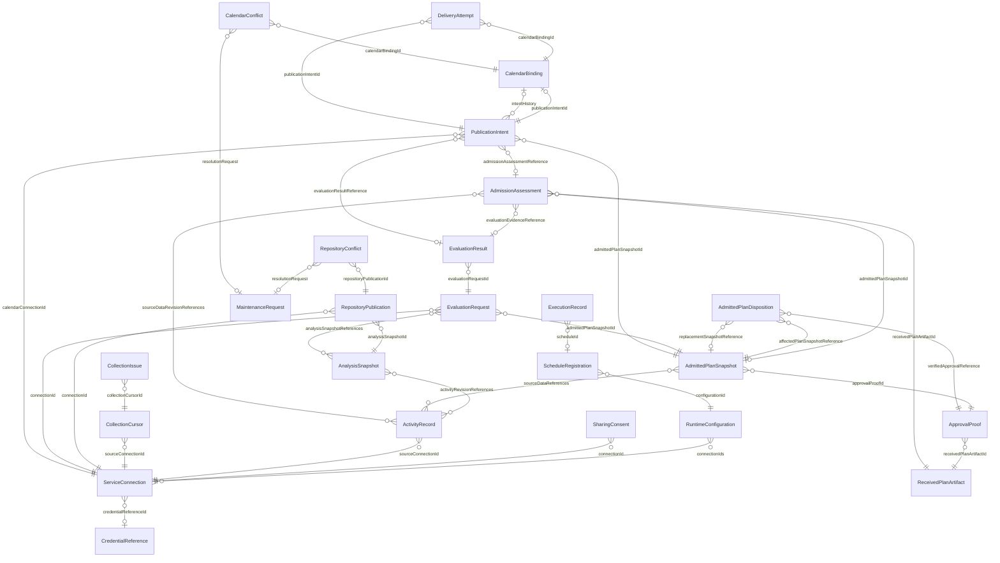

# U2 Linux 에이전트 기능 명세

근거: [단위 정의](../../../inception/units-generation/unit-of-work.md), [배정 66개 FR](../../../inception/units-generation/unit-of-work-story-map.md), [상세 요구사항](../../../inception/requirements-analysis/requirements.md), [원 소유 컴포넌트](../../../inception/domain-design/components.md), [공유 계약](../../../inception/contract-design/contract-summary.md), [확인 Q&A](functional-design-questions.md). User Stories 단계는 생략되어 FR로 추적한다.

이 문서는 **처리 순서와 상태 전이의 기준**이다. 데이터 형식·관계는 [entities.md](entities.md)의 YAML, 판단은 [rules.md](rules.md)의 YAML을 따른다. 아래 ER·규칙 표는 두 원본에서 파생한 보기다. U2는 한 사용자/한 PC의 Rust 설치형·Ubuntu 24.04 이상·한국어 CLI를 대상으로 한다. 별도 GUI·상시 서버·로컬 직접 실행 API·클라우드 배포·추가 후속 기능은 정의하지 않는다.

## 논리 경계와 실행 책임

| 소유 컴포넌트 | 받는 논리 요청 | 돌려주는 결과 | 직접 변경하는 범위 |
|---|---|---|---|
| OperationControl | 설정 후보/기대 개정, 예약/즉시/복구 목적, 유지보수 범위 확인 | 유효 설정·예약·집계 실행/종료 결과 | 설정·예약·실행·유지보수 요청 |
| DataAccessPolicy | 연결 시험, 현재 동의/목적/대상 확인, 보존 정책 | 보호 참조를 노출하지 않는 권한/현재 정책/차단 이유 | 연결·비밀 참조·동의·보존 |
| ActivityCollection | 유효 수집 범위·누락 재검사 | 확정 활동/개정·커서·미완료 범위 | 원천 활동·진행·항목 오류 |
| AnalysisPublication | 확정 활동/개정·기준시각·활성 대상 | 로컬 분석/탐색·대상별 결과·충돌 | 분석·게시 의도/결과·사본 충돌 |
| PlanAdmission | 고정 Drive 자료, 최종 효과 요청과 평가 결과/실패 근거, C07 | 검증 사본 또는 차단·시점별 최종 적격·처분 범위 | 수신·승인 근거·스냅샷·판정·처분 |
| PlanEvaluation | 정확한 검증 스냅샷·허용 분석 참조 | 검증된 평가/제안 또는 실패/미확인 | 요청·평가 결과 |
| CalendarDelivery | 검증 계획/처분과 시각 설정 값·재개 요청 | 의도/연결·세션별 시도/결과·충돌 | 일정 의도·연결·시도·충돌 |

컴포넌트 간 참조는 식별자/불변 버전으로 전달한다. 내부 동기 요청은 네트워크 서버를 뜻하지 않는다. OperationControl이 전달한 시간 설정은 CalendarDelivery가 역호출해 수정하지 않는다. CalendarDelivery가 PlanEvaluation 결과를 받은 후 PlanAdmission에 전달하므로 PlanAdmission→PlanEvaluation 역호출 순환이 없다. 외부 C05/C06/C07은 Drive 비동기 수신이며 U3의 작성 엔티티는 U2가 직접 변경하지 않는다.

C01의 Common/C03~C08·schema/fixture digest는 설치본의 신뢰한 배포와 고정 registry에 대조한다. U1 명세와 U2 자체 합성 자료로 독립 검증하며 다른 단위의 construction 문서·테스트·실행 파일·DB를 자체 검증 필수 의존으로 삼지 않는다.

## 처리 흐름

### F01 — 설치·초기 설정·제거

1. 지원 환경/권한/필요 경로·도구를 확인하고 불충분 항목을 한국어로 안내한다. 실제 설치·로그아웃 실행 시험은 이 문서의 완료 사실이 아니다.
2. CLI로 인증 참조·최초 수집 기간/범위·저장 대상·독립 주기·IANA 시간대·Calendar 기본 시각·서비스별 공유 및 보존 선택을 받는다. 비밀 값은 조회/문서/로그에 노출하지 않는다.
3. RuntimeConfiguration 후보 전체와 기대 개정을 검증한다. 비밀 보호 기술·예약 실행 수단·물리 저장은 NFR에서 선정하며 미해소 실행 프로필은 활성화하지 않는다.
4. 유효 후보만 새 개정으로 로컬 확정한 뒤 목적별 예약 등록 결과를 확인한다. 실패 시 기존 유효본과 예약 상태를 보존하고 불일치를 숨기지 않는다.
5. 제거는 MaintenanceRequest의 확인된 제거 범위로 예약 신규 실행을 중단한 뒤 진행 중 작업/미확인 효과를 보존한다. 데이터 삭제는 별도 범위 확인과 소유자 결과가 필요하다. 원격 잔존/복구를 보장하지 않는다.

적용: BR1.1~BR1.4, BR3.7~BR3.8.

### F02 — 예약·즉시 실행·목적별 중단/재개

1. COLLECTION_SYNC(기본 1시간)와 PLAN_CHECK(기본 15분)를 독립 조회/변경/중단/재개한다. 중단한 목적은 새 예약을 시작하지 않는다.
2. 실행 요청은 유효 설정 개정과 사용자/PC/목적 workKey를 고정하고 단일 실행권을 확보한다. 겹친 요청은 대기 또는 DUPLICATE_SUPPRESSED로 기록한다.
3. ExecutionRecord를 먼저 확정한다. COLLECTION_SYNC는 F03→F04→F05, PLAN_CHECK는 F07→F08→F09/F10을 조정한다. 일부 도메인 차단이 다른 유효 대상의 보존을 취소하지 않는다.
4. 각 모듈은 같은 원천/게시 대상/논리 세션의 기대 개정과 영속 멱등성을 별도로 검사한다. 두 목적이 동시에 접근해도 공유 자료를 공동 쓰지 않는다.
5. 소유자가 반환한 실제 단계별 결과를 집계한다. 끝나지 않은 실행은 INTERRUPTED/OUTCOME_UNKNOWN을 대조하며 SUCCESS로 종료하지 않는다. 마지막/다음 실행은 최초/중단 시 null과 사유를 표시한다.

적용: BR1.3~BR1.8, BR7.5~BR7.6.

### F03 — 원천 수집·원천 수정·커서와 부분 실패

1. DataAccessPolicy에서 현재 Garmin 연결·허용 범위·보호 인증 참조와 P05 적격성을 확인한다. 현재 상세 계약이 미확보이므로 실제 수집은 차단되어 있다.
2. 최초 기간 또는 마지막 확정 지점과 pendingRanges를 요청 범위로 고정한다. 늦은 수정 조회의 창/커서/종료 방법은 공식 원천 계약으로 확인해야 하며 추측하지 않는다.
3. 목록을 페이지 종료 조건까지 읽고 각 상세를 독립 검증한다. 정상 빈 목록·페이지 종료와 네트워크/권한/응답 실패를 구별한다.
4. sourceConnectionId+sourceActivityId로 대조한다. 같은 내용 반복은 무변경이며 확인된 수정만 새 개정으로 반영한다. 원천 ID/오프셋·종목·지표·단위·출처·수집시각과 누락/0/추정 상태를 보존한다.
5. 유효 항목 로컬 확정 후만 커서의 확인 지점을 전진한다. 상세 실패/미지원은 CollectionIssue와 pendingRanges에 남기며 성공 항목은 버리지 않는다. 목록 실패 시 요청 범위를 완료로 넘기지 않는다.
6. 수정된 활동은 영향 기간/종목의 분석 재계산을 요청한다. 재계산 실패는 이전 유효 분석과 갱신 필요 상태를 유지한다. 게시 사본 충돌은 F05에서 별도 처리한다.
7. 만료/영구 입력 오류는 사용자 조치 전 반복하지 않는다. 일시 실패는 현재 자원/호출 예산과 공급자 대기 지시 안에서만 재시도하고 종료 시 다음 상태를 보존한다.

적용: BR2.1~BR2.9, BR3.3, BR1.7.

### F04 — 일관된 분석·탐색·분할 산출물

1. 확정 ActivityRecord의 정확한 개정 집합·사용자 시간대·기준시각을 고정한다. 갱신 중인 입력을 섞지 않는다.
2. 최근 7/28/90일, ISO 월요일 주, 달력 월/연 범위를 시작 포함·끝 제외로 계산한다. 최근 기간은 기준 현지 날짜 D에서 [D-(N-1),D+1)이다. 기준시각 이후의 당일은 아직 수집할 수 없음을 표시한다.
3. 운동 UTC 순간을 사용자 시간대의 날짜로 변환해 종목별로 배정한다. 같은 ID는 단일 입력이며 unknown은 별도다. Decimal 원값으로 합산하고 분모 0/누락/미수집/해당 없음/추정을 전파한다.
4. wire 원값은 정확 십진 문자열을 유지한다. 사람용 표시만 half-even 소수 2자리 반올림하며 단위/계산/차이와 원값을 대조할 수 있게 한다. 이 결정은 의료 한계값이 아니다.
5. 원천 completeness·missingPeriods·수집시각·생성시각·입력 개정·명세를 포함한 로컬 원 분석을 확정한다. EMPTY는 성공적 수집 0건, NEVER_COLLECTED는 미수집·sourceCollectedAt=null·missingPeriods=[period]로 구별한다.
6. F06에서 실제 경로의 동일 공유 집합을 확인하고 대상별 투영을 만든다. 투영 변경은 새 snapshotId/digest이며 sourceSnapshotRef로 계보를 연결한다.
7. INLINE은 루트 activities 전체와 Detail 없음, PARTITIONED는 루트 activities=[]·등록 Detail들만 사용한다. N/연속 index/개수/유일 ID/계보·기간·정렬·Decimal 요약을 검사한다. 같은 날 조각 기간 겹침은 허용하되 같은 활동은 중복 금지다.
8. 상세를 선확정/선게시하고 고정 버전·digest를 대조한 후 manifest를 마지막 게시한다. 일부 실패는 원천 선언을 바꾸지 않고 effectiveCompleteness와 실패 조각을 별도 표시한다. 전부 읽기 전 루트 요약을 검증 완료로 표시하지 않는다.
9. 최신 탐색 안내와 상세/기간별 고정 참조를 제공한다. 오래된 상태·실패·접근 불가를 정상 최신으로 제시하지 않는다. 상세 하위 참조/임의 URL 탐색은 없다.

적용: BR4.1~BR4.9, BR10.1~BR10.3.

### F05 — GitHub/Drive 독립 게시·충돌·결과 미확인

1. 유효 설정에서 활성 분석 대상만 선택하고 F06 현재 권한/비공개·동의/실제 경로를 확인한다. 유효 대상이 없으면 로컬 보존과 외부 미게시를 표시한다.
2. 대상별 RepositoryPublication에 로컬 확정 분석·정책 개정·고정 객체/경로·기대 digest와 의도를 확정한다. 로컬 확정 실패면 신규 외부 요청을 보내지 않는다.
3. P01/P02의 현재 원격 내용/버전을 대조한다. 기존 사용자 수정/삭제/소유 불명은 RepositoryConflict로 보류한다. GitHub 갱신은 읽은 blob SHA, Drive는 전후 metadata와 실제 blob을 대조한다.
4. 새 효과 요청 후 실제 원격 내용/버전/digest를 재확인해야 해당 대상 SUCCESS다. 응답 유실은 OUTCOME_UNKNOWN이며 같은 경로/객체·원 의도로 조회한다.
5. 일치면 확인 성공, 불일치면 CONFLICT, 읽기 불가면 미확인을 유지한다. 실제 미생성 확인 후만 같은 의도를 재시도한다. 새 이름/객체를 만들어 우회하지 않는다.
6. 한 대상 성공/다른 대상 실패는 전체 PARTIAL이며 성공을 되돌리지 않는다. 재개는 실패/대기 대상만 처리하되 새 요청 직전 권한/정책을 재검사한다. 계획/목표 전달 파일을 분석 게시로 덮어쓰지 않는다.

적용: BR3.1~BR3.9, BR4.10.

### F06 — 동의·비밀·보존과 전송 경계

1. 설정 시 서비스/목적/대상별 필요한 필드를 설명하고 명시 동의를 확인한다. analysis.metadata는 불투명 계보·수집/생성시각·범위·운동/조각 개수도 드러냄을 알린다. activity.date는 정확한 시각/오프셋 공개다.
2. 새 전송 직전 실제 연결 설정에서 모든 경로를 구하고 각 (service,purpose,targetAlias)의 유일 grant·원 정책/사용자/현재성/철회·전체 C04 digest를 검증한다. payload가 경로를 누락해 검사를 생략하지 못한다.
3. C03의 각 실제 ANALYSIS 경로 허용 9개 필드 집합을 ASCII 정렬해 projection과 정확히 대조한다. 더 넓거나 좁아도 전체 신규 전송을 보류하고 경로별 차이를 안내한다. 사용자 정책 변경 후 새 정책 digest/투영/snapshotId로 다시 검사한다.
4. 최소 analysis.metadata/summary.period/activity.date/activity.sport 중 하나라도 거부면 C03 전체 전송을 보류한다. 나머지 미허용 지표는 fixed slot의 withheld+quantity/sourceRef/calculationBasis=null이다.
5. pace/speed는 intensity·distance·duration 모두 허용되어야 하며 heartRate는 별도다. summary.totals는 개별 비공개 지표를 공개하지 않는다. 민감 별도 동의가 있어도 미등록 GPS/FIT/수면/HRV/통증을 extension에 넣지 않는다.
6. C05~C08도 해당 목적의 필수 업무 묶음을 명시 허용해야 한다. plan/explanation/constraints/오류/LLM 근거에도 금지 자료가 없음을 확인하고 안전한 최소 자료를 만들 수 없으면 보류한다. 승인 내용을 임의 잘라 같은 승인으로 보내지 않는다.
7. 철회는 새 요청을 즉시 차단한다. 이미 시작한 전송은 결과/한계와 대조 필요를 기록하며 이미 전달된 복사본 회수 성공을 주장하지 않는다. 비밀 값/보호 보관 참조는 교환·진단에서 제외한다.
8. 보존 기간 미설정은 자동 삭제 없음이다. 정리는 MaintenanceRequest로 정확한 로컬/원격/일정 영향 확인 후 소유자가 처리하고 미해소 의도/연결/대조 근거를 먼저 없애지 않는다. 실제 이력/휴지통 복구 한계는 미검증이면 그렇게 알린다.

적용: BR3.7~BR3.8, BR4.10, BR8.7, BR10.3.

### F07 — Drive 수신·승인·안전·불변 스냅샷과 계보

1. PLAN_CHECK는 적격 P01 읽기 권한/등록 별칭에서 후보 C05/C06/C07을 발견한다. 이름/수정시각만으로 최신 승인을 선택하지 않는다. 같은 고정 참조/내용은 기존 수신에 연결한다.
2. metadata-before→blob→metadata-after를 읽고 원격 versionRef·MIME·바이트/깊이·엄격 파싱·등록 schema·전체 JCS digest를 대조해 ReceivedPlanArtifact에 로컬 보존한다. 실패는 기존 검증본을 유지한다.
3. C05 목표/기간/주차/날짜/세션·휴식/단위/강도/수행내용과 모든 참조를 의미 검사한다. 기간 밖/중복/0시간·음수/모호 시각/누락/부분 작성·버전 혼합은 계획 전체를 보류한다.
4. C06의 선언·digest/정책/단일 허용 행위가 맞아도 독립 적격 검증기가 실제 사용자·전체 내용·명시적 인간 의도·정책·현재 계보/철회 CLEAR를 확인해야 한다. 지금은 적격 승인 프로필이 없으므로 자동 게시 가능 근거를 만들지 못한다.
5. 안전 규칙집의 근거/버전·적용 대상/기간·지표/단위·비교 방법·허용 한계·부족 자료 처리·결과를 검증 문맥에 보존한다. 가용 시간/고정 운동 중복·휴식/세션 모순은 구조/제약으로 검사한다. 훈련량/강도 변화·회복 적정성은 적격 근거/한계 없이 통과시키지 않는다.
6. 원천 수정·입력 부족·비교 불가 또는 미해소 안전 경고/규칙집 미설정은 SAFETY_BLOCKED다. 의료 수치 임계값·진단·안전 보장을 발명하지 않는다. 규칙/한계는 후속 근거 적격화 대상으로 남으며 그동안 관련 자동 게시가 차단된다.
7. 형식·승인·안전 검증을 모두 통과한 정확한 C05 전체만 AdmittedPlanSnapshot으로 불변 보존한다. 원 작성 버전/whole digest·목표·세션·설명/가정/시각/정책·원천 개정·ApprovalProof를 연결한다. 이는 ADMITTED_FOR_EVALUATION이며 최종 게시 적격은 아니다.
8. previousPlanDigest를 현재 확정 계보와 대조한다. 신규 내용은 새 버전/새 승인, 같은 버전 다른 내용·현재 계보 불명·동시 승인 분기/구버전은 CONFLICT/BLOCKED다. 선택/병합/되돌리기를 자동 수행하지 않는다.
9. CalendarDelivery가 평가 근거를 전달하면 해당 정확한 버전의 현재 승인/계보/철회·정책/시각·원천/안전·외부 권한을 다시 확인해 시점별 최종 AdmissionAssessment를 발급한다. 변경/검사 불가는 기존 판정 재사용 금지다.

적용: BR5.8, BR5.11, BR6.2~BR6.12 중 U2 배정 규칙, BR7.2~BR7.9, BR10.4.

### F08 — LLM 평가·근거 검증·오류와 제한 예외

1. PlanEvaluation은 ADMITTED_FOR_EVALUATION인 정확한 스냅샷과 허용 분석 개정·동의·현재 제공자/모델·처리 위치·유료 비용 조건·유한 Limits를 고정한다. 미선정이면 호출 없이 BLOCKED다.
2. 원격 초기 대상은 OpenAI API다. 비스트리밍 Chat Completions, tools 없음, store=false, 선택 모델의 지원 token limit 필드 하나만 사용한다. Responses API를 혼용하지 않는다. 로컬/사설은 제공자/실제 처리 위치/하드웨어/원격 우회 없음 확인 전 비활성이고 Ollama는 제외한다.
3. 허용 입력만 담은 EvaluationRequest와 예산·출처를 로컬 확정한다. 요청에 자료 부족/기간·비진단/불확실성 조건을 전달하며 외부 텍스트의 지시를 실행하지 않는다.
4. 응답 상태/크기/finish_reason/refusal/tool_calls와 content를 검사하고 JSON을 다시 엄격 파싱해 EVALUATION에 대조한다. evaluatedDigest·evidenceRefs·수치/주장이 실제 허용 원천과 일치해야 VALID다.
5. 결과/제안은 별도로 보존한다. 새 승인 전 계획/일정 수정은 없다. VALID도 사용자 승인이나 최종 안전 판정이 아니며 CAUTION/UNSUITABLE/INSUFFICIENT_DATA 또는 안전 관련 WARNING/BLOCKER가 미해소면 자동 게시 차단이다.
6. 잘림/거절/형식/근거 불일치는 INVALID/LLM_INVALID다. 확인된 호출 실패는 CALL_FAILED, 사용량/결과 미확인은 OUTCOME_UNKNOWN으로 구분한다. 원본·동기화 자료·승인 근거를 유지한다.
7. CalendarDelivery는 결과/실패 근거를 PlanAdmission에 전달한다. **확인된 CALL_FAILED + 변경 없는 정확한 기존 승인/형식/안전 통과 + 현재 정책/계보/철회/권한 확인 + 미해소 경고 없음**인 경우만 실패 고지와 새 ELIGIBLE_WITH_EVALUATION_FAILURE 판정으로 원본 게시 후보가 될 수 있다.
8. INVALID/미확인을 호출 실패로 바꾸거나 오류 평가 결과/안전 경고를 적용해 우회하지 않는다. 동의 없는 제공자/모델 우회도 없다. 늦은 응답은 원 요청에 보존하며 현재 계획 자동 변경 권한이 없다.
9. 실패/타임아웃 재시도는 같은 입력 계보·현재 권한/동의와 기간별 예산을 재확인한다. 사용량 불명은 대조 전 중복 호출하지 않고 예약 실행으로 비용 한도를 초기화하지 않는다.

적용: BR8.1~BR8.7, BR6.5, BR7.7.

### F09 — 최종 적격 판정·미래 세션 신규 생성·고정 ID와 대조

1. CalendarDelivery는 정확한 스냅샷·세션·대상·평가 근거를 선택하고 PlanAdmission에 최종 판정을 요청한다. 미해소 승인/현재성/안전/정책/권한/모델 적격 상태는 효과를 차단한다.
2. C05/C04의 timingPolicy·현재 설정·tzdbVersion·대상을 대조한다. 세션 localTime 우선, null이면 승인 payload에 결합한 기본 시각이다. 실제 단일 IANA 순간이어야 하고 종료는 시작 순간+expectedDuration 경과 초다.
3. 논리 세션의 기존 의도/CalendarBinding/DeliveryAttempt를 조회한다. 고정 ID는 P03 그대로 `gta`+SHA-256(JCS([subjectRef,calendarAlias,planId,sessionId])) 소문자 base32hex 패딩 제외 55자이며 개정에도 유지한다.
4. 이전 OUTCOME_UNKNOWN/IN_PROGRESS 중단이 있으면 **원 의도·고정 ID·기대 내용·현재 원격 상태를 먼저 대조**한다. 이미 반영된 내용 일치면 기존 효과를 확인하고 연결 복구한다. 불일치는 CONFLICT, 조회 불가면 OUTCOME_UNKNOWN이다. 원격 marker·이름만으로 소유를 인정하지 않는다.
5. 이전 시도가 없거나 실제 미생성이 확인된 경우에만 신규 CREATE 정책을 적용한다. 신뢰된 현재 시각보다 시작 순간이 엄격히 미래여야 후보이며 시작<=현재는 SKIPPED_PAST다. 현재 시각의 신뢰 근거가 없으면 BLOCKED로 둔다.
6. SKIPPED_PAST는 원 의도·원본 날짜/시각·승인 내용·skipReason/skipScope/관측시각을 로컬 보존한다. 신규 생성·오늘 이후 자동 이동·기존 과거 일정 삭제·실제 운동 변경을 수행하지 않는다. C08는 F12처럼 세션 BLOCKED로 투영한다.
7. 미래 CREATE 후보는 로컬 PublicationIntent·예약 CalendarBinding·고정 eventId·기대 내용·시도/적격 확인 문맥을 먼저 확정한다. 저장 실패면 요청을 보내지 않는다.
8. 요청 직전 현재 승인/정책/권한/현재 시각을 재확인한다. 검사 중 시각이 지나면 CREATE를 보내지 않고 skip 판정과 범위를 기록한다. 이미 효과 요청이 시작됐으면 결과 미확인/대조 규칙을 적용한다.
9. 원격 생성 후 같은 ID의 내용/계보를 확인해야 CONFIRMED/SUCCESS다. 409·응답 유실·재시작은 다시 단계4 대조로 돌아간다. 실제 미생성이라도 재시도 시 이미 시작했다면 단계5에 의해 skip이다. 새 ID 생성으로 우회하지 않는다.
10. 일부 세션 성공을 전체 성공으로 올리지 않는다. 실패/skip/미확인과 원 요청 전체 범위는 F12에 남긴다. 새 버전·원천/안전/정책 변화는 남은 세션부터 재판정한다.

적용: BR9.1~BR9.4, BR9.7, BR7.5~BR7.7, BR8.5.

### F10 — 개정·폐기·교체·취소와 사용자 충돌

1. C07 요청의 정확한 대상 계획/예상 versionId/전체 digest·정책·영향 ALL_FUTURE 또는 SELECTED_FUTURE를 수신한다. C06 DISPOSITION은 대응 단일 행위를 독립 검증한다.
2. REPLACE는 새 C05의 별도 PUBLISH_PLAN 승인·형식·안전 검증 및 확정 계보도 요구한다. 같은 사용자 결정으로 두 근거를 발급할 실제 프로필은 미해소이며 단순 선언으로 대체하지 않는다.
3. 검증한 처분과 영향 범위를 AdmittedPlanDisposition에 확정한다. WITHDRAW는 대상 버전의 이후 적용을 차단한다. 연결된 미래 이벤트의 변경/취소는 명시 승인된 영향 범위에 한정한다. CANCEL_PUBLICATION은 해당 게시 취소이며 실제 운동 삭제가 아니다.
4. 신뢰된 현재 시각으로 미래 연결 세션/이벤트만 고른다. 시간이 지나 범위에서 제외되면 그 사유/대상을 남기며 원 요청을 조용히 성공 축소하지 않는다. 과거 일정/실적/타 계획/다른 사용자의 일정은 보존한다.
5. 변경 없는 논리 세션/내용은 재생성하지 않는다. 변경은 같은 fixedEventId의 새 의도로 남기고 마지막 확인 내용과 현재 GET/etag를 대조한다.
6. 양쪽 내용이 일치하고 현재 적격성이 통과하면 If-Match로 UPDATE/CANCEL한다. 사용자 수정/삭제/412/조회 불가는 CalendarConflict 또는 미확인으로 남기며 새 etag로 무조건 덮어쓰지 않는다.
7. 응답 유실은 원 effect/ID/기대 결과로 대조한다. CANCEL의 실제 부재는 기존 소유 연결과 원 취소 의도가 확인될 때만 취소 확인으로 인정한다. GET 실패를 404로 변환하거나 타 이벤트를 삭제하지 않는다.
8. 성공한 세션은 유지하고 실패/미확인만 현재 권한·승인 범위 안에서 복구한다. 처리 중 철회/계보 변화는 남은 효과 중단과 결과 대조가 필요하며 외부 다단계 원자성을 가정하지 않는다.

적용: BR7.8, BR9.5~BR9.7, BR6.10~BR6.11.

### F11 — 중단·동시 수정·제한 후 복구

1. 시작한 소유 작업의 영속 상태·현재 workKey·설정 개정·마지막 확정 커서·의도/시도를 조회한다. 실행권 불명인 진행 작업을 임의 성공/실패로 종료하지 않는다.
2. 로컬 확정 전 중단은 이전 유효본으로 복구한다. 로컬 의도 확정 후 외부 효과 시작 여부가 불명이면 OUTCOME_UNKNOWN으로 대조한다. 시작 시도만 남았다고 실제 미전송으로 단정하지 않는다.
3. 새 원천 읽기/게시/평가/Calendar 요청마다 현재 권한·동의·승인·기간별 예산·입력 개정을 재확인한다. 영구 권한/입력 오류는 사용자 조치 전 재요청하지 않는다.
4. 제한/오프라인/일시 장애는 공급자 대기 지시와 유한 시간/호출 예산 안에서만 재시도한다. 예산 초과면 작업과 다음 조치를 보존하고 이번 실행을 종료한다. 구체 수치/백오프/지터는 NFR에서 선정한다.
5. 원격 사용자 변경·정책 철회·수신 전후 버전 변경·늦은 응답은 기존 원본과 현재 버전을 비교해 보류한다. 자동 병합/권한 확대/새 ID/대체 제공자 호출을 복구 수단으로 쓰지 않는다.
6. 소유자별 미완료 대상만 재개한 후 전체 상태를 다시 집계한다. 통제된 대역 검증과 실제 서비스/로그아웃 실행 증거는 별도로 기록한다.

적용: BR1.6~BR1.8, BR2.8, BR3.5~BR3.7, BR7.5~BR7.7, BR8.6, BR9.4~BR9.7.

### F12 — 단계별 결과·과거 건너뜀·C08 범위

1. 원 소유 결과에서 정확한 workId/targetDigest·관측시각·마지막 성공과 요청된 모든 세션 집합을 고정한다. 제외/skip은 원 요청 범위에서 삭제하지 않는다.
2. U2는 RECEIVE/VALIDATE/EVALUATE/CALENDAR의 자기 사실만 생성한다. U3 STORE 결과는 출처로만 읽고 U2 승인/수신/게시 사실을 대리 발급하지 못한다. C08 노출 경로의 권한/현재성이 미검증이면 실제 U3 조회 지원을 주장하지 않는다.
3. 세션마다 SUCCESS/FAILED/PENDING/OUTCOME_UNKNOWN/CONFLICT/BLOCKED를 기록하며 wire에 SKIPPED를 추가하지 않는다. 로컬 skip 원인은 아래 표와 고정 안내로 연결한다.
4. 전체 상태는 요청 범위 전체로 집계한다. 원 요청의 효과 대상이 1개 이상이고 모든 세션이 실제 확인 성공인 경우만 SUCCESS이며 errors=[]. 효과 대상이 0개면 BLOCKED와 현재 적용 가능한 미래 세션 없음의 고정 사유를 남긴다. 성공 일부+기타가 하나라도 있으면 PARTIAL, 성공 없음+미확인은 OUTCOME_UNKNOWN, 성공 없음+충돌은 CONFLICT, 성공 없음+진행/대기는 PENDING, 그 외 차단/skip은 BLOCKED, 실제 전송 실패만 있으면 FAILED다. 여러 원인이면 미확인→충돌→대기→차단→실패 순서로 대표 상태를 정하고 나머지 세션/오류를 숨기지 않는다.
5. 실패/보류/미확인/충돌은 해당 Common.Error·fieldPath·workRef·suggestedAction을 포함한다. 메시지는 고정 한국어 최소 안내이며 원문/비밀/민감 수치가 없다.
6. CLI는 로컬 이유/범위와 wire 대표 상태를 함께 보여 주고 Calendar가 모두 성공하기 전 계획 전체 게시 완료라고 하지 않는다. 평가 실패 고지는 EVALUATE의 실패와 CALENDAR의 실제 결과를 각각 유지한다.

| 로컬 사실/상태 | C08 세션 결과 | 오류/처리 범위 |
|---|---|---|
| SKIPPED_PAST, 실제 미생성 확인 | BLOCKED, remoteReference=null | DATA_INVALID, retryable=false, fieldPath=sessions[해당 index].date, suggestedAction=NONE. 고정 안내: 이미 시작한 미게시 세션은 신규 생성하지 않습니다. 잘못된 원본이라는 뜻이 아닌 현재 신규 생성 정책의 부적격이며 승인/검증 상태는 보존한다. |
| 과거 skip만 있는 요청 | 전체 BLOCKED | 모든 원 요청 sessionResults 유지; skip의 로컬 원인/관측시각/미생성 확인 근거 보존 |
| 미래 성공+과거 skip | 전체 PARTIAL | 미래 성공과 skip 세션 각각 기록; 원 계획 일부를 SUCCESS로 축소하지 않음 |
| 이전 CREATE 미확인, 과거가 됨 | OUTCOME_UNKNOWN | OUTCOME_UNKNOWN/RECONCILE_REMOTE, skip으로 변경 금지 |
| 이전 의도와 원격 내용 일치 | SUCCESS | 원래 의도의 성공 확인; 과거가 됐다는 이유로 삭제/재생성 금지 |
| 조회 성공·실제 미생성 확인 뒤 이미 시작 | BLOCKED | 원 시도 대조 근거 보존 후 SKIPPED_PAST 투영 |
| 미래 범위 처분 중 시각 경과로 제외 | BLOCKED | DATA_INVALID·현재 미래 범위 제외 안내; 원 처분 전체 성공으로 처리 금지 |

C08의 기존 enum/스키마를 바꾸지 않는다. 과거 skip 고정 정책 자체를 실패로 재시도하지 않고, 원 계획/승인 내용/실제 운동을 보존한다. wire가 표현하지 않는 skip 세부 원인은 소유 로컬 기록 및 한국어 설명으로만 연결한다.

## 상태 전이 기준

아래에서 명시한 전이만 허용한다. 기존 기록은 삭제 대신 새 개정/판정/시도를 연결한다. 상태 값을 추가한 행은 로컬 모델이며 Common/C08 wire enum 추가가 아니다.

| 대상 | 시작/전이 | 조건 및 보존 |
|---|---|---|
| RuntimeConfiguration.installationState | INITIALIZED→READY→REMOVING→REMOVED | 유효 설정+등록 확인 후 READY; 제거는 예약 중단/확인 범위만. 무효 설정 후보/실패는 현재 유효본 유지. 재설치 초기화는 보존 자료와 별도 검증한 새 유효 설정이다. |
| ScheduleRegistration.scheduleState | PENDING→ACTIVE/FAILED; ACTIVE→PAUSED/FAILED/REMOVED; PAUSED→ACTIVE/FAILED/REMOVED; FAILED→PENDING; PENDING→REMOVED | 목적별 등록 실제 확인 후만 ACTIVE. 중단/제거는 새 예약 없음, 진행 효과는 결과 대조. FAILED 복구는 새 등록 시도로만. |
| ExecutionRecord.executionOutcome | RUNNING→SUCCESS/PARTIAL/FAILED/BLOCKED/OUTCOME_UNKNOWN/INTERRUPTED; 새 중복 요청→DUPLICATE_SUPPRESSED | 종료 기록을 덮어 RUNNING으로 바꾸지 않고 새 실행이 recoveryHint/childWorkRefs를 이어받음. 종료 시 finishedAt 설정. |
| ServiceConnection.connectionState | UNCONFIGURED→UNQUALIFIED; UNQUALIFIED→READY/DENIED/EXPIRED/UNAVAILABLE; READY→DENIED/EXPIRED/REVOKED/UNAVAILABLE/UNQUALIFIED; DENIED/EXPIRED/REVOKED/UNAVAILABLE→UNQUALIFIED | 재연결/권한/프로필 변화는 재시험. 실제 권한/현재성/적격성 모두 필요하며 문서만으로 READY 불가. |
| CredentialReference.rotationState | ACTIVE→ROTATION_REQUIRED/UNAVAILABLE/REVOKED; ROTATION_REQUIRED/UNAVAILABLE→ACTIVE/REVOKED | 보호된 갱신/접근 확인 후만 ACTIVE; REVOKED는 새 참조 등록 필요. |
| CollectionCursor.cursorState | NEVER_COLLECTED→RUNNING/BLOCKED; RUNNING→COMPLETE/PARTIAL/BLOCKED; COMPLETE/PARTIAL/BLOCKED→RUNNING | 새 수집/복귀마다 pending 포함. COMPLETE 전 확정 범위/종료 확인; lastSuccessfulAt은 실제 성공 범위만. |
| CollectionIssue.retryState | WAITING→READY/REQUIRES_ACTION/EXHAUSTED; READY→RESOLVED/WAITING/REQUIRES_ACTION/EXHAUSTED; REQUIRES_ACTION/EXHAUSTED→READY | 현재 한도/사용자 조치 후 READY; RESOLVED 기록 불변. |
| RepositoryPublication.publicationState | LOCAL_COMMITTED→PENDING/BLOCKED; PENDING→IN_PROGRESS/BLOCKED; IN_PROGRESS→SUCCESS/PARTIAL/FAILED/OUTCOME_UNKNOWN/CONFLICT; PARTIAL/FAILED/BLOCKED→PENDING; OUTCOME_UNKNOWN→SUCCESS/CONFLICT/PENDING/OUTCOME_UNKNOWN; CONFLICT→PENDING | 미확인→PENDING은 실제 미반영 확인, 충돌→PENDING은 명시 해결/현재 정책 확인 후. SUCCESS는 새 내용이면 새 게시 레코드; 기존 성공 불변. |
| ReceivedPlanArtifact.receptionState | RECEIVED→VALIDATING; VALIDATING→VALIDATED/BLOCKED/CONFLICT; BLOCKED→VALIDATING; CONFLICT→VALIDATING | 같은 고정 내용만 재검증; 원격 변경이면 새 수신 기록. VALIDATED도 현재 게시 적격성은 별도. |
| AdmissionAssessment.assessmentOutcome | 새 판정→BLOCKED/CONFLICT/ADMITTED_FOR_EVALUATION/ELIGIBLE/ELIGIBLE_WITH_EVALUATION_FAILURE/SUPERSEDED | 판정은 시점별 불변 레코드. 근거 변경/계보 교체는 새 SUPERSEDED 판정과 새 검사로 연결; 전 판정을 덮어쓰지 않음. |
| AdmittedPlanDisposition.dispositionAssessment | BLOCKED→VERIFIED/CONFLICT; VERIFIED→APPLIED/PARTIAL/CONFLICT/OUTCOME_UNKNOWN; PARTIAL/OUTCOME_UNKNOWN→APPLIED/PARTIAL/CONFLICT/OUTCOME_UNKNOWN; CONFLICT→VERIFIED | 검증/현재성 재확인 및 세션별 결과 대조 필요; 과거 범위 제외가 남으면 APPLIED 금지. |
| EvaluationRequest.requestState | PREPARED→IN_PROGRESS/BLOCKED; IN_PROGRESS→COMPLETED/FAILED/OUTCOME_UNKNOWN; OUTCOME_UNKNOWN→COMPLETED/FAILED/OUTCOME_UNKNOWN | 한 요청의 완료 뒤 재시도는 새 요청 ID+같은 입력 계보. BLOCKED는 외부 미호출. |
| EvaluationResult.evaluationOutcome | 새 결과→VALID/CALL_FAILED/INVALID/OUTCOME_UNKNOWN/BLOCKED | 결과는 원 요청/digest에 불변 결합. 후속 응답/대조는 새 결과로 남기고 이전 오류를 정상 평가로 덮어쓰지 않음. |
| PublicationIntent.intentState | PREPARED→BLOCKED/READY/SKIPPED_PAST; READY→IN_PROGRESS/BLOCKED/SKIPPED_PAST; IN_PROGRESS→CONFIRMED/FAILED/OUTCOME_UNKNOWN/CONFLICT; OUTCOME_UNKNOWN→CONFIRMED/CONFLICT/READY/SKIPPED_PAST/OUTCOME_UNKNOWN; FAILED/BLOCKED→READY/SKIPPED_PAST; CONFLICT→READY | READY는 최신 적격 재확인; 미확인→READY/skip은 실제 미반영 확인 후만. SKIPPED_PAST는 CREATE 실제 미생성/시각 경과에만. CONFIRMED/SKIPPED_PAST 이력은 불변이며 새 내용은 새 의도. |
| CalendarBinding.bindingState | RESERVED→ACTIVE/CANCELLED/OUTCOME_UNKNOWN/CONFLICT; ACTIVE→ACTIVE/CANCELLED/OUTCOME_UNKNOWN/CONFLICT; OUTCOME_UNKNOWN→ACTIVE/CANCELLED/RESERVED/CONFLICT/OUTCOME_UNKNOWN; CONFLICT→ACTIVE/CANCELLED/RESERVED; CANCELLED→RESERVED | 확인된 소유 의도의 실제 원격 결과로만 전이. CANCELLED→RESERVED는 새 유효 승인/미래 CREATE 의도가 필요하고 같은 fixedEventId 재사용 가능성은 실제 공급자 적격 확인 전 보류. |
| DeliveryAttempt.remoteOutcome/retryState | 새 시도 NOT_SENT/NONE→SUCCESS/DONE 또는 FAILED/READY·REQUIRES_ACTION·EXHAUSTED 또는 OUTCOME_UNKNOWN/RECONCILE_FIRST 또는 CONFLICT/REQUIRES_ACTION | 시도는 시작/종료와 원격 결과를 보존. 결과 대조는 attemptKind=LOOKUP의 새 시도로 남김. 실제 미전송 확인 없는 NOT_SENT를 성공적 무효과로 추정 금지. |

SharingConsent는 철회 시 withdrawnAt과 새 개정으로 새 전송을 막고 과거 동의 이력을 보존한다. ActivityRecord·AnalysisSnapshot·ApprovalProof·AdmittedPlanSnapshot·평가/결과·충돌·MaintenanceRequest의 확정 내용은 원 소유자가 새 개정/기록으로 연결한다. ApprovalProof의 내부 VerificationResult는 새 검증 때 새 proof/판정으로 보존하고 외부 VERIFIED로 수정하지 않는다. MaintenanceRequest.ownerOutcomes는 소유자 실제 결과로만 집계하며 확인 범위가 달라지면 새 요청 확인이 필요하다. RepositoryConflict/CalendarConflict는 resolutionRequest가 있어도 자동 해소하지 않으며 연결 소유자가 실제 대조 후 해소 근거를 남긴다.

## 파생 ER 보기

선은 식별자 참조이며 호출 순서/공동 쓰기/연쇄 삭제를 뜻하지 않는다. 필수 참조는 정확히 한 대상, nullable 참조는 0..1 대상이다. Set 참조는 양쪽 0..*다. RetentionPolicy는 dataScope 값 객체로 범위를 지정하는 독립 엔티티이므로 강제 FK 선을 만들지 않는다.

텍스트 대안: OperationControl은 설정→연결과 예약→설정·실행→예약을 참조한다. DataAccessPolicy는 연결→비밀 참조와 동의→연결을 소유하고 보존 정책은 독립이다. ActivityCollection은 활동/커서→연결, 오류→커서다. AnalysisPublication은 스냅샷→활동 개정 집합, 게시→스냅샷/연결, 충돌→게시/해결 요청이다. PlanAdmission은 승인 근거→수신, 불변 사본→근거/활동, 판정→수신/사본/활동/평가 근거, 처분→대상/대체 사본/승인이다. PlanEvaluation은 요청→사본/분석/연결, 결과→요청이다. CalendarDelivery는 의도→사본/연결/판정/평가, 연결→현재/이전 의도, 시도→의도/연결, 충돌→연결/해결 요청이다. 외부 작성 엔티티는 출처 값으로만 보존한다.

작성 전에 이 ER의 알려진 엔티티·관계 문자열·카디널리티를 제한 구조로 검사했다. 전체 Mermaid 파서/mmdc 설치·렌더링은 수행하지 않았다. 본문 텍스트가 모든 관계의 대안이다.

## 파생 규칙 요약

| 규칙 | 요약 | 상류 |
|---|---|---|
| BR1.1 | 설치/초기화/제거는 데이터 삭제와 분리한다 | FR1.1 |
| BR1.2 | 설정 후보 전체 검증 후 유효본을 교체한다 | FR1.2 |
| BR1.3 | 예약 등록 완료와 실제 로그아웃 실행 검증은 구별한다 | FR1.3 |
| BR1.4 | 수집/동기화와 계획 확인 주기는 독립 관리한다 | FR1.4 |
| BR1.5 | 즉시 실행도 동일 중복/현재성 조건을 따른다 | FR1.5 |
| BR1.6 | 중복 실행 배제와 도메인 멱등성을 함께 유지한다 | FR1.6 |
| BR1.7 | 복귀는 마지막 확정 지점과 미완료를 재검사한다 | FR1.7 |
| BR1.8 | CLI는 한국어 텍스트·결과·복구 조치를 제공한다 | FR1.8 |
| BR2.1 | Garmin 상세 계약/권한 확인 전 수집을 활성화하지 않는다 | FR2.1 |
| BR2.2 | 전체 목록 페이지와 각 상세의 확정 범위를 분리한다 | FR2.2 |
| BR2.3 | 최초/신규/수정/늦은 수정의 근거를 보존한다 | FR2.3 |
| BR2.4 | 원천 연결과 불투명 ID로 유일 운동을 유지한다 | FR2.4 |
| BR2.5 | 확인 원천 수정과 게시 사본 충돌을 분리한다 | FR2.5 |
| BR2.6 | 지원 종목/지표와 미상 상태를 유지한다 | FR2.6 |
| BR2.7 | 측정값·단위·원천·수집시각 및 변환 근거를 보존한다 | FR2.7 |
| BR2.8 | 외부/항목 오류는 한정 복구한다 | FR2.8 |
| BR2.9 | 미제공/미수집/해당 없음/실제 0/추정을 혼동하지 않는다 | FR2.9 |
| BR3.1 | GitHub와 Drive 연결/권한 시험을 독립한다 | FR3.1 |
| BR3.2 | 활성 분석 대상만 전송한다 | FR3.2 |
| BR3.3 | 외부 효과 전 로컬 유효본과 의도를 확정한다 | FR3.3 |
| BR3.4 | 대상별 성공·실패·대기·미확인을 집계한다 | FR3.4 |
| BR3.5 | 실패 대상만 복구하고 타 대상 성공을 유지한다 | FR3.5 |
| BR3.6 | 응답 유실은 고정 대상/내용 대조가 먼저다 | FR3.6 |
| BR3.7 | 원격 사본 충돌·보존·삭제 영향은 명시 확인한다 | FR3.7 |
| BR3.8 | 비공개/허용 대상 확인 후 게시한다 | FR3.8 |
| BR3.9 | 생성·원천 수집·갱신·마지막 성공 게시 시각을 구별한다 | FR3.9 |
| BR4.1 | 최신 상태/상세/기간 탐색을 허용 고정 참조로 제공한다 | FR4.1 |
| BR4.2 | 기간은 시간대의 시작 포함·끝 제외로 계산한다 | FR4.2 |
| BR4.3 | 구조화 상세와 계산 정의로 재계산 가능하게 한다 | FR4.3 |
| BR4.4 | 상세 개정과 영향 요약의 계보를 고정한다 | FR4.4 |
| BR4.5 | 범위·시각·단위·출처·명세를 함께 식별한다 | FR4.5 |
| BR4.6 | 분모 0과 비수치 상태는 유효 성과가 아니다 | FR4.6 |
| BR4.7 | 종목별 유일 집합으로 계산한다 | FR4.7 |
| BR4.8 | 정확 계산 뒤 표시 반올림과 차이를 설명한다 | FR4.8 |
| BR4.9 | 원천 완전성과 전달 완전성/최신성을 분리한다 | FR4.9 |
| BR4.10 | 모든 실제 전송 경로를 같은 현재 정책으로 검사한다 | FR4.10 |
| BR5.8 | 외부 승인 선언은 독립 검증 전 권한이 아니다 | FR5.8 |
| BR5.11 | Drive 주기 수신은 로컬 직접 호출 없이 수행한다 | FR5.11 |
| BR6.2 | 필수 계획/세션이 모두 유효해야 전체를 채택한다 | FR6.2 |
| BR6.5 | 안전 근거·적용조건·한계가 미해소면 적격 판정을 내리지 않는다 | FR6.5 |
| BR6.8 | 작성·승인·저장·수신·평가·게시 결과를 분리한다 | FR6.8 |
| BR6.10 | 새 내용과 개정은 새 승인 및 확정 계보를 요구한다 | FR6.10 |
| BR6.11 | 계획 개정/취소가 실제 운동을 변경하지 않는다 | FR6.11 |
| BR6.12 | 완전한 같은 버전만 검증한다 | FR6.12 |
| BR7.2 | 계획 확인 실패를 최신 확인으로 처리하지 않는다 | FR7.2 |
| BR7.3 | 내용·계보·ID와 원격 저장 위치를 각각 대조한다 | FR7.3 |
| BR7.4 | 형식·참조·허용 행위·승인·현재성을 모두 검사한다 | FR7.4 |
| BR7.5 | 반복 조회/재개는 영속 결과를 재사용한다 | FR7.5 |
| BR7.6 | 계획별 단계와 세션별 결과를 보존한다 | FR7.6 |
| BR7.7 | 검사 후 변경과 동시 수정은 재검증/보류한다 | FR7.7 |
| BR7.8 | 폐기/교체/취소는 승인된 미래 영향만 처리한다 | FR7.8 |
| BR7.9 | 외부 자료는 권한을 부여하지 않는 데이터다 | FR7.9 |
| BR8.1 | 제공자·모델·인증 참조·비용/한도를 확인한다 | FR8.1 |
| BR8.2 | 원격과 로컬/사설 유형은 각각 실제 호환성 증거가 필요하다 | FR8.2 |
| BR8.3 | 평가·실적 분석·조정안은 승인/계획 변경과 분리한다 | FR8.3 |
| BR8.4 | 모델 결과의 구조·digest·근거·수치를 다시 검사한다 | FR8.4 |
| BR8.5 | 평가 실패 예외는 변경 없는 기존 검증 스냅샷에만 적용한다 | FR8.5 |
| BR8.6 | 실패·늦은 평가 응답은 원본과 현재 계획을 보존한다 | FR8.6 |
| BR8.7 | 제공자별 허용 입력과 문맥 한도를 적용한다 | FR8.7 |
| BR9.1 | 선택 캘린더 권한을 각 요청 전 확인한다 | FR9.1 |
| BR9.2 | 시각 정책과 미래 여부를 검증한 세션만 신규 생성한다 | FR9.2 |
| BR9.3 | 일정은 승인 세션과 허용 투영에 일치해야 한다 | FR9.3 |
| BR9.4 | 고정 이벤트 ID·원 의도·연결로 중복/응답 유실을 대조한다 | FR9.4 |
| BR9.5 | 승인된 미래 일정 영향만 조건부 변경/취소한다 | FR9.5 |
| BR9.6 | 사용자 수정/조건부 충돌은 덮어쓰지 않는다 | FR9.6 |
| BR9.7 | 부분 성공·미확인·과거 건너뜀을 성공과 구별한다 | FR9.7 |
| BR10.1 | C03 분할은 등록 Detail·계보·개수·범위를 검증한다 | FR4.3·FR4.4·FR4.9 |
| BR10.2 | C03 요약 상태와 정렬은 공통 의미 규칙을 따른다 | FR4.6·FR4.7·FR4.8 |
| BR10.3 | 기본 메타데이터 묶음과 파생 유출을 확인한다 | FR4.10·FR8.7 |
| BR10.4 | 엄격 파싱과 고정 명세 전체 digest를 적용한다 | FR7.4·FR7.9·FR4.5 |

## 합성 인수 사례의 설계 기대값

아래 64개는 **설계한 기대 결과이며 새 제품/검증기를 실행한 결과가 아니다.** 정상 경로의 적격 승인/권한/안전/모델 가정은 대역 입력으로만 만들 수 있으며 현재 미해소 실제 조건을 해소하지 않는다. U1 공통 사례와 U2 자체 합성 자료를 사용하고 실명·건강 자료·비밀을 사용하지 않는다. 실행 시험은 Code Generation/Build and Test/실제 인수의 후속 책임이다.

| 사례 | 흐름 | 합성 입력/조건 | 기대 결과 | 규칙 |
|---|---|---|---|---|
| U2-S01 | F01 | 지원 Ubuntu·유효 설정·보호 참조 등록 | 유효본 확정 뒤 두 예약 등록; 실제 로그아웃 실측은 별도 | BR1.1 BR1.2 BR1.3 |
| U2-S02 | F01 | 무효 시간대·0 주기·기대 설정 개정 불일치 | 필드 오류/동시 변경; 기존 설정/예약 보존 | BR1.2 BR1.4 |
| U2-S03 | F01 | 제거하되 데이터 삭제 확인 없음 | 예약 중단/제거 범위만 실행; 데이터 보존 | BR1.1 BR3.7 |
| U2-S04 | F02 | 같은 PC 예약/즉시 실행 중첩 | 중복 실행은 대기/건너뜀, 운동/이벤트 수 단일 | BR1.5 BR1.6 |
| U2-S05 | F02 | 계획 확인만 중단 후 재개 | 수집 주기 유지; 중단 목적 새 예약 없음; 재개 등록 확인 | BR1.3 BR1.4 |
| U2-S06 | F02 | PC 복귀·목록 기간/세션 의도 미완료 | 마지막 확정+pending 재검사, 미확인 효과는 대조 우선 | BR1.7 BR7.5 |
| U2-S07 | F03 | P05 계약 없음 또는 인증 만료 | 실제 수집 비활성/차단 및 재인증 안내; 가상 endpoint 없음 | BR2.1 BR2.8 |
| U2-S08 | F03 | 목록 여러 페이지 후 정상 종료·상세 하나 실패 | 유효 활동 보존; 실패 ID/pending·PARTIAL; 실패를 0건 처리 금지 | BR2.2 BR2.8 |
| U2-S09 | F03 | 목록 요청 실패와 정상 빈 목록 비교 | 실패는 요청 전체 미완료, 성공 빈 목록만 EMPTY 후보 | BR2.2 BR2.9 |
| U2-S10 | F03 | 원천 ID 0001/1/A/a와 동일 날짜 운동 | 각 ID 보존·다른 ID 병합 없음; 반복 같은 ID 한 건 | BR2.4 |
| U2-S11 | F03 | 늦은 수정·이전 유효본·요약 재생성 실패 | 원천 확인 개정 보존, 이전 분석 보존 및 갱신 필요 표시 | BR2.3 BR2.5 |
| U2-S12 | F03 | 수영·unknown 운동과 미지원 단위 | 종목 분리·미지원 사유·러닝 치환 없음 | BR2.6 BR2.7 |
| U2-S13 | F03 | observed 0/missing/not_collected/estimated 혼합 | 상태·근거 유지, 미수집을 미운동/0으로 확정하지 않음 | BR2.7 BR2.9 |
| U2-S14 | F04 | 최근7/28/90일·주/월/연·윤일/연말 경계 | 시작 포함/끝 제외·동일 입력 단일 배정·시간대/기준시각 표시 | BR4.2 |
| U2-S15 | F04 | distance=0 또는 duration=0 | pace/speed 해당 없음·quantity=null; NaN/Infinity 없음 | BR4.6 |
| U2-S16 | F04 | 종목별 Decimal 합계·반올림 부분합 차이 | 원값 정확 합산·표시 반올림 근거·차이 설명; 종목 혼합 없음 | BR4.7 BR4.8 BR10.2 |
| U2-S17 | F04 | 한 운동 개정 후 상세/기간 연결 소실 | 불일치·갱신 필요 표시, 원천/이전 유효본 삭제 없음 | BR4.1 BR4.4 BR4.5 |
| U2-S18 | F04 | PARTITIONED 두 Detail 정상 | 고정 버전/hash/계보/개수/정렬/합계 확인 후만 COMPLETE 유지 | BR10.1 BR10.2 |
| U2-S19 | F04 | 루트 COMPLETE·Detail 읽기 실패/descriptor 미도착 | source 선언 보존, effective PARTIAL·SOURCE_INCOMPLETE·실패 범위 표시 | BR4.9 BR10.1 |
| U2-S20 | F04 | Detail 중복 ID/index·혼합 snapshot·범위 밖·합계 오류 | DATA_INVALID·분석/계획 근거 채택 보류, 0건 변환 없음 | BR10.1 BR10.2 |
| U2-S21 | F04 | 원천 PARTIAL인데 모든 Detail 전달 성공 | effective PARTIAL 유지; COMPLETE 승격 없음 | BR4.9 |
| U2-S22 | F06 | 거리만 허용·시간/심박 실제 존재 | duration/pace/speed/heartRate는 withheld+세 null; 원천/설명 역산 유출 없음 | BR10.3 BR4.10 |
| U2-S23 | F06 | 최소 메타데이터 네 항목 중 하나 거부 | C03 전체 신규 전송 0건; 필수라는 이유로 자동 동의 없음 | BR10.3 |
| U2-S24 | F06 | Drive/ChatGPT 분석 집합 일치/더 넓음/더 좁음 | 일치만 후보, 넓거나 좁으면 모두 전체 보류; 자동 교집합 없음 | BR4.10 |
| U2-S25 | F06 | 동일 service/purpose/target의 중복 grant | 합쳐 권한 확대하지 않고 거절 | BR4.10 |
| U2-S26 | F06 | 민감 별도 동의 있으나 C03 필드 미등록 | GPS/FIT/수면/HRV/통증 extension 전송 없음 | BR10.3 |
| U2-S27 | F05 | GitHub 성공·Drive 실패 | 대상별 결과 유지·전체 PARTIAL; Drive만 복구 | BR3.1 BR3.4 BR3.5 |
| U2-S28 | F05 | 로컬 디스크 가득 참/읽기 전용/쓰기 중단 | 이전 유효본 보존·새 외부 요청 0건·성공 표시 없음 | BR3.3 |
| U2-S29 | F05 | 쓰기 응답 유실·원격 기대 내용 일치 | 원 의도/고정 참조 재조회 후 SUCCESS, 새 객체 없음 | BR3.6 |
| U2-S30 | F05 | 원격 사용자 수정/삭제 또는 조회 불가 | CONFLICT 또는 OUTCOME_UNKNOWN, 자동 덮어쓰기/로컬 삭제 없음 | BR3.6 BR3.7 |
| U2-S31 | F06 | 비공개 여부 불명·허용 안 된 폴더·대상 비활성 | 해당 대상 새 전송 0건·로컬 유지; 계획 Drive 별도 요구 유지 | BR3.2 BR3.8 |
| U2-S32 | F06 | 보존 기간 미설정/미해소 효과 근거 삭제 요청 | 자동 삭제 없음; 확인 범위·대조 근거 보존·복구 한계 안내 | BR3.7 |
| U2-S33 | F07 | 정상 C05/C06 형식이나 승인 프로필 미적격 | APPROVAL_PROFILE_UNQUALIFIED; 스냅샷 게시 권한 없음 | BR5.8 BR7.4 |
| U2-S34 | F07 | 중복 키/잘린 JSON/잘못된 UTF-8/후행 문서 | DATA_INVALID·계획 전체 보류; 유효 세션만 떼어 게시하지 않음 | BR6.12 BR10.4 |
| U2-S35 | F07 | 단일 BOM/CRLF/한글 인용/줄바꿈 | 지원 파싱에서 문자열 의미 보존·전체 JCS digest 대조 | BR10.4 |
| U2-S36 | F07 | 기간 밖 세션·중복 ID·0 예상시간·단위/RPE 오류 | 계획 전체 DATA_INVALID; 필드 경로·수정 안내 | BR6.2 |
| U2-S37 | F07 | approved=true/외부 VERIFIED/임의 profileId | 권한 인정/검증기 자동 등록 없음; 승인 보류 | BR5.8 BR7.9 |
| U2-S38 | F07 | 같은 버전 다른 내용·동시 분기·구버전 늦게 도착 | CONTENT_MISMATCH/REMOTE_CONFLICT; 현재 계보 유지 | BR6.10 BR7.3 BR7.5 |
| U2-S39 | F07 | 수신 전후 원격 버전 변화 또는 검사 뒤 정책 철회 | 판정 재사용 금지; 남은 신규 효과 중단·시작한 효과 대조 | BR7.7 |
| U2-S40 | F07 | 안전 규칙집/한계 미설정 또는 회복/양/강도 경고 미해소 | SAFETY_BLOCKED; 의료 임계값 발명/LLM 실패 우회 없음 | BR6.5 |
| U2-S41 | F08 | 모델/유료 비용/토큰/호출 한도 미선정 | 외부 LLM 호출 0건·DEPENDENCY_UNQUALIFIED/RESOURCE_LIMIT | BR8.1 |
| U2-S42 | F08 | 로컬 사설 주소만 있고 실제 원격 우회/하드웨어 불명 | 로컬/사설 적격 인정 안 함·Ollama/자동 대체 사용 없음 | BR8.2 |
| U2-S43 | F08 | 정상 평가+수정 제안 | 같은 digest 근거 검증 후 결과만 보존; 새 승인 전 계획 변경 없음 | BR8.3 BR8.4 |
| U2-S44 | F08 | length/refusal/tools/잘린 content/잘못된 근거/허위 수치 | INVALID·LLM_INVALID; 결과 내용/조정안 미적용 | BR8.4 BR8.5 |
| U2-S45 | F08 | 확인 CALL_FAILED+변경 없는 승인/형식/안전 통과 스냅샷 | 실패 고지·현재성 재확인·실제 최종 적격 판정 후에만 원 내용 게시 후보 | BR8.5 |
| U2-S46 | F08 | CALL_FAILED지만 승인 실패/안전 경고/조정안 적용 | 예외 불가·BLOCKED·게시 0건 | BR6.5 BR8.5 |
| U2-S47 | F08 | 평가 응답/사용량 미확인 또는 늦은 구버전 응답 | 미확인 비용/결과 대조; 현재 버전 변경/중복 무제한 호출 없음 | BR8.6 |
| U2-S48 | F08 | 문맥 한도 초과·금지 자료·다른 제공자 대체 유도 | 허용 분할+한계 또는 명시 실패; 동의 없는 대체/조용한 잘림 없음 | BR8.7 |
| U2-S49 | F09 | 적격 전제·미래 세션·세션 시각 또는 기본 시각 | 정확 시간대/정책·고정 ID·로컬 의도·현재 권한 후 CREATE, 재읽기 확인 | BR9.1 BR9.2 BR9.3 BR9.4 |
| U2-S50 | F09 | 실제 미생성이고 시작<현재 또는 시작=현재 | SKIPPED_PAST·wire 세션 BLOCKED·고정 정책 사유; 신규 생성/시각 이동/실적 변경 없음 | BR9.2 BR9.7 |
| U2-S51 | F09 | 현재 시각 불신 또는 DST 중복/존재하지 않는 시각 | BLOCKED; 자동 시각 추정/이동 없음 | BR9.2 BR9.3 |
| U2-S52 | F09 | 과거 세션이나 이전 CREATE 응답 유실·원격 일치 존재 | 원 의도 대조로 기존 효과 SUCCESS/연결 복구; skip/신규 생성/삭제 없음 | BR9.4 |
| U2-S53 | F09 | 과거 세션·이전 OUTCOME_UNKNOWN·원격 GET 실패/불일치 | 미확인/충돌 유지, 미게시 단정/skip/재생성 없음 | BR9.4 BR9.6 |
| U2-S54 | F09 | 이전 미확인 CREATE의 실제 미생성 확인 후 시각 경과 | 재대조 근거 보존 뒤 SKIPPED_PAST; 원 요청은 과거 건너뜀으로 노출 | BR9.2 BR9.4 BR9.7 |
| U2-S55 | F10 | 새 계획 REPLACE·기존 미래 세션 일부 변경/취소 | C07 승인+새 C05 PUBLISH_PLAN 각각 검증; 변경 없는 세션/실적/과거/타 일정 보존 | BR7.8 BR9.5 BR6.11 |
| U2-S56 | F10 | 사용자 이벤트 수정/삭제·조건부 412·고정 ID 409 불일치 | CONFLICT·차이/원 의도 보존, 최신 etag 무조건 재쓰기/타 일정 소유 추정 없음 | BR9.4 BR9.6 |
| U2-S57 | F10 | 취소 일부 성공·일부 응답 유실·권한 철회 | 성공 유지·나머지 중단/대조·PARTIAL 및 재처리 범위 | BR7.8 BR9.1 BR9.7 |
| U2-S58 | F12 | 원 요청 세션 중 성공+skip·전부 skip·성공+미확인·효과 대상 0개 | 각각 전체 PARTIAL/BLOCKED/PARTIAL/BLOCKED; 모든 세션 포함·skip을 성공 분모에서 제거하지 않음 | BR9.7 BR7.6 |
| U2-S59 | F11 | 중단 직전 외부 효과 전송·재시작·같은 workKey | 영속 의도/시도 조회와 대조 우선; 새 중복 효과 없음 | BR1.6 BR1.7 BR9.4 |
| U2-S60 | F12 | U3 STORE 성공 또는 평가 실패가 Calendar 성공처럼 도착 | 원 소유/단계 대조로 대리 성공 거절; 단계별 원 상태 표시 | BR6.8 BR7.6 |
| U2-S61 | F06 | 전송 직전 동의 철회·진행 중 전송 존재 | 신규 요청 차단, 이미 시작한 외부 효과는 미확인/대조; 복사본 회수 성공 주장 없음 | BR4.10 BR7.7 |
| U2-S62 | F11 | 429 Retry-After가 실행 제한 초과·반복 예약 | 이번 실행 종료/대기 보존, 기간별 호출/비용 예산 유지·무한 반복 없음 | BR2.8 BR8.6 |
| U2-S63 | F12 | 합성 비밀 표식·제어문자·민감 수치 포함 오류 | 고정 한국어 오류/조치만 제공·표식/민감 원문 외부 출력 0건 기대 | BR1.8 BR4.10 BR7.9 |
| U2-S64 | F07 | instruction/파일명에 셸 실행·허용 루트 이탈·비밀 요청 | 데이터로 보존/거절; 실행/임의 경로 접근/권한 확대 0건 기대 | BR7.9 |

기존 공통 계약의 54개 schema 사례·23개 공유/상세 의미 사례·7개 엄격 파싱 사례는 변형하지 않고 재검사 대상으로 이어받는다. C03 실제 경로 허용 집합 동일성·최소 메타데이터 동의·withheld·등록 Detail 완전성 규칙을 위 합성 기대값과 함께 유지한다.

## 검증 범위와 미해소 조건

문서 검증은 YAML/JSON·25개 원 소유 모델/속성·참조/카디널리티·66개 실제 배정 FR와 70개 BR/source/target·로컬 링크·문자/공백·제한 ER 문법의 정합성이다. 기존 공통 합성 의미/구조 검사는 계약 명세와 기존 검사기로 수행할 수 있다. 이 단계의 새 64개 기대 사례는 실행 시험으로 표시하지 않는다.

| 미해소 항목 | 활성화 차단/후속 증거 |
|---|---|
| Garmin P05 상세 계약/권한·기간/페이지/수정/지표/한도 | 실제 수집 비활성. 공식 상세 계약과 실제 허용 시험 필요 |
| 적격 승인 발급/검증·명시적 인간 의도와 정확한 전체 내용·철회/계보 현재성 | 관련 자동 Calendar 게시/변경/취소 차단. 파일/해시/승인 문자열로 대체 불가 |
| C04 원 정책 신뢰·실제 클라이언트 최신성/철회·모든 실제 경로 동의 | 확인 불가인 신규 전송 차단. 기존 복사본 회수 보장 금지 |
| 안전 규칙의 근거/적용 조건/단위·비교 기간·한계와 검증 프로필 | SAFETY_BLOCKED. 의료 임계값을 발명하지 않고 입력 부족/미해소 경고 보류 |
| P01~P03 실제 계정/권한·비공개/동시 수정·원격 결과 대조 | 해당 외부 게시/수신 활성화·인수 차단. 대역 성공은 실제 성공 아님 |
| 원격 OpenAI 모델/지원·비용·예산/한도·품질 | 적격 확인 전 평가 요청 차단. API 초기 대상 결정만 완료 |
| 로컬/사설 대체 제공자/API·모델·실제 처리 위치/하드웨어 | 해당 유형 비활성, Ollama 제외. 원격만으로 FR8.2 완료 불가 |
| Ubuntu 설치·로그아웃/복귀·예약·물리 저장·비밀 보호·현재 시각/tzdb 적격·유한 Limits | NFR 선택 및 실제 환경 시험 필요. 논리 설계로 실측 완료 주장 금지 |
| ChatGPT 환경별 읽기/쓰기·승인 전달 및 C08 노출/현재성 | U3/전체 인수 책임의 실제 지원 증거 필요; U2 자체 검증 필수 의존으로 끌어오지 않음 |

미해소 항목은 기능 설계 미완성 표시 대신 명시적인 현재 차단 조건이다. 이 문서는 해당 조건을 승인/해결하거나 요구사항을 축소하지 않는다. 코드·설치·외부 계정/HTTP·의학적 타당성·실제 로그아웃 실행·제품 통합 인수는 수행하지 않았다.

