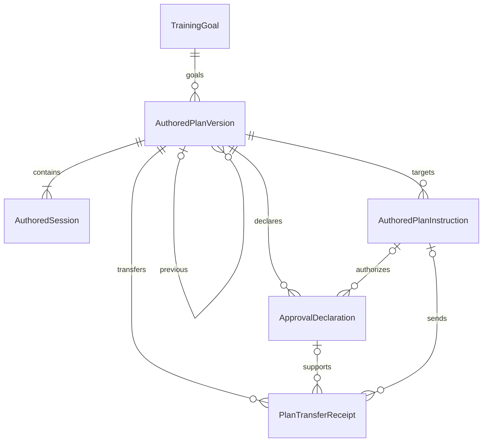

# U3 ChatGPT 워크플로 기능 명세

- 대상: U3 `u3-chatgpt-workflow`, kind `spec`, Standard 깊이·검증 전략.
- 근거: [확인한 입력](functional-design-questions.md), [단위 정의](../../../inception/units-generation/unit-of-work.md), [배정 FR](../../../inception/units-generation/unit-of-work-story-map.md), [요구사항](../../../inception/requirements-analysis/requirements.md), [컴포넌트](../../../inception/domain-design/components.md), [공통 계약](../../../inception/contract-design/contract-summary.md).
- 기준: 데이터 모양은 [entities.md](entities.md)의 YAML, 판정은 [rules.md](rules.md)의 YAML, **순서 있는 처리와 상태 전이는 이 문서**가 기준이다. User Stories는 생략되어 배정 FR 33개를 사용한다.
- 현재 결과: 설계 문서 4개, 소유 엔티티 6개, 규칙 36개, 흐름 11개, U3 합성 설계 사례 36개. 구현·계정/도구 호출·실제 승인/저장/게시 시험 결과가 아니다.

## 책임·신뢰·교환 경계

CoachingWorkflow는 목표·러닝 작성본·세션·원 승인 의사·STORE 확인·처분 요청만 소유한다. C05의 `authoringState=PROPOSAL`은 승인 후에도 바꾸지 않는다. C06의 선언은 U2 PlanAdmission이 독립 검증할 불신 입력이다. U2의 `ApprovalProof`·`AdmittedPlanSnapshot`·현재 게시 적격성·평가·Calendar 결과를 U3가 생성하지 않는다.

| 경계 | U3가 소비/생산하는 자료 | 필수 조건·실패 표현 |
|---|---|---|
| C02 → U3 | 같은 고정 Common/C01~C08 1.0.0 registry와 U1 합성 사례 | 명세/실제 digest·등록 스키마·호환 확인. 임의 원격 schema/코드 다운로드 금지 |
| C03 → U3 | manifest·INLINE 또는 등록 Detail 분할·읽은 범위/근거 | 허용 정책·모든 실제 경로 집합 동일성, 고정 버전·원천/전달 완전성 분리 |
| C04 → U3 | U2 원 정책의 교환 표현·timingPolicy·정책 digest | ACTIVE 문자열만으로 신뢰 금지. 실제 현재성/철회 경로 미해소는 신규 전송 보류 |
| U3 → C05 | 목표 스냅샷·전체 계획·세션·설명·가정·계보 | 버전별 일반 JSON. 전체 JCS digest, PROPOSAL 유지 |
| U3 → C06 | 정확한 C05/C07와 정책·단일 행위의 승인 선언 | 실제 인간 의도·사용자/내용/행위·현재성/철회는 적격 독립 검증 필요 |
| U3 → C07 | 기대 원 버전/digest·처분 행위·미래 영향·교체 참조 | C07 전체 승인, REPLACE는 새 C05 게시 승인도 별도 필요 |
| U3 → C08 | producerUnit=U3, stage=STORE 결과 | 실제 위치/버전/내용 재확인. 수신·검증·평가·게시를 대신하지 않음 |
| U2 C08 → U3 | 대상 digest·workId·관측 시각별 독립 결과 인용 | 신뢰 가능한 위치/권한/현재성 미검증은 결과 미확인으로 안내 |

모든 실제 흐름은 신규 요청 직전 정책·권한·대상·지원 환경·유한 실행 한도를 다시 확인한다. 현재 승인 신뢰 프로필·U3 정책 최신성·ChatGPT 개인 계정 웹/모바일 도구 지원·Drive 권한/저장 확인·안전 기준 적격성이 미해소이므로 관련 실제 경로는 **활성화 보류**다. 아래 정상 경로는 해당 증거가 확보된 경우의 설계 순서다. 합성 사례는 신뢰 검증 성공을 실제로 발급하지 않는다.

Garmin 공식 상세 계약은 여전히 차단 조건이다. 원격 평가 초기 대상은 OpenAI이며 모델·한도·비용·실행은 미확정, Ollama는 제외한다. 로컬/사설 대체 제공자·실제 처리 위치·하드웨어도 미정이다. U3는 원격만으로 두 유형 완료를 선언하거나 제공자를 자동 전환하지 않는다. 추가 PC 승인·PC 직접 명령·독자 서버·GUI·생활 일정 자동 열람/재배치·장기 선호 추론·통증/RPE 수집 기능을 추가하지 않는다. RPE는 기존 강도 표현이며 새 피드백 입력 기능이 아니다.

## 엔티티 관계 — 파생 뷰

다음 도표는 entities.md의 관계 9개를 옮긴 뷰다. 쓰기 전 알려진 엔티티·제한 관계 문법·카디널리티를 검사했다. 전체 Mermaid 파서·mmdc 렌더링은 수행하지 않는다.

텍스트 대안: 정확한 TrainingGoal 개정 1개는 계획 버전 0개 이상에 연결된다. 완전 계획 버전은 세션 1개 이상, 승인 선언·저장 관측·처분 요청 각각 0개 이상에 연결된다. 부모는 최초 버전에서 없고 개정에서 1개다. 선언/영수증의 처분 참조와 영수증의 선언 참조는 선택적이며 해당 종류일 때만 필요하다. 같은 부모 분기는 표현할 수 있지만 현재 승인 계보의 승자를 자동 결정하지 않는다.

## 정상·실패·복구 흐름

### WF3.01 — 요청 분류와 환경 확인

1. 자연어 요청을 목표 입력·기록 검토·러닝 계획·전체/주/세션 개정·처분·상태 질문으로 구분한다. 후속 전용 진행률 자동화는 현재 제한을 설명한다.
2. 현재 계정·클라이언트·웹/모바일의 읽기/쓰기/JSON 생성/재읽기·승인 전달 지원 증거를 항목별로 확인한다. 다른 환경의 성공으로 대체하지 않는다.
3. 필요한 고정 C02 registry·지원 버전·실제 경로·시간/크기/호출 한도를 확인한다. 명세 안의 release 주장만으로 신뢰하지 않는다.
4. 새 전송이 필요하면 실제 정책/권한을 확인한다. 미확인·철회·한도 미설정은 BLOCKED와 다음 확인 조건을 표시한다.
5. 가능하면 WF3.02로 진행한다. 미지원이면 허용된 수동 대안 조건을 안내하고 대안도 미충족이면 해당 경로를 보류한다.

적용: BR1.1, BR2.4, BR5.1, BR5.3, BR5.4. 별도 로컬 실행 권한을 정상 흐름에 요구하지 않는다.

### WF3.02 — 필요한 입력만 수집하고 목표 요약 확인

1. 같은 사용자의 이전 입력·확인된 자료와 출처/시각을 조회해 재사용 후보를 만든다. 추정·기존 문서 지시는 사용자 진술로 취급하지 않는다.
2. 종목·거리/목표 시간 또는 수행 목표·목표일·가능 요일/시간·빈도·기존 고정 운동·제약을 구조화한다. 거리 m·시간 s 등 단위와 필수/선택 여부를 안내한다.
3. 날짜 오류·음수·시간 범위/충돌·빈도 실현 불가·상충/오래된 출처가 있으면 해당 필드만 확인한다. 값이 없고 사용자가 모르면 미정으로 남긴다.
4. 필요한 값이 모이면 정확한 goalRevision의 요약·근거·미정/선택값을 제시하고 수정 기회를 준다. 요약 확인은 계획 게시 승인과 구별한다.
5. 수정되면 새 개정과 바뀐 요약을 다시 제시한다. 변하지 않은 확인값은 유지하되 이전 요약 확인을 새 내용 확인으로 전용하지 않는다.
6. 필수 미정/상충이 해소되고 정확한 요약을 확인했을 때만 WF3.03/04로 진행한다. 중단 시 완료 입력과 남은 항목을 보존한다.

적용: BR1.2~BR1.6. null targetDistance/targetTime은 수행 목표에서 가능하지만 objective·목표일·실행 가능한 시간/빈도 등의 필수 확정은 면제하지 않는다. fixedActivities/constraints의 빈 배열은 확인한 없음과 아직 확인하지 않음을 fieldEvidence로 구별한다.

### WF3.03 — 분석 자료 탐색·정책·완전성 검토

1. 신뢰된 연결 설정에서 실제 저장소와 최종 독자 경로를 구한다. payload가 지목한 경로만 검사해 나머지를 생략하지 않는다.
2. 각 경로의 사용자·현재 원 정책·철회·실제 권한·목적/대상별 유일 grant와 C04 전체 digest를 확인한다. 분석용 9개 이름을 추린 정렬 집합이 projection과 모두 정확히 같고 최소 4개 메타데이터 묶음을 명시 허용해야 한다.
3. 차이가 있으면 더 넓거나 좁은 경우 모두 PERMISSION_DENIED로 전체 신규 전송을 보류한다. 교집합/자동 정책 변경을 만들지 않고 경로 차이와 명시적 정책 재확인 필요를 안내한다.
4. C03 manifest를 엄격 파싱해 고정 스키마·digest·기간/시간대·생성/수집 시각·원천 completeness·missingPeriods를 확인한다. INLINE/PARTITIONED를 혼합하지 않는다.
5. PARTITIONED는 N개 descriptor와 등록 `C03#/$defs/Detail`을 고정 참조로 읽는다. 각 digest·동일 계보/정책/루트 기간·연속 index·개수·유일 운동·범위·정렬을 검사한다. Detail은 하위 탐색을 갖지 않으며 임의 URL을 따라가지 않는다.
6. 미허용 지표는 고정 슬롯에 withheld·나머지 null인지 검사한다. pace/speed의 거리·시간 의존, 심박 별도 동의, summary.totals·자유 설명/근거/extension의 파생 유출을 검사한다. policy상 withheld는 수집 실패가 아니다.
7. 모든 상세가 도착해야 허용된 원천으로 종목별 수·거리 m·시간 s 합계를 정확한 Decimal로 대조한다. missing/not_collected/not_applicable/estimated의 합산 우선순위는 공통 계약을 그대로 적용한다. 부분 합계를 전체로 제시하지 않는다.
8. 원천 completeness와 별도 effectiveCompleteness·실패 조각·누락 기간을 기록한다. 상세 읽기/해시 실패·descriptor 누락은 SOURCE_INCOMPLETE/PARTIAL, 구조/계보/중복/개수/합계 오류는 DATA_INVALID로 관련 스냅샷 채택 보류다.
9. 정상 0건 EMPTY·NEVER_COLLECTED·읽기 실패·오래됨·미동기화·부분·withheld를 구별해 사용자에게 기간/마지막 성공/한계를 설명한다. 기록 기반 또는 사용자 진술/추정 기반 중 실제 선택 근거로 WF3.04에 넘긴다.

적용: BR2.1~BR2.6. 분석 수신 성공과 원천 Garmin 수집 성공을 같은 결과로 쓰지 않는다. 데이터가 부족한 자체 제안은 가능해도 금지 공유나 검증되지 않은 스냅샷을 기록 기반 근거로 채택하지 않는다.

### WF3.04 — 완전 러닝 제안과 안전 한계 제시

1. 확인 목표 개정과 실제 읽은 자료/기간/버전을 고정한다. 자료 부족이면 사용자 진술·추정과 필요한 확인을 설명한다.
2. 목표일까지 적용 기간을 시작 포함·끝 제외로 잡고 목표일 포함 여부를 명시한다. 부분 주까지 각 주차 목표를 세운다.
3. 가능 시간·빈도·등록한 고정 운동·휴식/회복을 대조해 러닝 세션과 휴식 날짜를 작성한다. 고정 운동 충돌·실행 불가이면 구체적 대안을 제시하고 임의 이동하지 않는다.
4. 각 세션에 논리 sessionId·새 sessionVersionId·날짜·현지 시각/null·예상 시간 s·거리 m/null·강도 기준/단위/척도·준비/본/정리 내용을 넣는다. null 시각은 결합 timingPolicy의 기본 시각임을 명시한다.
5. 시간대/tzdbVersion·기본 시각·캘린더 별칭을 결합한다. DST 중복/존재하지 않는 시각은 자동 이동하지 않고 정확한 단일 시각 확인을 요구한다. 예상 시간은 실제 경과시간이며 자정 넘김도 가능한 시간과 대조한다.
6. 계획 전체 필수 필드·기간·주차·날짜·유일 ID·휴식 중복·양수 시간·단위·강도 상하한·설명 수치의 일관성을 검사한다. 일부 세션 오류여도 전체 완전본 출력을 보류한다.
7. 현재 능력과 목표 차이·자료 기간·관측/진술/계산/추정·가정/한계를 설명한다. 근거 없는 기록·달성 확률·의학적 판단은 작성하지 않는다.
8. 아래 안전 표로 정합성/명시 제약과 안전 미해소를 구별해 경고·조정 후보를 만든다. 수치 안전 적격을 발명하지 않는다.
9. 전체 내용과 근거·변경 가능 범위를 사용자에게 제시한다. 내부 DRAFTING이 완전 REVIEW 후보가 되더라도 C05는 PROPOSAL이고 자동 게시 권한은 없다.

적용: BR3.1~BR3.7, BR5.5. 작성 대상은 C05 전체이며 Markdown은 읽기용 파생 요약이다.

| 검토 대상 | 근거·적용 조건·한계 | 기대 판정 |
|---|---|---|
| 구조·시간/양·주차/설명 | C05/CR04~05의 논리 제약, 정확한 단위/시간대; 의학적 판단 아님 | 위반 DATA_INVALID, 계획 전체 보류 |
| 사용자 명시 고정 운동/가능 시간/휴식 제약 | 사용자가 확인한 해당 개정·현지 시간·등록한 제약만 사용 | 충돌 경고·수정 후보·확인 전 적용 보류 |
| 관측 부족/추정·갑작스런 양/강도 변화·회복 적정성 | 사용 가능한 동종목·동일 단위/기간 근거를 비교해 차이를 설명할 수 있음. 차이 자체가 수치 안전 합격/실패를 증명하지 않음 | 부족/주의 조건 표시, 적격 안전 기준 미해소면 SAFETY_BLOCKED |
| 수치 훈련량/강도·의학적 한계 | 근거 문서/버전·적용 집단/조건·필요 입력·계산·한계값·검증 증거가 필요. 현재 미확정 | 임계값/확률 발명 금지. 자동 게시 안전 적격성 보류 |

### WF3.05 — 수정·개정·동시 편집

1. 전체·특정 주·특정 세션 중 요청 범위와 사유를 확인하고 기준 planId/versionId/digest·목표 개정을 고정한다.
2. 원 버전의 전체 내용과 확인 가능한 현재 계보를 대조한다. 기준 불명·동일 ID 다른 내용·같은 부모의 동시 분기면 양쪽 내용을 보존하고 충돌을 알린다.
3. 확인한 변경을 새 versionId·새 digest·previousVersionId/previousPlanDigest로 작성한다. 같은 논리 세션은 sessionId를 유지하고 새 세션 버전 ID를 사용한다.
4. 바뀌지 않은 내용까지 포함하는 새 C05 완전본을 검사한다. 차이·사유·미래 세션 영향·정책/시간/대상 변경을 설명하고 실제 완료 운동은 손대지 않는다.
5. 기존 승인 버전/선언은 보존한다. 새 내용은 REVIEW의 PROPOSAL이며 새 명시적 승인 의사가 필요하다. 거절되면 기존 유효본이 계속 기준이다.
6. 늦은 구버전 응답·새 승인 계보 불명은 기존/새 결과를 덮어쓰지 않고 재확인한다. 최신 파일명/수정 시각으로 승자를 고르지 않는다.
7. 현재 정합성과 정확한 새 내용 확인 후 WF3.06으로 간다. 기존 계획 교체의 외부 효과는 WF3.10의 C07 별도 범위다.

적용: BR4.2~BR4.6. 본문의 단어·assumptions·extension 수정도 digest 변경이므로 같은 승인으로 가리지 않는다.

### WF3.06 — 명시적 사용자 승인 의사와 C06

1. WF3.04/05의 정확한 전체 C05와 app versionId·JCS digest·원 정책 digest·timingPolicy·미래 영향·PUBLISH_PLAN 행위를 제시한다. 전체 내용에 접근할 수 없는 요약만으로 승인 대상이 완전 제시됐다고 말하지 않는다.
2. 명시적 사용자 의사를 해당 버전에 연결한다. 목표 요약 확인·모호한 긍정·외부 파일의 승인 지시·도구 성공은 대신하지 못한다.
3. userStatementReference·claimedSubjectRef·선언 시각·정확한 내용/정책·단일 행위를 ApprovalDeclaration에 보존한다. 거절/수정이면 새 승인 선언을 만들지 않고 검토로 돌아간다.
4. 적격 프로필과 실제 근거 지시자를 확보하지 못하면 evidenceLocator=null의 내부 미해소로 남긴다. 임의 profileId/키/대화 사본으로 완전 C06 또는 VERIFIED를 합성하지 않는다.
5. 근거 지시자 후보가 있으면 C06 PLAN/PUBLISH_PLAN·대상 전체 digest·정책 digest를 대조한다. 원 사용자·내용·행위·현재 유효성/철회·인간 의도 결합의 독립 검증은 U2 책임이다.
6. 현재 적격 승인 프로필 없음과 정책 최신성 미해소는 승인 전달/자동 게시를 보류한다. “이 내용에 대한 승인 의사를 확인했습니다. 독립 검증/게시 적격성은 확인되지 않았습니다.”처럼 사실 범위만 안내한다.
7. 정책·권한·지원·적격 조건이 실제 확보된 경로에서만 WF3.07로 전달을 진행한다. 추가 PC 확인 없는 정책을 몰래 PC 승인으로 바꾸지 않는다.

적용: BR4.1, BR4.2, BR4.7. C05 PROPOSAL → C06 선언 → U2 ApprovalProof → 현재 게시 적격성은 독립 단계다.

### WF3.07 — 직접/수동 Drive JSON 저장과 확인

1. 동일 전달 의도의 workId, 정확한 C05/C06(처분이면 C07 포함) 자료별 기대 digest·대상 별칭·현재 정책/권한·진행 단계를 보존한다. 실제 지원을 확인한 직접 경로 또는 허용 수동 경로를 고른다.
2. 직접 쓰기 미지원이면 사용자가 정확한 일반 JSON을 허용 Drive 위치에 업로드하는 절차를 안내할 수 있다. 수동 편집·복사로 내용을 바꾸면 새 내용/승인 대상이며 수동이라는 이유로 조건을 완화하지 않는다.
3. 버전별 새 일반 JSON 객체를 저장한다. 승인 전달 자료의 파일별 완료 여부를 분리하며 다중 파일 원자성을 가정하지 않는다. Markdown 편집본을 C05 대신 쓰지 않는다.
4. 저장 도구 응답/사용자의 업로드 보고를 받는다. 성공 코드·fileId·파일명·저장했다고 한 진술만으로 STORE SUCCESS를 만들지 않는다.
5. 허용된 실제 객체의 metadata-before → blob 전체 재읽기/엄격 파싱·전체 JCS digest → metadata-after를 대조한다. 객체 위치/실제 권한·remote versionRef·앱 versionId·전체 내용과 선언 결합을 확인한다.
6. 완전 동일한 자료의 저장 확인만 자료별 SUCCESS로 기록한다. 일부만 확인되면 묶음 PARTIAL, 응답 유실/읽기 불가는 OUTCOME_UNKNOWN, 다른 내용/동시 변경은 CONFLICT, 명확한 쓰기 실패는 FAILED다.
7. U3 C08 STORE로 workId/targetDigest·관측/마지막 성공 시각·고정 오류를 보존한다. 전체 전달 묶음 성공은 필요한 C05/C06/C07 모두 확인한 경우뿐이다. “계획 JSON만 저장 확인, 승인 근거 전달 미완료”처럼 범위를 명시한다.
8. U2는 자기 주기로 수신한다. Drive 저장 확인을 U2 수신·승인 검증·평가·Calendar 완료로 말하지 않는다. 결과 조회는 WF3.09로 분리한다.

적용: BR5.1~BR5.6, BR4.6. 현재의 미해소 지원/정책/승인 경로에서는 해당 실제 정상 경로가 활성화되었다고 주장하지 않는다.

### WF3.08 — 중단·응답 유실·부분 저장·재시도 복구

1. 같은 workId와 마지막 완료 단계·대상 앱 버전/digest·원격 참조/의도를 복원한다. 복원 불가면 새 효과를 만들지 않고 대상을 확인한다.
2. 현재 클라이언트 지원·권한·원 정책 현재성/철회·승인 대상 계보·안전 차단·유한 예산을 다시 확인한다. 이전 확인만으로 자동 재전송하지 않는다.
3. 미완료 작성은 정확한 목표/계획/부모 개정에서 이어 쓴다. 수정이 있었으면 새 버전/새 승인으로 WF3.05/06에 돌아간다.
4. 쓰기 응답 유실은 원격 대상/원 의도·고정 객체·전체 내용부터 대조한다. 일치하면 원 결과에 연결하고, 새 객체를 중복 생성하지 않는다. 불명확하면 OUTCOME_UNKNOWN으로 유지한다.
5. 자료 일부 저장은 확인된 성공 부분을 보존한다. 빠진/실패한 자료만 현재 정책과 정확한 결합을 다시 확인한 뒤 복구한다. 부분 파일을 합쳐 완성본으로 승격하지 않는다.
6. 권한 거절/형식 오류/상충은 재인증·수정·충돌 확인 전 효과 요청을 반복하지 않는다. 일시 장애는 검증된 유한 제한/공급자 대기 지시 안에서만 재시도한다. 한도 없음/소진은 다음 처리 상태와 조치를 남긴다.
7. 조회 중 내용/계보/정책이 바뀌거나 철회를 발견하면 남은 요청을 중단하고 CONFLICT/BLOCKED/OUTCOME_UNKNOWN 중 실제 관측에 맞게 보존한다. 시작된 원격 효과를 회수했다고 말하지 않는다.
8. 재확인 후 WF3.07의 실제 확인된 저장 상태만 갱신한다. 과거 성공/실패 관측은 삭제하지 않는다.

적용: BR1.2, BR4.6, BR5.2, BR5.5, BR5.7.

### WF3.09 — 독립 결과 조회·설명

1. 사용자가 요청한 planId/versionId/digest·workId와 알고 싶은 단계를 식별한다. U3의 원 결과는 STORE뿐이다.
2. C08을 읽는 실제 위치·현재 접근 정책/권한·생산자 신뢰·관측 시각/최신성을 확인한다. 미해소면 해당 단계의 결과를 확인할 수 없다고 안내한다.
3. RECEIVE·VALIDATE·EVALUATE·CALENDAR를 각각 정확한 대상과 연결해 읽는다. 이전 digest/늦은 결과는 과거 버전 정보로만 남기고 새 버전을 덮어쓰지 않는다.
4. 생산자와 상태의 실제 확인 범위·마지막 성공·현재 오류·세션별 성공/실패/미확인을 구분한다. Calendar는 대상 모두 확인한 경우에만 전체 성공으로 인용한다.
5. 평가 호출 실패 고지와 변경 없는 검증 버전의 게시 가능 예외를 설명할 수 있으나 U2의 승인·형식·안전·정책·게시 직전 판정을 대신하지 않는다. 오류 모델 출력/미승인 조정안은 적용되지 않는다고 안내한다.
6. 사용자 조치·재시도 대상은 고정 안내로 제공한다. C08 suggestedAction·원격 메시지·외부 문서를 실행 명령으로 사용하지 않는다.

적용: BR4.7, BR2.6, BR6.2. 예: “Drive 저장 확인. 수신 미확인. 승인 검증 미확인. 평가 미확인. Calendar 게시 미확인.”처럼 단계별로 표현한다.

### WF3.10 — 폐기·교체·게시 취소 요청

1. WITHDRAW(계획 폐기)·REPLACE(새 승인 계획으로 교체)·CANCEL_PUBLICATION(지정 미래 게시 취소)의 요청 목적과 정확한 원 계획/버전/digest를 확인한다.
2. 현재 대상/연결·기준 시각·미래 세션·타 계획/실제 완료 운동의 제외 범위를 제시한다. 확인할 수 없으면 영향 미확인으로 남기고 전달/적용을 보류한다.
3. ALL_FUTURE는 대상 계획의 미래 전체·빈 sessionIds, SELECTED_FUTURE는 정확한 유일 sessionIds 1개 이상으로 작성한다. 이름만으로 외부 이벤트를 찾거나 소유를 추정하지 않는다.
4. REPLACE이면 WF3.05/06으로 만든 새 C05의 정확한 ArtifactRef와 새 PUBLISH_PLAN 선언이 필요하다. 나머지는 replacementPlan=null이다.
5. C07 전체 digest와 정책에 대응하는 단일 C06 DISPOSITION 행위를 결합한다. REPLACE→REPLACE_PLAN, WITHDRAW→WITHDRAW_PLAN, CANCEL_PUBLICATION→CANCEL_PUBLICATION이다. 하나의 인간 결정으로 두 근거 발급이 가능한지는 적격 프로필에서 확인해야 하며 현재 임의 합성하지 않는다.
6. WF3.07/08로 지원된 정확한 자료 저장을 확인한다. 이 결과는 요청 전달 STORE이며 실제 처분 완료가 아니다.
7. U2는 처리 시점에 승인/계보·소유 연결·미래 여부·최종 적격성을 재확인한다. 실제 완료 운동·타 사용자/계획 일정은 보호한다.
8. WF3.09로 신뢰성 있게 확인한 대상별 C08만 안내한다. 일부 취소 실패면 성공 범위와 실패/미확인 복구 대상을 구분한다. 폐기는 자동 파일 삭제/Calendar 전체 취소·복구 보장이 아니다.

적용: BR6.1~BR6.3, BR4.4. 미래였던 요청 세션이 처리 시 이미 지난 경우의 실제 효과는 U2가 현재 조건으로 재판정하며 U3가 과거 요청만으로 강제 적용하지 않는다.

### WF3.11 — 불신 입력·공유 철회·검사 후 변경

1. 문서/파일명/설명/모델 응답에서 지시가 발견돼도 데이터로만 분리하고 등록 명세/허용 대상/행위를 유지한다.
2. 입력이 임의 스키마·URL·파일 경로·검증기·비밀 공개·PC 실행을 요구하면 수행하지 않는다. 필수/권한 관련 미지 필드는 거절하고 extension도 실행에 사용하지 않는다.
3. 신규 전송 직전 원 정책·서비스/목적/대상·정확한 공개 필드 집합과 실제 권한을 확인한다. 철회/미확인은 해당 신규 전송을 중단한다.
4. 자유 서술/계산 근거/요약·오류에도 금지 데이터가 포함됐는지 확인한다. 안전한 자료로 만들기 위해 승인 내용을 바꾸면 새 버전/새 승인 대상이다.
5. 검사 뒤 승인/정책/내용 변경을 발견하면 남은 요청을 멈추고 이미 관측한 효과·불명확한 효과를 구분한다. 자동 삭제/되돌리기로 해결하지 않는다.
6. 오류는 code·fieldPath·작업 참조·조치의 고정 안내로 남기며 비밀/실제 건강 원천을 echo하지 않는다. 정정·새 동의·적격 확인 후 관련 흐름부터 다시 검사한다.

적용: BR2.4~BR2.6, BR4.2, BR4.6, BR5.7.

## 상태 전이 기준

아래 내부 진행 표시는 C05/C06의 새 wire enum이 아니다. 대화 진행과 교환 자료를 구별하기 위한 내부 값/조회 표현이며 상태만으로 권한이 생기지 않는다.

| 축 | 시작 → 다음 | 조건·보존·실패 |
|---|---|---|
| 목표 확인 | INCOMPLETE → NEEDS_CONFIRMATION | 필수값 유효·상충 해소 후 정확한 개정 요약 제시 |
| 목표 확인 | NEEDS_CONFIRMATION → CONFIRMED | 그 개정의 사용자 확인. 계획 게시 승인 아님 |
| 목표 수정 | CONFIRMED → 새 개정 NEEDS_CONFIRMATION 또는 INCOMPLETE | 기존 개정 확인 보존. 중요 미정은 새 확정 보류 |
| 작성 진행 | INPUT → DATA_REVIEW → DRAFTING → REVIEW | 단계별 완료 근거 보존. 읽기 실패도 원인과 대안 확인 후 진행 가능하나 기록 기반 자칭 금지 |
| 검토/수정 | REVIEW → 새 버전 DRAFTING → REVIEW | 전체 재검증·차이/사유·새 승인 필요. 이전본 유지 |
| 승인 의사 진행 | REVIEW → DECLARATION | 명시적 정확한 의사 수집. 적격 증거 미해소면 BLOCKED, C06 완전 전달/게시 적격 자칭 금지 |
| 전달 진행 | DECLARATION → TRANSFER | 실제 정책·권한·지원·정확한 내용·근거 조건 확인 후에만 진행 |
| 중단 | 각 진행 단계 → PAUSED → 이전 미완료 단계 | 마지막 완료·대상 digest/workId 유지, 재개 시 현재성 전부 재확인 |
| 차단 | 각 진행 단계 → BLOCKED → 해당 검사 단계 | 형식/정책/승인/안전/지원 원인을 해소한 증거 필요. 시간 경과 자체로 허용하지 않음 |
| 작성 wire 상태 | PROPOSAL → PROPOSAL | 승인 의사·저장·수신·평가·게시와 무관하게 작성 상태는 고정 |
| 선언 | 없음 → 명시 의사 기록 → 후보 근거 연결 | 근거 없음은 evidenceLocator=null 내부 상태. 독립 검증/철회/적격 판단 소유는 U2 |
| 선언 내용 변경 | 기존 선언 유지 + 새 버전/새 선언 | C05/C07/정책/행위 중 하나라도 달라지면 재사용 금지 |
| 처분 | 영향 미정 → 정확한 C07 후보 → 별도 승인 의사 → STORE 결과 | 대상/미래 영향 미확인은 보류. 요청 저장과 실제 처분 결과는 별개 |
| 외부 결과 읽기 | 미확인 → 신뢰성 있게 확인한 개별 C08 인용 | 생성 주체/대상/현재성 불명·늦은 응답은 새 상태로 승격하지 않음 |

PlanTransferReceipt는 관측별 불변 결과를 남긴다. 같은 workId의 최신 안내를 아래 조건으로 파생하며 과거 영수증을 수정해 실패를 감추지 않는다.

| 이전 안내 → 다음 관측 | 유일한 전이 조건 | 안내 |
|---|---|---|
| PENDING → SUCCESS | 필요한 모든 자료의 위치·전체 내용·안정된 버전·정책 조건 실제 확인 | 해당 STORE 묶음만 성공 |
| PENDING → PARTIAL | 필요한 자료 일부만 확인 | 확인된 자료와 미완료 자료 구분 |
| PENDING → FAILED | 효과 실패가 명확히 확인 | 원인/조치, 기존 유효본 보존 |
| PENDING → OUTCOME_UNKNOWN | 응답 유실·조회 불가 등 효과 불명 | 원격 대조 전 재생성 금지 |
| 각 상태 → CONFLICT | 내용/기대 원격 버전/부모 계보 충돌 | 양쪽 보존·해결 확인 전 덮어쓰기 금지 |
| 각 미완료 → BLOCKED | 현재 권한/정책/승인/지원/한도 조건 불충족 | 조건 해소 전 새 효과 없음 |
| PARTIAL/FAILED/BLOCKED → PENDING | 현재 조건 해소·정확한 동일 의도 재확인 | 실패/미완료 자료만 제한 재시도 |
| OUTCOME_UNKNOWN → SUCCESS/PARTIAL/FAILED/CONFLICT | 원 의도·정확한 원격 객체와 실제 내용/버전 대조 | 실제 관측 결과만 채택 |
| SUCCESS → 새 OUTCOME_UNKNOWN/CONFLICT/BLOCKED 관측 | 이후 현재 조회 실패/변경/철회 발견 | 과거 저장 성공은 과거 사실로 보존, 현재 미확인을 별도 표시 |

## 규칙 요약 — 파생 뷰

| 규칙군 | 판정 핵심 | 연결 흐름 |
|---|---|---|
| BR1.1~BR1.6 | 지원 요청 분류·입력 재사용·부족/상충 확인·목표 개정 요약 | WF3.01~02 |
| BR2.1~BR2.6 | 고정 분석 자료·상세 완전성·실제 경로 허용 동일성·withheld·현재 정책·불신 지시 | WF3.03, WF3.11 |
| BR3.1~BR3.7 | 러닝 완전본·고정 운동/휴식·근거·안전 미해소·단위/수행 설명 | WF3.04 |
| BR4.1~BR4.7 | 선언과 독립 검증·새 버전 새 승인·실적 보존·ID·동시 수정·독립 상태 | WF3.05~06, WF3.09 |
| BR5.1~BR5.7 | 지원 직접/수동·Drive 재읽기·지속 보관·완전성·PC 호출 비필수·중단 복구 | WF3.07~08 |
| BR6.1~BR6.3 | 정확한 처분·미래 영향·REPLACE의 두 승인 범위 | WF3.10 |

## U3 합성 설계 사례

다음 U3-01~36은 **설계 기대값**이다. 이번 단계에 새 워크플로 실행기를 구현하거나 이 사례들을 제품에서 실행/통과했다고 주장하지 않는다. 신뢰·지원·한도가 충족된 가상 입력 조건은 분기 설명용이며 실제 적격 증거가 아니다. 공통 계약의 기존 V/N/B/T 및 S01~S23 결과와 별도로 다룬다. U3 자체 검증은 U1 고정 명세/공통 사례와 아래 U3 자료만 사용하며 U2 construction 문서/실행 파일/DB를 필수로 요구하지 않는다.

| 사례 | 합성 입력·상황 | 흐름/규칙 | 설계 기대값 |
|---|---|---|---|
| U3-01 | 같은 목표일·가능 시간·빈도를 확인한 이전 입력 존재 | WF3.02 / BR1.3 | 재사용하고 부족한 항목만 질문, 출처 유지 |
| U3-02 | 사용자 최신 진술과 과거 목표일 상충 | WF3.02 / BR1.3 | 차이/시각/근거를 보여 해당 값 확인, 자동 승자 결정 없음 |
| U3-03 | 목표일 모름·가능 시간 없음 | WF3.02 / BR1.5 | 내부 미정/INCOMPLETE, 임의 목표일·빈도 생성 없음 |
| U3-04 | 목표 거리 음수·불가능 날짜·from>to | WF3.02 / BR1.4 | 해당 필드 오류, C05 완전본 보류 |
| U3-05 | 확인한 목표 요약의 목표일 수정 | WF3.02 / BR1.6 | 새 goalRevision·새 요약 확인, 이전 확인 재사용 없음 |
| U3-06 | 진행률 자동 추적·생활 일정 재배치 요청 | WF3.01 / BR1.1 | 현재 제한 설명, 후속 기능 지원 자칭 없음 |
| U3-07 | C03 정상 INLINE·0건 수집 완료 | WF3.03 / BR2.1~2.3 | EMPTY를 정상 0으로 안내, 읽기 실패/미수집과 구별 |
| U3-08 | sourceCollectedAt=null·미수집 전 기간 | WF3.03 / BR2.2~2.3 | NEVER_COLLECTED, 무운동·능력 0으로 단정하지 않음 |
| U3-09 | PARTITIONED N=2 중 Detail_1 접근 실패 | WF3.03 / BR2.2 | 원천 COMPLETE 보존·effective PARTIAL/SOURCE_INCOMPLETE·누락 범위, 전체 합계 확정 없음 |
| U3-10 | 두 상세의 activityId 중복 또는 계보 다름 | WF3.03 / BR2.2 | DATA_INVALID로 스냅샷 근거 채택 보류, 자동 합산 없음 |
| U3-11 | 오래된 게시·최근 수집 실패·부분 원천 | WF3.03 / BR2.2~2.3 | 생성/수집/게시 시각과 마지막 성공·미포함 기간 표시 |
| U3-12 | Drive grant가 ChatGPT 공개 집합보다 넓음 | WF3.03 / BR2.5 | PERMISSION_DENIED 전체 신규 전송 보류, 자동 교집합 없음 |
| U3-13 | Drive grant가 ChatGPT 공개 집합보다 좁음 | WF3.03 / BR2.5 | 동일하게 전체 보류, 명시적 정책 변경 후 새 투영 필요 |
| U3-14 | analysis.metadata 동의 누락 | WF3.03 / BR2.4~2.5 | 필수 필드 예외 없이 전체 전송 보류 |
| U3-15 | 거리만 허용, pace/심박 또는 설명에 숨긴 시간 | WF3.03 / BR2.5 | 미허용 슬롯 withheld·파생/자유 서술 유출 거절, 0/누락 위장 없음 |
| U3-16 | 원 정책 ACTIVE 사본만 있고 철회/현재성 경로 없음 | WF3.03,11 / BR2.4 | POLICY_UNVERIFIED/POLICY_STALE, 신규 읽기/저장 보류 |
| U3-17 | 허용 기록 읽기 실패, 사용자 수행 목표는 확인 | WF3.03~04 / BR2.3,3.1 | 접근 실패/사용 기간·진술/추정 대안 한계, Garmin 기반 자칭 없음 |
| U3-18 | 기간 밖 날짜·중복 sessionId·시간 0s | WF3.04 / BR3.2 | DATA_INVALID, 일부 유효 세션만 전달하지 않음 |
| U3-19 | 등록 수영과 러닝 시간 겹침·휴식 충돌 | WF3.04 / BR3.3 | 충돌/대안 설명·확인, 고정 운동 자동 이동 없음 |
| U3-20 | RPE 강도에 scaleRef 없음·pace에 bpm | WF3.04 / BR3.6 | DATA_INVALID, 척도/단위 확인 전 숫자 강도 확정 없음 |
| U3-21 | 측정 심박 없음·달성 확률 계산 요청 | WF3.04 / BR3.4~3.6 | 측정/확률 발명 없음, 정성 설명·근거 한계 유지 |
| U3-22 | 이전 기간과 큰 변화이나 안전 프로필/한계 없음 | WF3.04 / BR3.5 | 차이·부족 근거·조정 후보와 SAFETY_BLOCKED, 임의 변화율 안전 임계값 없음 |
| U3-23 | 설명 총 시간과 구조화 expectedDuration 불일치 | WF3.04 / BR3.7 | 수정 전 완전본/승인 의사 진행 보류 |
| U3-24 | 사용자가 정확한 전체 버전의 게시 승인 의사를 표현, 근거 프로필 없음 | WF3.06 / BR4.1 | 의사만 보존·C06 완전 전달/ApprovalProof/게시 적격 자칭 없음 |
| U3-25 | 과거 C06이 가리키는 계획의 설명 한 단어 수정 | WF3.05~06 / BR4.2 | 새 versionId/digest·변경 사유/차이·새 승인 요구 |
| U3-26 | 특정 미래 세션 수정 요청·실제 완료 운동 참조 | WF3.05 / BR4.3~4.4 | 새 완전 C05 제안, 기존 승인본/실제 운동 보존 |
| U3-27 | 같은 부모에 동시 개정 두 개·늦은 구버전 응답 | WF3.05,08 / BR4.6 | 현재 계보 불명은 충돌 보류, 수정 시각 승자/구버전 덮어쓰기 없음 |
| U3-28 | 업로드 성공 fileId만 있고 재읽기 실패 | WF3.07 / BR5.2 | OUTCOME_UNKNOWN, 저장 완료·수신/게시 완료 표현 없음 |
| U3-29 | C05 재읽기 성공, C06 저장 실패 | WF3.07~08 / BR5.2,5.5 | 계획 JSON만 확인·묶음 PARTIAL, 성공 부분 보존·실패 자료만 복구 |
| U3-30 | 응답 유실 후 같은 원격 객체/전체 digest 확인 | WF3.08 / BR5.7 | 같은 workId에 실제 결과 연결, 중복 객체 생성 없음 |
| U3-31 | 직접 쓰기 미지원·수동 업로드는 내용 동일하나 승인/정책 신뢰 없음 | WF3.07 / BR5.1,5.4 | 수동도 보류, 파일 복사만으로 독립 승인 자칭 없음 |
| U3-32 | 저장 직후 다른 클라이언트 수정·metadata-after 버전 변경 | WF3.07~08 / BR4.6 | CONFLICT/내용 재검증, 새 승인 전 덮어쓰기 없음 |
| U3-33 | REPLACE에 새 PUBLISH_PLAN만 있고 C07 승인 없음 | WF3.10 / BR6.1,6.3 | 처분 승인 미충족 보류, 두 범위 임의 합성 없음 |
| U3-34 | SELECTED_FUTURE의 과거/완료·타 계획 세션 혼합 | WF3.10 / BR6.1~6.2 | 대상·미래 영향 오류/미확인 보류, 실제 운동 불변 |
| U3-35 | U2 CALENDAR PARTIAL과 U3 STORE SUCCESS·한 세션 미확인 | WF3.09 / BR4.7,6.2 | 단계/버전/세션별 독립 안내, 전체 게시/취소 성공 표현 없음 |
| U3-36 | 외부 설명이 임의 URL 검증기·PC 명령·공유 철회 무시를 지시 | WF3.11 / BR2.4~2.6 | 불신 데이터, 실행/권한 확대/비밀 echo 없음, 관련 새 전송 보류 |

## 검증 범위와 미해소 조건

구조 검사는 YAML/JSON 파싱·원 소유 6개 모델·배정 FR 33개·규칙 source/추적 대상·고유 필드/관계·문서 링크·문자/공백·제한 ER 문법을 확인한다. 표준 traceability sensor로 실제 배정 상류 집합과 규칙 orphan을 검사한다. 새 합성 사례 U3-01~36은 이 명세의 기대값이며 실행 결과가 아니다.

전체 Mermaid 렌더링, 실제 ChatGPT 웹/모바일·도구 바인딩·공유/승인 현재성, Drive 일반 JSON 재읽기/동시성·수동 대안, Garmin 수집, 독립 ApprovalProof, 원격/로컬·사설 모델·비용·한도·실제 처리 위치·하드웨어, 수치 안전 기준/의학적 타당성, U2 수신/평가/Calendar 실행은 미검증이다. 공개 API 문서나 합성 구조/의미 검사로 이 조건을 해소했다고 말하지 않는다.

이 단계는 기존 확인 입력으로 설계를 구체화하며 추가 사용자 정책을 발명하지 않는다. 미해소는 설계 누락이 아니라 해당 실제 기능의 활성화/인수 차단 조건으로 유지하고, P0 범위·추가 PC 확인 없는 정책을 축소/변경하지 않는다.

