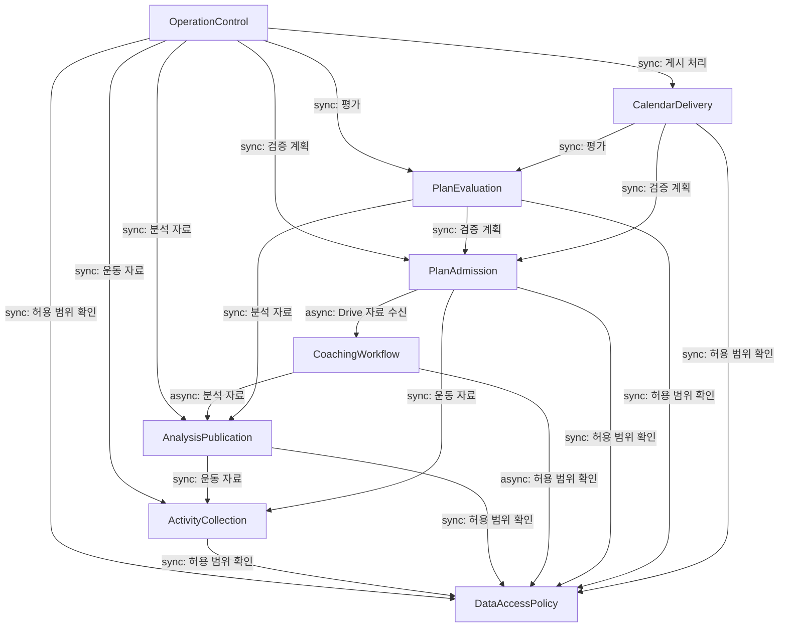

# Garmin Training Agent 컴포넌트 설계

- 작성일: 2026-11-17
- 근거: [승인된 상세 요구사항](../requirements-analysis/requirements.md), [도메인 질문과 확인한 요약](domain-design-questions.md).
- 대상: 초기 P0의 논리적 책임·데이터 소유·호출/자료 교환 경계. 제품 구현·실제 연동 성공의 증거가 아니다.
- 목록의 `name`과 엔티티 이름은 안정적인 설계 참조다. 배포 단위는 Units Generation, 형식·API·승인 증명은 Contract Design, 자료형·필드 제약·관계 수는 Functional Design에서 정한다.

## Component Catalogue

다음 YAML이 컴포넌트·엔티티·의존 관계의 기준이다. 속성은 이름과 소유 경계까지만 기술한다. 엔티티 참조는 소유권 이전이나 직접 데이터 수정 권한을 뜻하지 않는다.

```yaml
components:
  - name: "OperationControl"
    summary: "CLI 설정과 예약 실행 및 처리 조정"
    behaviour: "두 실행 주기를 별도로 관리하고 로그아웃 중 예약 실행과 복귀 후 재개를 조정한다. 같은 PC 중복 작업을 제어하며 자식 처리의 성공을 추정하지 않고 반환된 상태를 집계한다. 삭제·취소는 영향 범위를 확인한 요청으로 소유자에게 전달한다."
    responsibilities:
      - "CLI 설정 및 유효 설정 조회"
      - "수집·동기화와 계획 확인 작업의 예약·즉시 실행·중복 제어"
      - "실행 결과 집계와 유지보수 요청 조정"
    depends_on:
      - component: "DataAccessPolicy"
        interaction: "연결·공유·보존 정책 설정 및 상태 조회"
        style: "sync"
      - component: "ActivityCollection"
        interaction: "수집 및 누락 구간 재검사"
        style: "sync"
      - component: "AnalysisPublication"
        interaction: "요약 갱신·대상별 게시·상태 조회"
        style: "sync"
      - component: "PlanAdmission"
        interaction: "계획 확인·검증·폐기/교체 요청 확인"
        style: "sync"
      - component: "PlanEvaluation"
        interaction: "평가 재시도와 상태 조회"
        style: "sync"
      - component: "CalendarDelivery"
        interaction: "일정 게시·취소·복구와 상태 조회"
        style: "sync"
    external_dependencies:
      - name: "Linux 예약 실행 환경"
        kind: "other"
        purpose: "로그아웃 중 실행과 등록·중단·재개(실제 지원 방식은 후속 결정)"
      - name: "로컬 영속 저장 수단(구현 미정)"
        kind: "other"
        purpose: "소유 데이터와 미완료 처리 상태의 로컬 우선 보존"
    entities:
      - name: "RuntimeConfiguration"
        identifier: "configurationId"
        attributes: ["configurationId","timezone","collectionScope","initialCollectionPeriod","collectionInterval","planCheckInterval","connectionIds","calendarDefaults","configurationRevision"]
        references:
          - entity: "ServiceConnection"
            owned_by: "DataAccessPolicy"
            relationship: "사용할 연결 설정을 식별자로 참조"
      - name: "ScheduleRegistration"
        identifier: "scheduleId"
        attributes: ["scheduleId","configurationId","jobPurpose","registeredAt","lastTriggeredAt","nextPlannedAt","scheduleState"]
      - name: "ExecutionRecord"
        identifier: "executionId"
        attributes: ["executionId","scheduleId","triggerSource","startedAt","finishedAt","childWorkRefs","executionOutcome","recoveryHint"]
      - name: "MaintenanceRequest"
        identifier: "maintenanceRequestId"
        attributes: ["maintenanceRequestId","requestedAt","requestPurpose","affectedObjectRefs","confirmedImpact","ownerOutcomes"]
    dependents: []
  - name: "DataAccessPolicy"
    summary: "외부 연결과 비밀 참조 및 공유·보존 정책"
    behaviour: "서비스별 연결 권한·비공개 대상·공유 목적과 허용 범위를 관리한다. 인증정보는 보호 수단의 참조로 다루고 문서·로그에 노출하지 않는다. 동의 전 또는 정책 최신성/허용 여부를 확인할 수 없으면 관련 신규 전송을 보류한다. 보존 기간 미설정 시 자동 삭제를 허용하지 않는다."
    responsibilities:
      - "연결·인증 참조와 권한 상태 관리"
      - "서비스별 공유 동의와 금지 필드 판단"
      - "보존 정책과 허용 범위 조회"
    depends_on: []
    external_dependencies:
      - name: "서비스별 인증·권한 확인 수단"
        kind: "third-party-api"
        purpose: "연결 가능한 실제 권한 확인(공식 계약 미검증)"
      - name: "보호된 인증정보 보관 수단(구현 미정)"
        kind: "other"
        purpose: "인증정보 등록·갱신·사용 참조"
      - name: "로컬 영속 저장 수단(구현 미정)"
        kind: "other"
        purpose: "소유 데이터와 미완료 처리 상태의 로컬 우선 보존"
    entities:
      - name: "ServiceConnection"
        identifier: "connectionId"
        attributes: ["connectionId","serviceName","accountReference","targetReference","credentialReferenceId","permissionSummary","connectionState","checkedAt","endpointReference","modelReference"]
      - name: "CredentialReference"
        identifier: "credentialReferenceId"
        attributes: ["credentialReferenceId","protectedStoreReference","serviceName","registeredAt","rotationState"]
      - name: "SharingConsent"
        identifier: "consentId"
        attributes: ["consentId","connectionId","purpose","allowedFields","excludedFields","consentRevision","confirmedAt","withdrawnAt"]
      - name: "RetentionPolicy"
        identifier: "retentionPolicyId"
        attributes: ["retentionPolicyId","dataScope","retentionPeriod","configuredAt","deletionImpactPolicy","remoteRecoveryLimit"]
    dependents:
      - component: "OperationControl"
        interaction: "연결·공유·보존 정책 설정 및 상태 조회"
      - component: "ActivityCollection"
        interaction: "Garmin 연결·수집 허용 범위·인증 참조 확인"
      - component: "AnalysisPublication"
        interaction: "저장소 연결·비공개·허용 필드·보존 정책 확인"
      - component: "CoachingWorkflow"
        interaction: "사용자가 확인한 해당 환경의 공유·권한 정책을 교환 자료로 확인"
      - component: "PlanAdmission"
        interaction: "Drive 읽기 권한·사용자 범위·허용 행위 정책 확인"
      - component: "PlanEvaluation"
        interaction: "LLM 연결·인증 참조·목적별 공유 필드 확인"
      - component: "CalendarDelivery"
        interaction: "대상 캘린더 권한·허용 필드 확인"
  - name: "ActivityCollection"
    summary: "Garmin 운동 사실과 수집 진행 상태"
    behaviour: "허용된 목록·상세·수정 기록을 수집해 로컬에 확정한다. 외부 운동 식별자와 종목·단위·출처를 보존하며 누락과 실제 0을 구분한다. 유효 운동은 보존하고 실패/미완료 항목은 수집 범위에서 구분하여 재개한다. 원천 수정과 외부 게시 사본 충돌을 혼동하지 않는다."
    responsibilities:
      - "운동 기록의 신규·수정 수집과 정규화"
      - "중복 운동 방지 및 수집 커서 확정"
      - "부분 오류·제한·누락 범위 보존"
    depends_on:
      - component: "DataAccessPolicy"
        interaction: "Garmin 연결·수집 허용 범위·인증 참조 확인"
        style: "sync"
    external_dependencies:
      - name: "Garmin Personal API"
        kind: "third-party-api"
        purpose: "실제 허용된 운동 목록·상세·수정 정보 조회(계약·지표 미검증)"
      - name: "로컬 영속 저장 수단(구현 미정)"
        kind: "other"
        purpose: "소유 데이터와 미완료 처리 상태의 로컬 우선 보존"
    entities:
      - name: "ActivityRecord"
        identifier: "activityId"
        attributes: ["activityId","sourceActivityId","sourceConnectionId","sport","startedAt","sourceTimezone","measurements","sourceRevision","collectedAt","completeness"]
        references:
          - entity: "ServiceConnection"
            owned_by: "DataAccessPolicy"
            relationship: "수집 원천 연결을 참조"
      - name: "CollectionCursor"
        identifier: "collectionCursorId"
        attributes: ["collectionCursorId","sourceConnectionId","requestedPeriod","confirmedPosition","pendingRanges","lastSuccessfulAt"]
        references:
          - entity: "ServiceConnection"
            owned_by: "DataAccessPolicy"
            relationship: "수집 진행의 원천 연결을 참조"
      - name: "CollectionIssue"
        identifier: "collectionIssueId"
        attributes: ["collectionIssueId","collectionCursorId","sourceActivityReference","issueCategory","observedAt","retryState","userAction"]
    dependents:
      - component: "OperationControl"
        interaction: "수집 및 누락 구간 재검사"
      - component: "AnalysisPublication"
        interaction: "확정 운동과 변경·수집 완전성 조회"
      - component: "PlanAdmission"
        interaction: "안전 검증에 필요한 허용 운동 근거와 수정 상태 조회"
  - name: "AnalysisPublication"
    summary: "분석 산출물과 GitHub·Drive 독립 게시"
    behaviour: "확정 운동 자료에서 종목별 기간 요약·구조화 자료를 재생성하고 원천·기간·버전·불완전성을 표시한다. 로컬 산출물을 먼저 확정한 뒤 대상별 허용 필드만 게시하며 성공·실패·미확인과 충돌을 독립 보존한다. 목표·계획 전달 파일을 덮어쓰지 않는다."
    responsibilities:
      - "기간별 분석 요약과 탐색 자료 생성"
      - "원천 수정에 따른 산출물 갱신"
      - "GitHub·Drive 분석 자료의 독립 게시·중복·충돌 처리"
    depends_on:
      - component: "ActivityCollection"
        interaction: "확정 운동과 변경·수집 완전성 조회"
        style: "sync"
      - component: "DataAccessPolicy"
        interaction: "저장소 연결·비공개·허용 필드·보존 정책 확인"
        style: "sync"
    external_dependencies:
      - name: "GitHub API"
        kind: "third-party-api"
        purpose: "허용한 비공개 대상에 분석 자료 게시·대조"
      - name: "Google Drive API"
        kind: "third-party-api"
        purpose: "허용한 분석 자료 게시·충돌 대조(실제 형식 미정)"
      - name: "로컬 영속 저장 수단(구현 미정)"
        kind: "other"
        purpose: "소유 데이터와 미완료 처리 상태의 로컬 우선 보존"
    entities:
      - name: "AnalysisSnapshot"
        identifier: "analysisSnapshotId"
        attributes: ["analysisSnapshotId","activityRevisionReferences","period","timezone","sportSummaries","structuredData","sourceMetadata","schemaVersion","generatedAt","completeness"]
        references:
          - entity: "ActivityRecord"
            owned_by: "ActivityCollection"
            relationship: "요약 근거 운동을 참조"
      - name: "RepositoryPublication"
        identifier: "repositoryPublicationId"
        attributes: ["repositoryPublicationId","analysisSnapshotId","connectionId","consentRevision","remoteObjectReferences","publicationState","createdAt","updatedAt","lastConfirmedAt"]
        references:
          - entity: "ServiceConnection"
            owned_by: "DataAccessPolicy"
            relationship: "게시 대상 연결을 참조"
          - entity: "SharingConsent"
            owned_by: "DataAccessPolicy"
            relationship: "적용한 공유 허용 범위를 참조"
      - name: "RepositoryConflict"
        identifier: "repositoryConflictId"
        attributes: ["repositoryConflictId","repositoryPublicationId","localRevision","remoteRevision","remoteChangeSummary","detectedAt","resolutionRequest"]
    dependents:
      - component: "OperationControl"
        interaction: "요약 갱신·대상별 게시·상태 조회"
      - component: "CoachingWorkflow"
        interaction: "GitHub/Drive에 게시된 분석 스냅샷을 비동기 자료로 읽음"
      - component: "PlanEvaluation"
        interaction: "평가에 사용 가능한 분석 스냅샷 조회"
  - name: "CoachingWorkflow"
    summary: "ChatGPT 목표·계획 작성과 명시적 승인 의사·저장 확인"
    behaviour: "사용자에게 부족한 목표 정보만 확인하고 러닝 계획·개정·근거·불확실성을 제시한다. 사용자 승인 의사는 정확한 작성 버전에 결합하되 수신 측의 신뢰 검증을 대신하지 않는다. Drive 실제 저장 확인 전 성공을 말하지 않는다. 읽기·쓰기 미지원 시 허용 대안을 안내하며 지원을 가정하지 않는다."
    responsibilities:
      - "ChatGPT에서 목표 확인·계획 작성·수정 안내"
      - "명시적 사용자 승인 의사의 출처와 대상 버전 보존"
      - "목표·계획·승인 의사 자료의 Drive 저장 및 결과 확인"
    depends_on:
      - component: "AnalysisPublication"
        interaction: "GitHub/Drive에 게시된 분석 스냅샷을 비동기 자료로 읽음"
        style: "async"
      - component: "DataAccessPolicy"
        interaction: "사용자가 확인한 해당 환경의 공유·권한 정책을 교환 자료로 확인"
        style: "async"
    external_dependencies:
      - name: "ChatGPT 클라이언트와 연결 도구"
        kind: "other"
        purpose: "작성할 워크플로 정의의 실행·자료 읽기·저장(환경별 지원 미검증)"
      - name: "Google Drive 저장·읽기 수단"
        kind: "third-party-api"
        purpose: "목표·계획 작성본과 승인 의사 자료 전달(직접/수동 대안 검증 필요)"
    entities:
      - name: "TrainingGoal"
        identifier: "goalId"
        attributes: ["goalId","sport","targetDistance","performanceTarget","targetDate","availability","weeklyFrequency","fixedActivities","constraints","goalRevision"]
      - name: "AuthoredPlanVersion"
        identifier: "authoredPlanVersionId"
        attributes: ["authoredPlanVersionId","planId","goalId","previousVersionId","sourceAnalysisReferences","period","weeklyObjectives","restDays","assumptions","changeReason","authoredAt","authoringState"]
        references:
          - entity: "AnalysisSnapshot"
            owned_by: "AnalysisPublication"
            relationship: "계획 작성에 사용한 분석 스냅샷을 참조"
      - name: "AuthoredSession"
        identifier: "authoredSessionVersionId"
        attributes: ["authoredSessionVersionId","authoredPlanVersionId","sessionId","plannedDate","plannedTime","timezone","sport","duration","distance","intensityBasis","sessionInstructions"]
      - name: "ApprovalDeclaration"
        identifier: "approvalDeclarationId"
        attributes: ["approvalDeclarationId","authoredPlanVersionId","contentReference","userReference","approvalScope","userStatementReference","declaredAt"]
      - name: "PlanTransferReceipt"
        identifier: "planTransferReceiptId"
        attributes: ["planTransferReceiptId","authoredPlanVersionId","approvalDeclarationId","driveObjectReference","transferResult","verifiedAt","failureReason"]
      - name: "AuthoredPlanInstruction"
        identifier: "authoredPlanInstructionId"
        attributes: ["authoredPlanInstructionId","authoredPlanVersionId","requestedPurpose","replacementVersionReference","userStatementReference","impactScope","requestedAt"]
    dependents:
      - component: "PlanAdmission"
        interaction: "Drive에 저장된 작성본·승인 의사·저장 결과 자료 수신"
  - name: "PlanAdmission"
    summary: "Drive 자료 수신과 승인 근거 검증·게시 적격 판단"
    behaviour: "수신 자료를 불신 데이터로 처리하고 완전성·버전·허용 행위·사용자 승인 근거와 안전 기준을 검사한다. 검증한 내용의 스냅샷과 판정 근거를 로컬에 보존하며 미확인·부분 작성·동시 변경·구버전은 보류한다. 파일의 approved 표기나 LLM 응답을 승인으로 인정하지 않는다. 폐기·교체·취소도 승인된 적용 범위를 검사한다."
    responsibilities:
      - "Drive 계획·승인/처분 자료 확인과 충돌 감지"
      - "검증된 정확한 내용·승인 근거·안전 판정의 로컬 보존"
      - "게시 전 최신 적격성 재확인과 폐기·교체·취소 검증"
    depends_on:
      - component: "CoachingWorkflow"
        interaction: "Drive에 저장된 작성본·승인 의사·저장 결과 자료 수신"
        style: "async"
      - component: "ActivityCollection"
        interaction: "안전 검증에 필요한 허용 운동 근거와 수정 상태 조회"
        style: "sync"
      - component: "DataAccessPolicy"
        interaction: "Drive 읽기 권한·사용자 범위·허용 행위 정책 확인"
        style: "sync"
    external_dependencies:
      - name: "Google Drive API"
        kind: "third-party-api"
        purpose: "계획·승인 자료·변경 여부 조회(형식·신뢰 계약 미정)"
      - name: "로컬 영속 저장 수단(구현 미정)"
        kind: "other"
        purpose: "소유 데이터와 미완료 처리 상태의 로컬 우선 보존"
    entities:
      - name: "ReceivedPlanArtifact"
        identifier: "receivedPlanArtifactId"
        attributes: ["receivedPlanArtifactId","remoteObjectReference","remoteRevision","receivedAt","rawContentReference","sourceVersionReference","completeness","conflictSummary","sourceInstructionReference"]
      - name: "ApprovalProof"
        identifier: "approvalProofId"
        attributes: ["approvalProofId","receivedPlanArtifactId","sourceDeclarationReference","verifiedUserReference","verifiedContentReference","approvalScope","verificationBasis","verifiedAt"]
        references:
          - entity: "ApprovalDeclaration"
            owned_by: "CoachingWorkflow"
            relationship: "검증 대상이었던 승인 의사를 참조"
      - name: "AdmittedPlanSnapshot"
        identifier: "admittedPlanSnapshotId"
        attributes: ["admittedPlanSnapshotId","sourcePlanVersionReference","contentReference","approvalProofId","goalSnapshot","sessionSnapshots","sourceDataReferences","admittedAt"]
        references:
          - entity: "AuthoredPlanVersion"
            owned_by: "CoachingWorkflow"
            relationship: "원 작성 버전의 계보만 참조하며 검증 사본 내용은 별도 보존"
          - entity: "ActivityRecord"
            owned_by: "ActivityCollection"
            relationship: "검증에 사용한 운동 자료를 참조"
      - name: "AdmissionAssessment"
        identifier: "admissionAssessmentId"
        attributes: ["admissionAssessmentId","admittedPlanSnapshotId","receivedPlanArtifactId","validationPolicyReference","sourceDataRevisionReferences","assessmentOutcome","blockingReasons","assessedAt","evaluationEvidenceReference"]
        references:
          - entity: "EvaluationResult"
            owned_by: "PlanEvaluation"
            relationship: "CalendarDelivery가 전달한 평가 근거를 참조하며 PlanEvaluation을 역호출하지 않음"
      - name: "AdmittedPlanDisposition"
        identifier: "admittedPlanDispositionId"
        attributes: ["admittedPlanDispositionId","affectedPlanSnapshotReference","replacementSnapshotReference","sourceRequestReference","verifiedApprovalReference","confirmedImpact","dispositionAssessment","assessedAt"]
        references:
          - entity: "AuthoredPlanInstruction"
            owned_by: "CoachingWorkflow"
            relationship: "Drive에서 수신하여 승인 범위를 검증한 원 요청을 참조"
    dependents:
      - component: "OperationControl"
        interaction: "계획 확인·검증·폐기/교체 요청 확인"
      - component: "PlanEvaluation"
        interaction: "검증 스냅샷과 적격 판단 조회"
      - component: "CalendarDelivery"
        interaction: "평가 근거를 전달하여 게시 직전 적격 버전·승인 근거와 변경/취소 범위 확인"
  - name: "PlanEvaluation"
    summary: "허용 자료에 대한 LLM 평가와 조정 제안"
    behaviour: "검증 스냅샷과 허용된 분석 자료를 사용해 원격 또는 로컬/사설 LLM을 평가한다. 결과의 형식·근거·한계를 검사하고 잘못된 수치를 적용하지 않는다. 결과는 평가/제안 상태로 보존하며 계획·승인·게시 상태를 직접 바꾸지 않는다. 오류·타임아웃·금지 전송은 별도로 남긴다."
    responsibilities:
      - "평가 요청과 사용 입력 버전 보존"
      - "원격 및 로컬/사설 연결 유형 평가·오류 처리"
      - "결과 검증·불확실성·조정 제안과 실패 기록"
    depends_on:
      - component: "PlanAdmission"
        interaction: "검증 스냅샷과 적격 판단 조회"
        style: "sync"
      - component: "AnalysisPublication"
        interaction: "평가에 사용 가능한 분석 스냅샷 조회"
        style: "sync"
      - component: "DataAccessPolicy"
        interaction: "LLM 연결·인증 참조·목적별 공유 필드 확인"
        style: "sync"
    external_dependencies:
      - name: "OpenAI 호환 원격 LLM API"
        kind: "third-party-api"
        purpose: "선정 후 실제 호환성을 확인할 원격 평가 유형"
      - name: "OpenAI 호환 로컬/사설 LLM API"
        kind: "third-party-api"
        purpose: "선정 후 실제 호환성·하드웨어를 확인할 로컬/사설 평가 유형"
      - name: "로컬 영속 저장 수단(구현 미정)"
        kind: "other"
        purpose: "소유 데이터와 미완료 처리 상태의 로컬 우선 보존"
    entities:
      - name: "EvaluationRequest"
        identifier: "evaluationRequestId"
        attributes: ["evaluationRequestId","admittedPlanSnapshotId","analysisSnapshotReferences","connectionId","modelReference","consentRevision","requestInputReference","requestedAt"]
        references:
          - entity: "AdmittedPlanSnapshot"
            owned_by: "PlanAdmission"
            relationship: "평가할 정확한 검증 계획을 참조"
          - entity: "AnalysisSnapshot"
            owned_by: "AnalysisPublication"
            relationship: "사용한 분석 입력을 참조"
          - entity: "ServiceConnection"
            owned_by: "DataAccessPolicy"
            relationship: "선택한 LLM 연결을 참조"
          - entity: "SharingConsent"
            owned_by: "DataAccessPolicy"
            relationship: "전송에 적용한 동의를 참조"
      - name: "EvaluationResult"
        identifier: "evaluationResultId"
        attributes: ["evaluationResultId","evaluationRequestId","evaluatedContentReference","evaluationOutcome","findings","proposedAdjustments","evidenceReferences","assumptions","limitations","completedAt","failureReason"]
    dependents:
      - component: "OperationControl"
        interaction: "평가 재시도와 상태 조회"
      - component: "CalendarDelivery"
        interaction: "동일 버전 평가 요청·결과/실패 조회"
  - name: "CalendarDelivery"
    summary: "검증 계획의 Calendar 반영과 연결·충돌·복구"
    behaviour: "현재 적격한 정확한 승인 스냅샷의 세션만 허용 캘린더에 반영한다. 평가 실패는 고지하고 기존 승인·형식·안전 검증 통과 버전을 변경 없이 게시할 수 있으나 오류 평가 결과나 미승인 조정안은 적용하지 않는다. 사용자 수정과 원격 결과 미확인은 대조·보류하며 세션별 중복·부분 성공·취소를 추적한다."
    responsibilities:
      - "게시 요청과 캘린더 세션 연결의 로컬 보존"
      - "검증 버전 세션의 생성·갱신·취소와 중복 방지"
      - "사용자 수정 충돌·부분 실패·응답 유실 복구"
    depends_on:
      - component: "PlanAdmission"
        interaction: "평가 근거를 전달하여 게시 직전 적격 버전·승인 근거와 변경/취소 범위 확인"
        style: "sync"
      - component: "PlanEvaluation"
        interaction: "동일 버전 평가 요청·결과/실패 조회"
        style: "sync"
      - component: "DataAccessPolicy"
        interaction: "대상 캘린더 권한·허용 필드 확인"
        style: "sync"
    external_dependencies:
      - name: "Google Calendar API"
        kind: "third-party-api"
        purpose: "선택한 캘린더 이벤트 조회·생성·수정·취소(권한·충돌 계약 미검증)"
      - name: "로컬 영속 저장 수단(구현 미정)"
        kind: "other"
        purpose: "소유 데이터와 미완료 처리 상태의 로컬 우선 보존"
    entities:
      - name: "PublicationIntent"
        identifier: "publicationIntentId"
        attributes: ["publicationIntentId","admittedPlanSnapshotId","sourceSessionReference","calendarConnectionId","admissionAssessmentReference","evaluationResultReference","requestedEffect","confirmedImpact","intentState"]
        references:
          - entity: "AdmittedPlanSnapshot"
            owned_by: "PlanAdmission"
            relationship: "게시할 원본 검증 스냅샷을 참조"
          - entity: "AdmissionAssessment"
            owned_by: "PlanAdmission"
            relationship: "게시 적격성 판정을 참조"
          - entity: "EvaluationResult"
            owned_by: "PlanEvaluation"
            relationship: "평가 결과 또는 확인된 실패를 참조"
          - entity: "ServiceConnection"
            owned_by: "DataAccessPolicy"
            relationship: "게시 대상 캘린더 연결을 참조"
      - name: "CalendarBinding"
        identifier: "calendarBindingId"
        attributes: ["calendarBindingId","publicationIntentId","sourcePlanReference","sourceSessionReference","remoteEventReference","lastConfirmedRemoteRevision","lastAppliedContentReference","bindingState"]
      - name: "DeliveryAttempt"
        identifier: "deliveryAttemptId"
        attributes: ["deliveryAttemptId","publicationIntentId","calendarBindingId","startedAt","finishedAt","remoteOutcome","retryState","failureReason"]
      - name: "CalendarConflict"
        identifier: "calendarConflictId"
        attributes: ["calendarConflictId","calendarBindingId","expectedContentReference","observedRemoteRevision","userChangeSummary","detectedAt","resolutionRequest"]
    dependents:
      - component: "OperationControl"
        interaction: "일정 게시·취소·복구와 상태 조회"
```

## Component Diagram

화살표는 사용하는 쪽에서 제공하는 쪽으로 향한다. `sync`는 요청/결과 형태의 논리적 호출, `async`는 저장 자료를 통한 시차 있는 교환이다. 물리적 네트워크 프로토콜이나 프로세스 배치를 확정한 표시는 아니다. 특히 CoachingWorkflow의 연결은 GitHub/Drive 자료와 명시적인 사용자 확인을 통한 비동기 교환이며 ChatGPT의 PC 직접 호출이 아니다.



텍스트 대체 설명: OperationControl이 설정과 실행을 조정한다. ActivityCollection은 DataAccessPolicy에서 허용 범위를 확인해 운동을 수집한다. AnalysisPublication은 운동으로 분석 자료를 만들고 허용된 GitHub/Drive에 게시한다. CoachingWorkflow는 게시 자료와 확인한 정책을 읽어 목표·계획·승인 의사를 Drive에 남긴다. PlanAdmission은 그 자료와 운동 근거·허용 범위를 검사해 검증 스냅샷을 보존한다. PlanEvaluation은 해당 스냅샷과 분석 자료를 허용된 LLM에 평가한다. CalendarDelivery는 평가 근거를 받아 PlanAdmission에 최종 적격 판정을 요청하고 DataAccessPolicy의 허용 범위에서 일정을 반영한다.

## Component Summary

| Component | Purpose | Depends On | Dependents | Entities Owned |
|---|---|---|---|---|
| OperationControl | CLI 설정과 예약 실행 및 처리 조정 | DataAccessPolicy, ActivityCollection, AnalysisPublication, PlanAdmission, PlanEvaluation, CalendarDelivery | 없음 | RuntimeConfiguration, ScheduleRegistration, ExecutionRecord, MaintenanceRequest |
| DataAccessPolicy | 외부 연결과 비밀 참조 및 공유·보존 정책 | 없음 | OperationControl, ActivityCollection, AnalysisPublication, CoachingWorkflow, PlanAdmission, PlanEvaluation, CalendarDelivery | ServiceConnection, CredentialReference, SharingConsent, RetentionPolicy |
| ActivityCollection | Garmin 운동 사실과 수집 진행 상태 | DataAccessPolicy | OperationControl, AnalysisPublication, PlanAdmission | ActivityRecord, CollectionCursor, CollectionIssue |
| AnalysisPublication | 분석 산출물과 GitHub·Drive 독립 게시 | ActivityCollection, DataAccessPolicy | OperationControl, CoachingWorkflow, PlanEvaluation | AnalysisSnapshot, RepositoryPublication, RepositoryConflict |
| CoachingWorkflow | ChatGPT 목표·계획 작성과 명시적 승인 의사·저장 확인 | AnalysisPublication, DataAccessPolicy | PlanAdmission | TrainingGoal, AuthoredPlanVersion, AuthoredSession, ApprovalDeclaration, PlanTransferReceipt, AuthoredPlanInstruction |
| PlanAdmission | Drive 자료 수신과 승인 근거 검증·게시 적격 판단 | CoachingWorkflow, ActivityCollection, DataAccessPolicy | OperationControl, PlanEvaluation, CalendarDelivery | ReceivedPlanArtifact, ApprovalProof, AdmittedPlanSnapshot, AdmissionAssessment, AdmittedPlanDisposition |
| PlanEvaluation | 허용 자료에 대한 LLM 평가와 조정 제안 | PlanAdmission, AnalysisPublication, DataAccessPolicy | OperationControl, CalendarDelivery | EvaluationRequest, EvaluationResult |
| CalendarDelivery | 검증 계획의 Calendar 반영과 연결·충돌·복구 | PlanAdmission, PlanEvaluation, DataAccessPolicy | OperationControl | PublicationIntent, CalendarBinding, DeliveryAttempt, CalendarConflict |

## Entity Ownership

| Entity | Owning Component | Identifier | Attributes | References |
|---|---|---|---|---|
| RuntimeConfiguration | OperationControl | configurationId | configurationId, timezone, collectionScope, initialCollectionPeriod, collectionInterval, planCheckInterval, connectionIds, calendarDefaults, configurationRevision | DataAccessPolicy.ServiceConnection: 사용할 연결 설정을 식별자로 참조 |
| ScheduleRegistration | OperationControl | scheduleId | scheduleId, configurationId, jobPurpose, registeredAt, lastTriggeredAt, nextPlannedAt, scheduleState | 컴포넌트 간 참조 없음 |
| ExecutionRecord | OperationControl | executionId | executionId, scheduleId, triggerSource, startedAt, finishedAt, childWorkRefs, executionOutcome, recoveryHint | 컴포넌트 간 참조 없음 |
| MaintenanceRequest | OperationControl | maintenanceRequestId | maintenanceRequestId, requestedAt, requestPurpose, affectedObjectRefs, confirmedImpact, ownerOutcomes | 컴포넌트 간 참조 없음 |
| ServiceConnection | DataAccessPolicy | connectionId | connectionId, serviceName, accountReference, targetReference, credentialReferenceId, permissionSummary, connectionState, checkedAt, endpointReference, modelReference | 컴포넌트 간 참조 없음 |
| CredentialReference | DataAccessPolicy | credentialReferenceId | credentialReferenceId, protectedStoreReference, serviceName, registeredAt, rotationState | 컴포넌트 간 참조 없음 |
| SharingConsent | DataAccessPolicy | consentId | consentId, connectionId, purpose, allowedFields, excludedFields, consentRevision, confirmedAt, withdrawnAt | 컴포넌트 간 참조 없음 |
| RetentionPolicy | DataAccessPolicy | retentionPolicyId | retentionPolicyId, dataScope, retentionPeriod, configuredAt, deletionImpactPolicy, remoteRecoveryLimit | 컴포넌트 간 참조 없음 |
| ActivityRecord | ActivityCollection | activityId | activityId, sourceActivityId, sourceConnectionId, sport, startedAt, sourceTimezone, measurements, sourceRevision, collectedAt, completeness | DataAccessPolicy.ServiceConnection: 수집 원천 연결을 참조 |
| CollectionCursor | ActivityCollection | collectionCursorId | collectionCursorId, sourceConnectionId, requestedPeriod, confirmedPosition, pendingRanges, lastSuccessfulAt | DataAccessPolicy.ServiceConnection: 수집 진행의 원천 연결을 참조 |
| CollectionIssue | ActivityCollection | collectionIssueId | collectionIssueId, collectionCursorId, sourceActivityReference, issueCategory, observedAt, retryState, userAction | 컴포넌트 간 참조 없음 |
| AnalysisSnapshot | AnalysisPublication | analysisSnapshotId | analysisSnapshotId, activityRevisionReferences, period, timezone, sportSummaries, structuredData, sourceMetadata, schemaVersion, generatedAt, completeness | ActivityCollection.ActivityRecord: 요약 근거 운동을 참조 |
| RepositoryPublication | AnalysisPublication | repositoryPublicationId | repositoryPublicationId, analysisSnapshotId, connectionId, consentRevision, remoteObjectReferences, publicationState, createdAt, updatedAt, lastConfirmedAt | DataAccessPolicy.ServiceConnection: 게시 대상 연결을 참조; DataAccessPolicy.SharingConsent: 적용한 공유 허용 범위를 참조 |
| RepositoryConflict | AnalysisPublication | repositoryConflictId | repositoryConflictId, repositoryPublicationId, localRevision, remoteRevision, remoteChangeSummary, detectedAt, resolutionRequest | 컴포넌트 간 참조 없음 |
| TrainingGoal | CoachingWorkflow | goalId | goalId, sport, targetDistance, performanceTarget, targetDate, availability, weeklyFrequency, fixedActivities, constraints, goalRevision | 컴포넌트 간 참조 없음 |
| AuthoredPlanVersion | CoachingWorkflow | authoredPlanVersionId | authoredPlanVersionId, planId, goalId, previousVersionId, sourceAnalysisReferences, period, weeklyObjectives, restDays, assumptions, changeReason, authoredAt, authoringState | AnalysisPublication.AnalysisSnapshot: 계획 작성에 사용한 분석 스냅샷을 참조 |
| AuthoredSession | CoachingWorkflow | authoredSessionVersionId | authoredSessionVersionId, authoredPlanVersionId, sessionId, plannedDate, plannedTime, timezone, sport, duration, distance, intensityBasis, sessionInstructions | 컴포넌트 간 참조 없음 |
| ApprovalDeclaration | CoachingWorkflow | approvalDeclarationId | approvalDeclarationId, authoredPlanVersionId, contentReference, userReference, approvalScope, userStatementReference, declaredAt | 컴포넌트 간 참조 없음 |
| PlanTransferReceipt | CoachingWorkflow | planTransferReceiptId | planTransferReceiptId, authoredPlanVersionId, approvalDeclarationId, driveObjectReference, transferResult, verifiedAt, failureReason | 컴포넌트 간 참조 없음 |
| AuthoredPlanInstruction | CoachingWorkflow | authoredPlanInstructionId | authoredPlanInstructionId, authoredPlanVersionId, requestedPurpose, replacementVersionReference, userStatementReference, impactScope, requestedAt | 컴포넌트 간 참조 없음 |
| ReceivedPlanArtifact | PlanAdmission | receivedPlanArtifactId | receivedPlanArtifactId, remoteObjectReference, remoteRevision, receivedAt, rawContentReference, sourceVersionReference, completeness, conflictSummary, sourceInstructionReference | 컴포넌트 간 참조 없음 |
| ApprovalProof | PlanAdmission | approvalProofId | approvalProofId, receivedPlanArtifactId, sourceDeclarationReference, verifiedUserReference, verifiedContentReference, approvalScope, verificationBasis, verifiedAt | CoachingWorkflow.ApprovalDeclaration: 검증 대상이었던 승인 의사를 참조 |
| AdmittedPlanSnapshot | PlanAdmission | admittedPlanSnapshotId | admittedPlanSnapshotId, sourcePlanVersionReference, contentReference, approvalProofId, goalSnapshot, sessionSnapshots, sourceDataReferences, admittedAt | CoachingWorkflow.AuthoredPlanVersion: 원 작성 버전의 계보만 참조하며 검증 사본 내용은 별도 보존; ActivityCollection.ActivityRecord: 검증에 사용한 운동 자료를 참조 |
| AdmissionAssessment | PlanAdmission | admissionAssessmentId | admissionAssessmentId, admittedPlanSnapshotId, receivedPlanArtifactId, validationPolicyReference, sourceDataRevisionReferences, assessmentOutcome, blockingReasons, assessedAt, evaluationEvidenceReference | PlanEvaluation.EvaluationResult: CalendarDelivery가 전달한 평가 근거를 참조하며 PlanEvaluation을 역호출하지 않음 |
| AdmittedPlanDisposition | PlanAdmission | admittedPlanDispositionId | admittedPlanDispositionId, affectedPlanSnapshotReference, replacementSnapshotReference, sourceRequestReference, verifiedApprovalReference, confirmedImpact, dispositionAssessment, assessedAt | CoachingWorkflow.AuthoredPlanInstruction: Drive에서 수신하여 승인 범위를 검증한 원 요청을 참조 |
| EvaluationRequest | PlanEvaluation | evaluationRequestId | evaluationRequestId, admittedPlanSnapshotId, analysisSnapshotReferences, connectionId, modelReference, consentRevision, requestInputReference, requestedAt | PlanAdmission.AdmittedPlanSnapshot: 평가할 정확한 검증 계획을 참조; AnalysisPublication.AnalysisSnapshot: 사용한 분석 입력을 참조; DataAccessPolicy.ServiceConnection: 선택한 LLM 연결을 참조; DataAccessPolicy.SharingConsent: 전송에 적용한 동의를 참조 |
| EvaluationResult | PlanEvaluation | evaluationResultId | evaluationResultId, evaluationRequestId, evaluatedContentReference, evaluationOutcome, findings, proposedAdjustments, evidenceReferences, assumptions, limitations, completedAt, failureReason | 컴포넌트 간 참조 없음 |
| PublicationIntent | CalendarDelivery | publicationIntentId | publicationIntentId, admittedPlanSnapshotId, sourceSessionReference, calendarConnectionId, admissionAssessmentReference, evaluationResultReference, requestedEffect, confirmedImpact, intentState | PlanAdmission.AdmittedPlanSnapshot: 게시할 원본 검증 스냅샷을 참조; PlanAdmission.AdmissionAssessment: 게시 적격성 판정을 참조; PlanEvaluation.EvaluationResult: 평가 결과 또는 확인된 실패를 참조; DataAccessPolicy.ServiceConnection: 게시 대상 캘린더 연결을 참조 |
| CalendarBinding | CalendarDelivery | calendarBindingId | calendarBindingId, publicationIntentId, sourcePlanReference, sourceSessionReference, remoteEventReference, lastConfirmedRemoteRevision, lastAppliedContentReference, bindingState | 컴포넌트 간 참조 없음 |
| DeliveryAttempt | CalendarDelivery | deliveryAttemptId | deliveryAttemptId, publicationIntentId, calendarBindingId, startedAt, finishedAt, remoteOutcome, retryState, failureReason | 컴포넌트 간 참조 없음 |
| CalendarConflict | CalendarDelivery | calendarConflictId | calendarConflictId, calendarBindingId, expectedContentReference, observedRemoteRevision, userChangeSummary, detectedAt, resolutionRequest | 컴포넌트 간 참조 없음 |

같은 소유자 내부의 연결은 속성 이름에 나타나며 표의 References는 다른 소유자의 엔티티만 나열한다. 원격 ID·버전·내용 참조의 실제 인코딩/검증법과 보관 형식은 계약 설계에서 확정한다. 인증정보 값은 엔티티 속성으로 교환하지 않는다.

## External Dependencies

| Component | Dependency | Kind | Purpose |
|---|---|---|---|
| OperationControl | Linux 예약 실행 환경 | other | 로그아웃 중 실행과 등록·중단·재개(실제 지원 방식은 후속 결정) |
| OperationControl | 로컬 영속 저장 수단(구현 미정) | other | 소유 데이터와 미완료 처리 상태의 로컬 우선 보존 |
| DataAccessPolicy | 서비스별 인증·권한 확인 수단 | third-party-api | 연결 가능한 실제 권한 확인(공식 계약 미검증) |
| DataAccessPolicy | 보호된 인증정보 보관 수단(구현 미정) | other | 인증정보 등록·갱신·사용 참조 |
| DataAccessPolicy | 로컬 영속 저장 수단(구현 미정) | other | 소유 데이터와 미완료 처리 상태의 로컬 우선 보존 |
| ActivityCollection | Garmin Personal API | third-party-api | 실제 허용된 운동 목록·상세·수정 정보 조회(계약·지표 미검증) |
| ActivityCollection | 로컬 영속 저장 수단(구현 미정) | other | 소유 데이터와 미완료 처리 상태의 로컬 우선 보존 |
| AnalysisPublication | GitHub API | third-party-api | 허용한 비공개 대상에 분석 자료 게시·대조 |
| AnalysisPublication | Google Drive API | third-party-api | 허용한 분석 자료 게시·충돌 대조(실제 형식 미정) |
| AnalysisPublication | 로컬 영속 저장 수단(구현 미정) | other | 소유 데이터와 미완료 처리 상태의 로컬 우선 보존 |
| CoachingWorkflow | ChatGPT 클라이언트와 연결 도구 | other | 작성할 워크플로 정의의 실행·자료 읽기·저장(환경별 지원 미검증) |
| CoachingWorkflow | Google Drive 저장·읽기 수단 | third-party-api | 목표·계획 작성본과 승인 의사 자료 전달(직접/수동 대안 검증 필요) |
| PlanAdmission | Google Drive API | third-party-api | 계획·승인 자료·변경 여부 조회(형식·신뢰 계약 미정) |
| PlanAdmission | 로컬 영속 저장 수단(구현 미정) | other | 소유 데이터와 미완료 처리 상태의 로컬 우선 보존 |
| PlanEvaluation | OpenAI 호환 원격 LLM API | third-party-api | 선정 후 실제 호환성을 확인할 원격 평가 유형 |
| PlanEvaluation | OpenAI 호환 로컬/사설 LLM API | third-party-api | 선정 후 실제 호환성·하드웨어를 확인할 로컬/사설 평가 유형 |
| PlanEvaluation | 로컬 영속 저장 수단(구현 미정) | other | 소유 데이터와 미완료 처리 상태의 로컬 우선 보존 |
| CalendarDelivery | Google Calendar API | third-party-api | 선택한 캘린더 이벤트 조회·생성·수정·취소(권한·충돌 계약 미검증) |
| CalendarDelivery | 로컬 영속 저장 수단(구현 미정) | other | 소유 데이터와 미완료 처리 상태의 로컬 우선 보존 |

로컬 영속 저장은 물리 기술을 선택하지 않은 의존 대상이다. 같은 저장 기술을 쓰더라도 다른 컴포넌트가 소유 데이터를 임의로 갱신하지 않는다. ChatGPT 워크플로 실행·연결 도구·Google/Garmin/GitHub/LLM의 환경별 기능과 권한은 아직 검증되지 않았다.

## Rationale

선택 전 비교는 질문 Q1에서 제시했다. A안(8개)은 작성/검증, 평가/게시, 설정/공유 정책의 수명주기를 분리한다. B안(6개)은 계약 수를 줄이지만 운영과 권한 및 작성과 검증의 내부 결합을 높인다. C안(4개)은 목록을 간단하게 만들지만 변경·검증 범위가 커진다. 요청자는 A안을 선택하고 역할 요약을 확인했다. 이 문서 전체는 단계 승인 대상으로 제시한다.

| Component | 분리 근거 | Alternatives Rejected | 결정 |
|---|---|---|---|
| OperationControl | 예약·중복 제어와 실행 집계가 도메인별 성공/실패 수명주기와 다름 | 각 도메인에 별도 예약·CLI 정책 중복 또는 전체 실행 상태로 상세 상태 대체 | ADR-001·003 |
| DataAccessPolicy | 연결·동의 철회·공유 필드·보존 정책은 모든 외부 전송에 공통으로 적용됨 | 운영 설정에 정책 판단을 묻거나 각 전송자가 독자 동의 상태 소유 | ADR-001·002 |
| ActivityCollection | Garmin 측정 사실·수정·수집 완전성의 소유자가 필요 | 요약·계획·LLM 결과가 원천 운동을 함께 갱신 | ADR-002 |
| AnalysisPublication | 원천에서 파생되는 분석 버전과 대상별 게시/충돌은 별도 수명주기 | 원천 수집 성공을 외부 게시 성공으로 처리, 계획 파일과 분석 파일의 동일 게시 책임 | ADR-001·002 |
| CoachingWorkflow | 대화·초안·승인 의사·저장 확인은 외부 환경의 작성 흐름 | 작성된 approved 값을 검증된 승인으로 그대로 승격 | ADR-001·002 |
| PlanAdmission | 외부 입력 완전성·승인 신뢰·적격 판단은 작성과 독립되어야 함 | 작성 도구 또는 LLM이 자신의 출력을 게시 가능으로 확정 | ADR-001·002·004 |
| PlanEvaluation | 제공자 오류·모델 출력·제안은 승인 및 게시 상태와 별도임 | 평가 성공을 승인으로 사용, 평가 실패로 기존 자료 삭제 | ADR-001·004 |
| CalendarDelivery | 세션/이벤트 연결·사용자 수정·응답 유실·부분 성공은 게시 대상의 상태임 | 계획 상태 하나로 모든 외부 일정 성공을 대체, 사용자 수정 무단 덮어쓰기 | ADR-001·004 |

## 자료의 기준과 상태 경계

| 자료/상태 | 기준과 소유자 | 다른 컴포넌트의 사용 |
|---|---|---|
| 측정 운동 사실·수집 완전성 | ActivityCollection.ActivityRecord·CollectionCursor | 분석·검증은 식별자/버전으로 조회하며 원천 사실을 덮어쓰지 않음 |
| 분석 파생 자료 | AnalysisPublication.AnalysisSnapshot | 작성·평가는 해당 버전/기간/완전성을 인용. 원천 변경 시 새로운 파생 결과로 대조 |
| 초안·개정·목표·원 승인 의사 | CoachingWorkflow의 작성 엔티티 | 외부 수신 시 불신 자료. ApprovalDeclaration만으로 게시 권한이 생기지 않음 |
| 검증 후 보존 계획 내용·승인 근거 | PlanAdmission.AdmittedPlanSnapshot·ApprovalProof | 게시/평가는 내용 참조가 같은 스냅샷을 사용. 원 작성본과 계보를 연결하되 같은 가변 객체로 취급하지 않음 |
| 현재 게시 적격성·폐기/교체/취소 범위 | PlanAdmission.AdmissionAssessment·AdmittedPlanDisposition | CalendarDelivery가 게시 직전 조회·확인. 새 버전·변경·취소·미확인 최신성은 재검증 필요 |
| 평가 결과·제안·오류 | PlanEvaluation.EvaluationResult | CalendarDelivery가 이를 근거로 PlanAdmission에 최종 판정을 요청. 승인·계획 변경을 직접 수행하지 않음 |
| 분석 저장소별 게시 결과 | AnalysisPublication.RepositoryPublication·RepositoryConflict | 실행 집계와 사용자 안내는 이 결과를 조회. 한 대상 실패가 타 대상 성공을 되돌리지 않음 |
| Calendar 세션 반영 결과 | CalendarDelivery.CalendarBinding·DeliveryAttempt·CalendarConflict | 실행 화면은 세션별 확정·부분 성공·미확인을 집계. 승인·Drive 저장과 구별 |
| 실행 전체 결과 | OperationControl.ExecutionRecord | 하위 소유자가 보고한 결과를 인용하며 해당 기록의 소유권을 가져오지 않음 |

상태 이름·허용 전이·검증 조건의 세부 명세는 기능 설계로 넘긴다. 이 표는 속성의 자료형·허용값 정의가 아니다.

## 주요 처리와 실패 책임

1. OperationControl이 수집 작업을 시작한다. ActivityCollection은 인증/허용 범위를 확인한 후 운동을 로컬에 확정하며 실패 범위·커서를 보존한다. AnalysisPublication은 확정 입력에서 산출물을 로컬에 확정한 뒤 대상별로 게시한다.
2. CoachingWorkflow는 실제 지원된 읽기/쓰기 경로로 목표·계획·승인 의사를 작성하고 저장 확인을 기록한다. 직접 저장이 불가한 환경의 수동 대안은 동일한 버전·완전성·승인 검증 조건을 만족해야 하며 미충족이면 보류한다.
3. PlanAdmission은 Drive의 새 자료를 검증한다. 작성본이 완전하고 승인 근거가 정확한 사용자·내용·행위에 결합되어야 검증 스냅샷을 보존한다. 신뢰 계약을 아직 선정하지 않았으므로 이 설계만으로 자동 게시 가능을 주장하지 않는다.
4. CalendarDelivery는 같은 스냅샷에 대한 PlanEvaluation의 결과/실패를 얻고 그 근거를 PlanAdmission에 전달해 게시 직전 판정을 받는다. **평가 입력용 스냅샷 수신**과 **실제 게시의 최종 적격 판정**은 구별한다. PlanAdmission이 평가자를 역호출하지 않으므로 호출 순환이 생기지 않는다.
5. 평가 근거가 오류·불완전·미확인이면 잘못된 내용을 계획에 적용하지 않는다. 확인된 평가 호출 실패는 기존 승인·형식·안전 검증을 통과한 변경 없는 스냅샷의 게시를 허용할 수 있다. 새 내용·미승인 조정·승인 검증 실패·미해소 안전 경고를 이 경로로 우회하지 않는다.
6. CalendarDelivery는 설정된 시간대·기본 운동 시각을 실행 입력으로 받아 세션별 시각을 우선한다. 설정의 원 소유자는 OperationControl이며 CalendarDelivery가 역호출하지 않는다. 대상 기본 알림을 따르고 사용자 수정·원격 결과 미확인은 대조 후 처리한다.
7. 세부 오류·대기·재시도 정보는 처리 소유자가 영속 보존한다. OperationControl은 재실행을 조정하고 결과를 집계한다. 여러 서비스의 성공을 하나의 원자적 외부 처리라고 주장하지 않는다.

CLI와 ChatGPT 워크플로가 사용자가 보는 진입점이다. 별도 GUI 컴포넌트는 이번 범위에 추가하지 않는다. 데이터 삭제·일정 취소는 OperationControl 또는 작성 워크플로에서 영향 범위를 확인해 요청하고 각 소유자가 자기 자료를 처리한다. 외부 잔존·실제 복구 가능 범위는 검증 후 안내한다.

## 비기능 책임 연결

| 요구사항 | 주 책임과 협력 |
|---|---|
| NFR1 | DataAccessPolicy가 비밀 참조를 소유하고 모든 전송자/실행 결과가 비밀 제외를 지킴 |
| NFR2 | DataAccessPolicy가 권한·비공개 정책 소유, AnalysisPublication·CoachingWorkflow·PlanAdmission·CalendarDelivery가 관련 요청 전 적용 |
| NFR3·NFR4 | DataAccessPolicy가 목적·서비스별 동의 소유, AnalysisPublication·CoachingWorkflow·PlanEvaluation·CalendarDelivery가 금지 필드 전송 차단 |
| NFR5 | ActivityCollection의 유일 운동, AnalysisPublication의 대상별 게시, PlanAdmission의 버전/스냅샷, CalendarDelivery의 세션 연결이 각각 무결성 소유; OperationControl은 중복 실행 제어 |
| NFR6 | OperationControl이 사용자 시간대 설정 소유, 각 도메인이 원천/분석/세션 시각 보존과 사용 책임 |
| NFR7·NFR10 | 각 처리자가 자기 결과를 보존, OperationControl이 비밀 없이 집계; PlanAdmission 승인 근거와 CalendarDelivery 게시 결과 분리 |
| NFR8 | 각 외부 처리자가 미완료·재시도 상태 소유, OperationControl이 복귀/재개 조정 |
| NFR9 | CoachingWorkflow·PlanEvaluation이 근거·불확실성 설명, PlanAdmission이 게시 검증을 맡으며 의학적 진단을 하지 않음 |
| NFR11 | 연결/저장/검증/평가/게시 소유자가 미검증·미지원·실제 성공을 구분하여 안내 |

## 후속 설계·검증 조건

- Contract Design: Drive 작성/검증 자료·분석 자료·정책 교환 자료의 위치/이름공간·스키마·내용 동일성·권한·승인 증명·최신성·동시 변경·형식 선택을 명세한다. 인증 참조는 교환 자료에 넣지 않는다.
- CoachingWorkflow의 분석/정책 교환과 PlanAdmission의 작성본 수신은 저장 자료 경로다. 해당 ChatGPT 환경이 자료/동의를 신뢰성 있게 확인할 수 없으면 전송·게시를 보류한다. 정책 동의 철회 후 새 요청을 막는 동기화/확인 계약은 실제 환경에서 검증해야 한다.
- Functional Design: 작성본/스냅샷/평가/게시 상태 전이, 승인·안전 규칙, 필드 자료형/검증/관계, 삭제·취소 영향, 재시도·원격 결과 미확인 처리의 상세 규칙을 정의한다.
- NFR Requirements/Design: 로그아웃 실행·기술 스택·로컬 영속 저장·비밀 보호 수단·실행 제한·재시도·자료 크기·자원 및 처리 지연 목표를 선정/검증한다. 이 문서는 해당 기술이나 가용성 수치를 확정하지 않는다.
- 실제 외부 지원 검증: Garmin 인증/지표/한도, ChatGPT 계정·웹/모바일 읽기·쓰기와 승인 근거, Google/GitHub 권한, LLM 두 연결 유형, Calendar 충돌/중복/복구 및 Ubuntu 로그아웃 실행의 증거가 필요하다.
- P1/P2·다중 PC·다종목 전용 계획·시계 직접 게시는 추가하지 않았다. 이번 컴포넌트 경계는 후속 기능 전체의 구현 약속이 아니다.

## 추적성과 검증 범위

[traceability.json](traceability.json)은 상위 FR 아래의 기능 요구사항 83개를 컴포넌트 또는 엔티티로 연결한다. 상위 FR는 하위 ID를 통해 추적하며 NFR 11개는 위 책임 표와 다음 NFR 단계로 연결한다. 구성 목록의 엔티티 31개는 소유자가 각각 하나다. 링크·소유자·참조·호출 관계 대칭·호출 순환·도표의 노드/간선·상류 ID와 대상 이름의 일치를 검사한다. 도표는 단순 노드/라벨 간선으로 제한한 Mermaid 문법을 작성 전에 검사했다. 문서 정합성 검사는 제품 실행·외부 API·의학적 타당성 검증을 대체하지 않는다.
