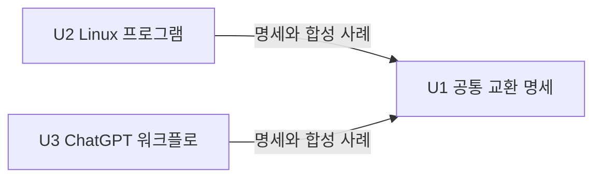

# 구현 단위 의존 관계

- 작성일: 2026-11-17
- 근거: [컴포넌트 목록](../domain-design/components.md), [도메인 ADR](../domain-design/decisions.md), [상세 요구사항](../requirements-analysis/requirements.md), [단위 정의](unit-of-work.md), [계획 확인](units-generation-questions.md).
- 범위: 단위 코드·정의와 필수 테스트가 빌드/통과에 요구하는 의존 관계. 경제적인 개발 순서·일정·인력·중요 경로는 정하지 않는다.

## 단위 의존 DAG

화살표 A→B는 A가 B의 산출물을 필요로 한다는 뜻이다. 다음 YAML이 단위 이름·kind·직접 의존 관계의 기준이다.

```yaml
units:
  - name: u1-exchange-spec
    kind: spec
    depends_on: []
  - name: u2-linux-agent
    kind: service
    depends_on: [u1-exchange-spec]
  - name: u3-chatgpt-workflow
    kind: spec
    depends_on: [u1-exchange-spec]
```



텍스트 대체: U2 u2-linux-agent와 U3 u3-chatgpt-workflow는 각각 U1 u1-exchange-spec에 의존한다. U1의 필수 구현 의존은 없다. U2와 U3 사이에는 빌드/자체 테스트 필수 간선이 없다.

| 의존하는 단위 | 필요한 단위 | 필요 산출물 | 금지할 숨은 의존 |
|---|---|---|---|
| U2 u2-linux-agent | U1 u1-exchange-spec | 고정 버전 명세·합성 분석/정책/계획/승인/오류 사례·예상 판정 | U3 정의/내부 자료를 U2 자체 검증에 필수로 읽음 |
| U3 u3-chatgpt-workflow | U1 u1-exchange-spec | 고정 버전 교환 명세·합성 탐색/목표/계획/저장 상태·허용 정책 자료 | U2 실행 파일·DB·내부 코드·테스트 디렉터리가 있어야 자체 검증 통과 |
| U1 u1-exchange-spec | 없음 | 자기 명세와 합성 사례 | 소비자의 미완성 구현으로 정답 사례를 동적으로 생성해야 검사 가능 |

## 실제 자료 교환과 통합 접점

아래는 제품 자료가 오가는 방향이며 YAML의 빌드 DAG에 새 순환 간선을 암묵적으로 추가하지 않는다. 저장 자료·판정의 최종 형식/신뢰/최신성 규칙은 Contract Design에서 정한다. U1은 교환 명세를 소유하고, 엔티티의 원 소유자는 components.md와 unit-of-work.md를 따른다.

| 접점 | 생산/확인 책임 | 소비 책임 | 공통 계약 내용 | 실패·충돌 책임 |
|---|---|---|---|---|
| 분석 요약·상세·탐색 자료 | U2 AnalysisPublication | U3 CoachingWorkflow | 기간·종목·단위·출처·완전성·자료/스키마 버전·위치 안내 | U2 대상별 게시/충돌 보존, U3 접근/최신성 실패와 분석 한계 고지 |
| 서비스별 허용 정책 | U2 DataAccessPolicy의 원 정책, U3에서 필요한 사용자 확인 | U2 전송 모듈 및 U3 CoachingWorkflow | 목적·대상·허용/금지 필드·동의·정책 버전·철회/최신성 확인 | 소유자는 변경/철회 보존, 소비자는 확인 불가 시 관련 신규 전송 보류 |
| 목표·계획·세션 작성본 | U3 CoachingWorkflow | U2 PlanAdmission | 목표/계획/세션·기간·버전·단위·내용 동일성·완전성 | U3 저장 확인/부분 저장 고지, U2 전체 계획 검증·충돌/미완성 보류 |
| 사용자 승인 의사·근거 | U3의 의사 수집/대상 버전 보존 | U2 PlanAdmission의 독립 신뢰 검증 | 사용자·정확한 내용·버전·승인 행위 범위·근거 검증 계약 | 작성본의 표기만으로 승인 인정 금지, 신뢰 검증 실패 시 U2 게시 보류 |
| 폐기·교체·게시 취소 요청 | U3 또는 U2 CLI에서 영향 범위 확인 | U2 PlanAdmission·CalendarDelivery | 대상 버전·새 승인·미래 세션 영향·요청/결과 연결 | U2 실제 운동 보존·부분 실패·사용자 이벤트 충돌 처리, U3 요청과 적용 결과 구별 |
| 저장·수신·평가·게시 상태 | 각 도메인 소유자 | U2 실행 집계 및 U3의 실제 확인 가능한 상태 안내 | 서로 다른 결과·시각·대상·버전·미확인/부분 실패 표현 | 확인한 범위까지만 안내. U2 상태를 U3에 제공하는 위치·권한·최신성 경로는 계약 설계에서 확정하며 미지원 시 성공을 추정하지 않음 |

Drive 매개 분석 게시→작성/승인 저장→수신/평가/Calendar라는 왕복 흐름은 제품 전체 인수에서 결합한다. 각 단위는 U1 사례로 독립 검증할 수 있지만, 실제 승인 신뢰·도구 지원·권한·자료 전달의 성공을 그 사례만으로 증명하지 않는다. ChatGPT가 Linux 프로그램을 직접 실행하는 경로를 요구하지 않는다.

## 동시 개발이 가능한 집합과 조건

- **U2와 U3:** U1의 합의된 버전·합성 사례가 동일하고 상대 구현 없이 자기 코드/정의·테스트가 통과한다는 조건에서, 서로의 변경이 없는 작업 사본으로 자체 작업이 가능하다. 이것은 병렬 실행이나 개발 순서를 선택한 기록이 아니다.
- U1 변경과 소비자 작업을 동시에 한다면 소비자가 사용할 U1 버전을 명시해야 한다. 명세/예상 판정을 임의로 바꿔 통과시킬 수 없고 호환성 변경은 양쪽 소비 범위를 재검토한다.
- U2 또는 U3의 **필수 빌드/테스트**가 상대 단위의 구현·산출물을 요구하면 지금의 독립성 조건이 깨진다. 필요한 간선을 명시하고 영향과 순환 여부를 재검토한 뒤 단위 계획을 갱신한다.
- 제품 전체 인수는 U2·U3와 실제 외부 환경을 함께 사용한다. 이 검증을 어느 단위의 자체 테스트로 편입해 필수 통과 조건으로 삼으면 그 단위의 구현 의존으로 명시해야 한다. 현재는 결합 제품 인수로 분리하여 완료 조건을 보존한다.

## 오류와 복구 책임

업무별 미완료·오류·원격 결과 미확인·중복/충돌은 원 컴포넌트가 보존한다. U2의 OperationControl은 실행·재시도 조정과 집계를 담당하고, U3는 작성/승인 의사/저장 확인 단계의 사용자 안내를 담당한다. U1의 명세는 오류 의미와 경계를 제공한다.

평가 호출 실패로 원 계획을 수정하지 않는다. 기존 사용자 승인·형식·안전 검증을 통과한 동일 내용만 실패 고지 후 게시할 수 있으며, 미해소 안전 경고·승인 근거 실패·미승인 새 내용은 보류한다. 사용자 수정·원격 응답 유실은 성공이나 삭제로 추정하지 않는다.

실제 저장 형식·승인 증명·정책 최신성·권한을 검증하지 못하면 관련 자동화를 보류하고 제한과 대안을 안내한다. 이 DAG는 외부 서비스 가용성·클라이언트 지원·자료 호환 성공의 검증 결과가 아니다.

## 정합성 확인 범위

단위 3개·kind와 이름의 일치, 선언된 의존 대상, 자기 의존 부재·비순환, 도표와 YAML의 2개 간선 일치를 확인한다. Mermaid는 작성 전에 단순 노드/라벨 간선의 제한 문법을 검사하며 렌더러 실행과 제품 시험은 별도다. 요구사항 배정과 추적 대상은 [매핑](unit-of-work-story-map.md) 및 [추적성](traceability.json)에서 대조한다.
